# CA2 Design Dossier – Production Record System

**Scenario:** 29 Local Podcast Production Service (Kerry Community Media Collective)
**Module:** Software Analysis and Design (SAAD71000), CA2
**Board item:** #47 Compile and review the final CA2 design dossier
**Compiled:** 26/11/26 by Arno, from repository commit `2ae48eb` (same content as group repository `main` at `1bbbc7c`)
**Status:** Review draft. Not ready for submission. The open items are listed in [Dossier status](#dossier-status) and in `CA2_Dossier_Review_Report.md`.


| Member         | Section                       | Use cases      |
| -------------- | ----------------------------- | -------------- |
| Rani Wheeza    | A – Proposal management      | UC1, UC2       |
| Arno Coetzer   | B – Contributors and consent | UC3, UC4       |
| Jack O'Mahoney | C – Recording and drafts     | UC5, UC6, UC7  |
| Tsubasa Hirose | D – Review and publication   | UC8, UC9, UC10 |
| All            | Shared                        | UC11           |

<a id="about"></a>

## About this compilation

This dossier puts every CA2 artefact in the repository into one document, in reading order. Each source file is reproduced in full and its wording is not changed. The source path is given under each document title.

Only the layout was changed:

- Heading levels were moved down so that each source file sits under its part of the dossier.
- Windows line endings were normalised, and line breaks were added to the header lines of each file so they do not run together.
- HTML comments (working notes that do not display) were removed.
- Relative links between files were pointed to the matching place in this dossier, or to the group repository for CA1 files.
- Figures are numbered in one sequence. Every diagram was rendered again from its PlantUML source, so each figure matches the committed source. [Appendix C](#app-figures) lists them.
- Diagrams that a section names only by file path (Sections A and D, UC11) are shown under that section's SSD heading.
- The blank entry template at the end of the decision log was left out.
- The four standalone Section B working files (`CRC_Cards.md`, `GRASP_Justification.md`, `Access_and_Permissions.md`, `Outstanding_Questions.md`) and `contributors-consent.feature` were left out. `CA2_Section_B.md` and `Section_B_Contributors.feature` hold the later version of the same content.

Where an expected artefact is not in the repository, a note starting with "Not in the repository at compile time" marks the place and names the board item.

<a id="contents"></a>

## Contents

- [About this compilation](#about)
- [Dossier status](#dossier-status)
- [Traceability summary](#traceability-summary)
- [Part 1 – Group baseline](#part-1)
  - [Product Goal](#product-goal)
  - [Scenario suitability matrix (CA2)](#suitability-matrix)
  - [Reconciliation and Expansion Record (CA2)](#reconciliation-record)
  - [Revised Analysis Baseline (CA2)](#analysis-baseline)
  - [Prioritised Implementation Catalogue (CA2)](#implementation-catalogue)
  - [Definition of Done](#definition-of-done)
- [Part 2 – Section design](#part-2)
  - [Section A: Proposal management](#section-a)
  - [Section B: Contributors and Consent](#section-b)
  - [Section C: Recording, Source Recordings and Permissions](#section-c)
  - [Section D: Review and publication](#section-d)
- [Part 3 – Shared and integrated design](#part-3)
  - [UC11 View the production overview: SSD and operation contracts](#uc11)
  - [Integrated CRC Cards (CA2)](#integrated-crc)
  - [Controller Pattern Decision (CA2)](#controller-decision)
- [Part 4 – Detailed design: UC2 Record a proposal decision](#part-4)
  - [Object-interaction diagrams](#uc2-oid)
  - [Design class diagram](#uc2-dcd)
  - [Consistency check](#uc2-consistency)
- [Part 5 – Decisions and reviews](#part-5)
  - [Group Decision Log (CA2)](#decision-log)
  - [Review record: Section B design, UC2 interaction diagrams and #43 integration](#review-record-b)
  - [Iteration review and retrospective records](#review-records)
  - [AI interaction log](#ai-log)
- [Appendices](#appendices)
  - [Appendix A – Feature files](#app-features)
  - [Appendix B – Evidence documents](#app-evidence)
  - [Appendix C – List of figures](#app-figures)

<a id="dossier-status"></a>

## Dossier status

Status of each artefact at the source commit. Issue numbers refer to the group board.


| Part | Artefact                                             | Status                                                                                                               | Board                   |
| ---- | ---------------------------------------------------- | -------------------------------------------------------------------------------------------------------------------- | ----------------------- |
| 1    | Product goal, suitability matrix, Definition of Done | Complete                                                                                                             | #2, #3, #4 closed       |
| 1    | Reconciliation record                                | Agreed (section 8). Sixteen decision rows still read "Proposed"                                                      | #6 closed               |
| 1    | Analysis baseline                                    | Content complete. Status line reads "Draft for review"; FR1 and the traceability table are not updated               | #7 closed               |
| 1    | Implementation catalogue                             | Agreed in the file                                                                                                   | #9 open                 |
| 2    | Section A (UC1, UC2)                                 | Complete: requirements review, use cases, Gherkin, SSDs, CO1–CO4, CRC cards, GRASP                                  | #21, #28, #32 open      |
| 2    | Section B (UC3, UC4)                                 | Requirements review, Gherkin, CRC cards, GRASP, access rules and questions present. SSDs and contracts missing       | #22 open                |
| 2    | Section C (UC5–UC7)                                 | Requirements review, scenario table, SSDs, OC05–OC10 and CRC cards present. No feature file, no controller card     | #23, #30 open           |
| 2    | Section D (UC8–UC10)                                | Requirements review, UC8, Gherkin, SSDs, OC01–OC04, CRC cards and GRASP present. Review comments on #24 not applied | #24, #31 open           |
| 3    | UC11 SSD and contracts                               | Present. Reviewer not named                                                                                          | #25 open                |
| 3    | Integrated CRC cards                                 | Proposed. None of the 12 changes is marked done                                                                      | #43 open                |
| 3    | Controller pattern decision                          | Proposed. DEC-10 is not in the decision log                                                                          | #43 open                |
| 4    | UC2 interaction diagrams                             | Four alternative flows present. Main flow missing                                                                    | #37, #36 open           |
| 4    | UC2 design class diagram                             | Missing                                                                                                              | #44 open                |
| 4    | UC2 consistency check                                | Not started                                                                                                          | #45 open                |
| 5    | Decision log                                         | DEC-01 to DEC-09. The index table omits DEC-05                                                                       | –                      |
| 5    | Iteration review and retrospective records           | Missing                                                                                                              | #10, #27, #46, #50 open |
| 5    | AI interaction log                                   | Empty                                                                                                                | –                      |
| App. | Feature files                                        | A, B and D present (25 scenarios). Section C file missing                                                            | #20 open                |

<a id="traceability-summary"></a>

## Traceability summary

This table was put together at compile time from the feature-file tags, the SSD files and the cross-reference row of each operation contract. It replaces nothing in the sources: the baseline traceability table (10) still shows the CA1 scenarios only.


| Req  | Use case | Section | Gherkin                      | SSD       | Contracts        | Main classes                                           | Interaction diagrams                 |
| ---- | -------- | ------- | ---------------------------- | --------- | ---------------- | ------------------------------------------------------ | ------------------------------------ |
| FR1  | UC1      | A       | GS10, GS11                   | UC1       | CO1, CO3         | Proposal, PartnerOrganisation                          | –                                   |
| FR2  | UC1      | A       | GS12                         | UC1       | CO2              | Proposal, Episode                                      | –                                   |
| FR3  | UC2      | A       | GS1, GS2, GS13–GS16         | UC2       | CO4              | Proposal, ProposalDecision, DecisionOutcome            | Four alternatives. Main flow missing |
| FR4  | UC3      | B       | GS20, GS21                   | Missing   | Missing          | Contributor, Contribution, Episode                     | –                                   |
| FR5  | UC4      | B       | GS22, GS23, GS24             | Missing   | Missing          | Consent, ConsentForm, Contribution                     | –                                   |
| FR6  | UC5      | C       | GS40, GS41 (table only)      | UC5 (two) | OC05             | RecordingSession                                       | –                                   |
| FR7  | UC6      | C       | GS42–GS44 (table only)      | UC6 (two) | OC06, OC07, OC08 | SourceRecording, Draft                                 | –                                   |
| FR8  | UC7, UC8 | C, D    | GS4; GS45, GS46 (table only) | UC7 (two) | OC09, OC10       | Permission, Draft                                      | –                                   |
| FR9  | UC8      | D       | GS3, GS4, GS24, GS30–GS33   | UC8 (two) | OC01             | Draft, DraftReview, ReviewOutcome                      | –                                   |
| FR10 | UC9      | D       | GS5, GS34                    | UC9 (two) | OC02, OC03       | Publication, PublicationDateChange, PublicationChannel | –                                   |
| FR11 | UC10     | D       | GS35, GS36                   | UC10      | OC04             | Correction, CorrectionType                             | –                                   |
| FR12 | UC11     | Shared  | GS2, GS4, GS24               | UC11      | CO11.1, CO11.2   | ProductionOverviewController (proposed)                | –                                   |
| NFR1 | –       | B       | GS25                         | –        | –               | Not assigned (Q7, Q9 open)                             | –                                   |

<a id="part-1"></a>

# Part 1 – Group baseline

<a id="product-goal"></a>

## Product Goal

*Source file: `Group_Documents/Product_Goal/product-goal.md`*

Give Kerry Community Media Collective one reliable production record, so that staff can see
where every programme stands from proposal to publication and any later correction, and what
is blocking it, while editorial notes and sensitive contributor information stay restricted by role.

<a id="suitability-matrix"></a>

## Scenario suitability matrix (CA2)

*Source file: `Group_Documents/Scenario_Suitability_Matrix/Scenario suitability matrix.md`*

**Status:** Final. Ratings and selection agreed by the group; selection approved by the lecturer (Section 6).

### 1. Scenarios proposed by each member

The following table summarises the four scenarios originally proposed by the group members in CA1. These summaries are based on the supplied scenario documents and analysis artefacts.


| Member  | CA1 scenario                                                             | Organisation                                           | Summary (from the scenario text)                                                                                                                                                                                                                                                                                                                                                                                                                                                                                                                                     |
| ------- | ------------------------------------------------------------------------ | ------------------------------------------------------ | -------------------------------------------------------------------------------------------------------------------------------------------------------------------------------------------------------------------------------------------------------------------------------------------------------------------------------------------------------------------------------------------------------------------------------------------------------------------------------------------------------------------------------------------------------------------- |
| Rani    | 29 Local Podcast Production Service                                      | Kerry Community Media Collective                       | A small media collective produces local podcast programmes. Proposals, contributor details, consent, audio files, review notes and publication information are spread across email, folders, calendars and paper forms. The system would coordinate proposals and production records: proposal decisions, contributors and consent, recording sessions, source recordings and drafts, draft review, publication and corrections. Audio editing, streaming, advertising and accounting are out of scope.                                                              |
| Tsubasa | 36 Banking Operations Change and Incident Service                        | Atlantic International Banking Services, Tralee Office | An internal banking operations office coordinates planned service changes and investigates operational incidents. Requests, approvals, plans, incident updates and review evidence are spread across email, spreadsheets, tickets and chat. The system would coordinate change requests and approvals, scheduling and dependencies, implementation outcomes, incidents, status communication and post-change or post-incident reviews. Customer account processing, trading, transaction authorisation, fraud decisions and detailed cybersecurity are out of scope. |
| Arno    | 31 Environmental Sample Testing Service (KETCo Unified Digital Platform) | Kerry Environmental Testing Cooperative (KETCo)        | KETCo operates a laboratory that tests water and soil samples for local and rural stakeholders. Its existing processes rely on paper forms, spreadsheets and emails to manage sample requests, collection information, intake checks, laboratory assignments, testing and reporting. The proposed platform would centralise sample management, chain-of-custody records, test assignments, measurements, equipment checks and report management.                                                                                                                     |
| Jack    | 11 Atlantic Edge Experiences                                             | Atlantic Edge Experiences                              | An outdoor activity provider offering guided kayaking, coastal walking and introductory outdoor activities along the Wild Atlantic Way. The proposed system would coordinate bookings, participant information, instructor schedules, equipment readiness and activity sessions. Its purpose is to improve the management of activity operations and the recording of session outcomes and disruptions.                                                                                                                                                              |

### 2. Evaluation against the CA2 criteria

Each scenario was evaluated against the same six criteria identified in the CA2 brief, using one rating scale:

- **High:** Strong evidence that the scenario satisfies the criterion.
- **Medium:** The scenario satisfies the criterion, but some limitations or uncertainties exist.
- **Low:** Significant limitations affect the scenario's suitability against the criterion.


| Criterion            | What to check                                                                                       | Rani – Podcast | Arno – KETCo | Jack – Atlantic Edge | Tsubasa – Banking |
| -------------------- | --------------------------------------------------------------------------------------------------- | --------------- | ------------- | --------------------- | ------------------ |
| Scope                | Is the system's purpose and boundary clear and manageable?                                          | High            | Medium        | High                  | Medium             |
| Behavioural richness | Does the scenario contain meaningful workflows, interactions and decisions?                         | High            | High          | High                  | High               |
| OO potential         | Does it provide meaningful objects, classes, relationships and responsibilities?                    | High            | High          | High                  | High               |
| Sliceability         | Can its functionality be divided into meaningful, distinct capabilities?                            | High            | High          | High                  | High               |
| Testability          | Can requirements and expected behaviour be verified through scenarios and conditions?               | High            | High          | High                  | High               |
| Comparability        | Is there sufficient information to evaluate the scenario consistently against the other candidates? | High            | High          | Medium                | High               |

### 3. Reasons for each rating

#### 3.1 Scope


| Scenario              | Rating | Reason                                                                                                                                                                                                                 |
| --------------------- | ------ | ---------------------------------------------------------------------------------------------------------------------------------------------------------------------------------------------------------------------- |
| Rani – Podcast       | High   | The system has a defined purpose of coordinating podcast production records from proposal through publication. Its main activities and exclusions are identified, providing a manageable system boundary.              |
| Arno – KETCo         | Medium | The platform covers several interconnected laboratory processes, including sample intake, custody tracking, testing, equipment checks, external referrals and reporting. This creates a relatively broad system scope. |
| Jack – Atlantic Edge | High   | The system focuses on managing outdoor activity operations, including bookings, participants, instructors, equipment and session readiness. Its purpose and operational boundaries are identifiable.                   |
| Tsubasa – Banking    | Medium | The system has a defined focus on internal change and incident coordination, but covers several interconnected operational activities, including approvals, scheduling, implementation and incident management.        |

#### 3.2 Behavioural richness


| Scenario              | Rating | Reason                                                                                                                                                                                                                                  |
| --------------------- | ------ | --------------------------------------------------------------------------------------------------------------------------------------------------------------------------------------------------------------------------------------- |
| Rani – Podcast       | High   | The system contains connected workflows involving proposal evaluation, editorial decisions, contributor consent, recording, draft reviews, publication and corrections. These activities provide alternative outcomes and interactions. |
| Arno – KETCo         | High   | The system involves sample intake, acceptance or rejection, sample tracking, laboratory assignments, testing, measurement validation, report review and corrections.                                                                    |
| Jack – Atlantic Edge | High   | The system involves bookings, cancellations, participant management, instructor assignments, equipment checks, readiness decisions and activity outcomes.                                                                               |
| Tsubasa – Banking    | High   | The system includes change submissions, approval or rejection, scheduling, conflict checks, implementation outcomes, incident reporting and reviews.                                                                                    |

#### 3.3 Object-oriented potential


| Scenario              | Rating | Reason                                                                                                                                                                                                                                                                                  |
| --------------------- | ------ | --------------------------------------------------------------------------------------------------------------------------------------------------------------------------------------------------------------------------------------------------------------------------------------- |
| Rani – Podcast       | High   | The scenario provides identifiable domain concepts such as Proposal, Episode, ProposalDecision, Contributor, Consent, RecordingSession, SourceRecording, Draft, Permission, DraftReview, Publication and Correction. These concepts have meaningful relationships and responsibilities. |
| Arno – KETCo         | High   | The scenario contains domain concepts relating to sample requests, samples, sample tracking, custody records, test assignments, analysts, instruments, measurements and reports. These provide opportunities for modelling objects and relationships.                                   |
| Jack – Atlantic Edge | High   | The scenario includes concepts such as Activity, Session, Booking, Participant, Instructor, Equipment, EquipmentInspection, ReadinessCheck and Incident. These concepts have identifiable relationships within the activity-management process.                                         |
| Tsubasa – Banking    | High   | The scenario includes concepts such as ChangeRequest, Approval, Service, ImplementationWindow, ImplementationOutcome, Incident and Review. These provide opportunities to assign responsibilities and model relationships.                                                              |

#### 3.4 Sliceability


| Scenario              | Rating | Reason                                                                                                                                                                             |
| --------------------- | ------ | ---------------------------------------------------------------------------------------------------------------------------------------------------------------------------------- |
| Rani – Podcast       | High   | The production process contains distinguishable areas such as proposal management, contributor and consent management, recording and draft management, and review and publication. |
| Arno – KETCo         | High   | The laboratory process contains distinct activities such as sample intake, sample tracking, laboratory testing, measurement recording and report management.                       |
| Jack – Atlantic Edge | High   | The system contains distinct operational areas such as booking management, participant management, instructor and equipment coordination, and activity-session management.         |
| Tsubasa – Banking    | High   | The system contains distinct areas such as change-request management, approvals and scheduling, implementation tracking, and incident management.                                  |

#### 3.5 Testability


| Scenario              | Rating | Reason                                                                                                                                                                                                                            |
| --------------------- | ------ | --------------------------------------------------------------------------------------------------------------------------------------------------------------------------------------------------------------------------------- |
| Rani – Podcast       | High   | The requirements describe observable outcomes, including recording proposal decisions, maintaining consent information, identifying source recordings and drafts, recording review outcomes and tracking publication corrections. |
| Arno – KETCo         | High   | The requirements include verifiable activities such as generating sample identifiers, recording custody information, checking sample conditions, recording measurements and managing report versions.                             |
| Jack – Atlantic Edge | High   | The requirements describe observable outcomes such as recording bookings, checking equipment readiness, maintaining participant information, changing session status and recording incidents.                                     |
| Tsubasa – Banking    | High   | The requirements describe observable outcomes such as submitting change requests, approving or rejecting requests, checking scheduling conflicts and recording implementation outcomes.                                           |

#### 3.6 Comparability


| Scenario              | Rating | Reason                                                                                                                                                                                     |
| --------------------- | ------ | ------------------------------------------------------------------------------------------------------------------------------------------------------------------------------------------ |
| Rani – Podcast       | High   | The original dossier contains scenario information, scope, stakeholders, requirements, business rules, use cases, Gherkin examples and domain modelling material.                          |
| Arno – KETCo         | High   | The supplied specification contains structured requirements and business architecture information, including scope, actors, requirements, constraints and conceptual modelling.            |
| Jack – Atlantic Edge | Medium | The original CA1 work is available across separate artefacts rather than one consolidated dossier. The material can still be evaluated, but it requires examination across multiple files. |
| Tsubasa – Banking    | High   | The supplied dossier contains structured requirements and domain analysis information, including scope, actors, business rules, requirements, use cases and conceptual modelling.          |

### 4. Overall comparison

All four scenarios demonstrate potential for object-oriented analysis and design. Each has identifiable stakeholders, meaningful workflows, domain concepts and requirements that can be examined through behavioural and structural models.

The main differences relate to the nature and complexity of their operational domains.


| Scenario                                       | Main strengths                                                                                                  | Main considerations                                                                                 |
| ---------------------------------------------- | --------------------------------------------------------------------------------------------------------------- | --------------------------------------------------------------------------------------------------- |
| Local Podcast Production Service               | Clear production lifecycle, identifiable domain concepts, connected workflows and manageable system boundaries. | Requires coordination of several related production stages and permission records.                  |
| KETCo Unified Digital Platform                 | Detailed operational processes, sample tracking, testing activities and report management.                      | Broader technical and operational scope involving laboratory activities and equipment.              |
| Atlantic Edge Experiences                      | Clear activity-management process involving bookings, participants, instructors and equipment.                  | Original analysis is distributed across multiple artefacts, requiring consolidation for comparison. |
| Banking Operations Change and Incident Service | Rich approval, scheduling, implementation and incident-management workflows.                                    | Several interconnected operational processes and potentially complex decision rules.                |

The comparison indicates that each candidate has strengths, but they differ in scope, operational focus and the amount of coordination required to analyse their processes.

### 5. Recommendation and justification

**Recommended scenario: Scenario 29 – Local Podcast Production Service**

The group selected the Local Podcast Production Service proposed by Rani.

The selection is justified as follows:

1. **Clear organisational problem:** Production information is distributed across emails, shared folders, calendars and paper forms. This creates difficulties tracking proposals, contributors, recording sessions, reviews and publication.
2. **Manageable scope:** The system focuses on coordinating production records rather than implementing audio editing, public streaming, advertising or financial accounting.
3. **Meaningful workflows:** The production process contains connected activities and decisions, including proposal evaluation, contributor consent, recording, draft review, publication and corrections.
4. **Strong object-oriented potential:** The scenario provides identifiable domain concepts and relationships that can be developed into CRC cards, GRASP responsibilities, a Design Class Diagram and interaction models.
5. **Verifiable behaviour:** Requirements and business rules provide opportunities to describe successful, alternative and exceptional outcomes through use cases and Gherkin scenarios.
6. **Suitable for collaborative analysis and design:** The production process can be examined through four related areas: proposal management; contributors and consent; recording and draft management; and review and publication.

**Deciding factor.** The ratings are close: all four scenarios rate High on behavioural richness, OO potential and testability. Scenario 29 and Scenario 11 had the strongest overall profiles. Scenario 29 was preferred because its CA1 analysis was already consolidated into one dossier with traceability, business rules, Gherkin and a domain model, so it could serve as the analysis baseline with the least rework. This is reflected in the Scope and Comparability ratings.

The group considered the scenario suitable for the remaining CA2 analysis and design work. The lecturer subsequently approved the selection.

### 6. Group decision and approval record


| Decision item                 | Record                                          |
| ----------------------------- | ----------------------------------------------- |
| Selected scenario             | Scenario 29 – Local Podcast Production Service |
| Organisation                  | Kerry Community Media Collective                |
| Proposed by                   | Rani                                            |
| Group decision                | Selected                                        |
| CA3 slices and implementation | Removed by lecturer instruction (DEC-03)        |
| Date of group decision        | _16/11/26_                                      |
| Group members present         | Rani, Arno, Jack, Tsubasa                       |
| Decision record               | DEC-01 in the group decision log                |

### 7. Conclusion

The comparison demonstrates that all four proposed scenarios have potential for collaborative object-oriented analysis and design.

The Local Podcast Production Service was selected because it offers a clear organisational problem, a manageable system boundary, connected business workflows and meaningful domain concepts.

The completed matrix and decision record DEC-01 form the group's CA2 scenario evaluation evidence.

<a id="reconciliation-record"></a>

## Reconciliation and Expansion Record (CA2)

*Source file: `Group_Documents/Reconciliation_Record/CA1_Reconciliation_Record.md`*

**Scenario:** 29 Local Podcast Production Service (Kerry Community Media Collective)
**Board item:** Create reconciliation and expansion record
**Status:** Final. All decisions agreed by the group (Section 8). RD-06 and RD-08 were revised after peer review on issue #6.
**Prepared by:** Rani | **Reviewer:** Tsubasa

### 1. Purpose

This record shows how the group moved from four individual CA1 analyses to one agreed analysis baseline for Scenario 29. It records:

- how the four CA1 analyses differ,
- what the group found when it reviewed the selected CA1,
- which items were accepted, changed, merged, rejected or deferred, and why,
- the lecturer's instructions and how the group responded.

The revised analysis baseline (`Group_Documents/Analysis_Baseline/`) applies the decisions in Section 5. Identifiers (FR, BR, UC, A, Q, D) refer to the Scenario 29 CA1 dossier (`CA1_Reference/Rani/CA1_Analysis_Dossier.md`) unless stated otherwise.

### 2. Inputs


| Input                                                                   | Owner    | Location                                       |
| ----------------------------------------------------------------------- | -------- | ---------------------------------------------- |
| CA1 dossier, Scenario 29 Local Podcast Production Service               | Rani     | `CA1_Reference/Rani/`                          |
| CA1 specification, Scenario 31 Environmental Sample Testing (KETCo)     | Arno     | `CA1_Reference/Arno/`                          |
| CA1 repository, Scenario 11 Atlantic Edge Experiences                   | Jack     | `CA1_Reference/Jack/`                          |
| CA1 dossier, Scenario 36 Banking Operations Change and Incident Service | Tsubasa  | `CA1_Reference/Tsubasa/`                       |
| Scenario suitability matrix                                             | Group    | `Group_Documents/Scenario_Suitability_Matrix/` |
| Lecturer instructions after scenario approval                           | Lecturer | Section 3                                      |

### 3. Lecturer instructions and group response


| #                                                                                                            | Date       | Instruction                                                                                                                                             | Group response                                                                                                                                                                                                                |
| ------------------------------------------------------------------------------------------------------------ | ---------- | ------------------------------------------------------------------------------------------------------------------------------------------------------- | ----------------------------------------------------------------------------------------------------------------------------------------------------------------------------------------------------------------------------- |
| L1                                                                                                           | _02/11/26_ | Scenario 29 approved for CA2.                                                                                                                           | Scenario 29 is the basis for all CA2 artefacts.                                                                                                                                                                               |
| L2                                                                                                           | _04/11/26_ | CA3 will not run.                                                                                                                                       | CA3 slice specifications are not produced. Sliceability no longer drives the design; the implementation catalogue is ordered by value, dependency and risk instead (RD-19).                                                   |
| L3                                                                                                           | _09/11/26_ | Four artefacts removed: architecture and integration contract, CA3 slice specifications, technology decision record, project and contribution evidence. | Removed from the backlog and repository plan.                                                                                                                                                                                 |
| L4                                                                                                           | _04/11/26_ | CA2 weighting increased from 15% to 30% of the module.                                                                                                  | No change to scope; noted for planning.                                                                                                                                                                                       |
| L5                                                                                                           | _11/11/26_ | Expansion brief (extra rules, actors, constraints or use cases).                                                                                        |                                                                                                                                                                                                                               |
| L6                                                                                                           | _09/11/26_ | Detailed design is limited to one or two use cases: start with one in full detail, add a second only if time allows.                                    | The group selects UC2 (Record a proposal decision) for detailed design, with UC8 (Review a draft) as the second if time allows (DEC-09). SSDs and contracts already produced for other use cases remain as analysis evidence. |
| _None received as of this draft. If one is issued, add each item here and a matching decision in Section 5._ |            |                                                                                                                                                         |                                                                                                                                                                                                                               |

### 4. How the CA1 analyses differ

The four CA1s analyse **different scenarios**, so their requirements and domain content cannot be merged into Scenario 29. Reconciliation therefore works at two levels:

1. **Content:** the Scenario 29 analysis is reviewed critically by the whole group (Section 5.1), rather than adopted unchanged.
2. **Method:** useful techniques from the other three CA1s are applied to Scenario 29 where they improve it (Section 5.2).


| Member  | Scenario         | Form of CA1                                                                | Method worth reusing                                                                                                       | Used?            |
| ------- | ---------------- | -------------------------------------------------------------------------- | -------------------------------------------------------------------------------------------------------------------------- | ---------------- |
| Rani    | 29 Podcast       | Single dossier with traceability matrix, decision log, 5 Gherkin scenarios | Evidence labels (confirmed, inferred, assumption); full traceability chains                                                | Yes, as the base |
| Jack    | 11 Atlantic Edge | Repository of separate artefacts                                           | Detailed use cases in a two-column actor/system format with alternative scenarios; refinement table (keep, refine, reject) | Yes, RD-11       |
| Arno    | 31 KETCo         | Requirements and business architecture specification                       | Status rules tied to recorded decisions; sequential version numbers for reports                                            | Yes, RD-12       |
| Tsubasa | 36 Banking       | Requirements and domain analysis dossier                                   | Evidence vs uncertainty register; approval and post-change review workflows                                                | Partly, RD-13    |

Each member confirmed their own row on _13/11/26_.

### 5. Reconciliation decisions

Decision types: **Accepted** (kept unchanged), **Changed** (kept but corrected), **Merged** (method or content brought in from another CA1), **Rejected**, **Deferred**.

#### 5.1 Review of the Scenario 29 analysis


| ID    | Item                                                                                                                                 | Type       | Finding                                                                                                                                                                                       | Decision                                                                                                                                                                                                                                                                                                                                                                                                                                                                                               | Affects                               | Status                          |
| ----- | ------------------------------------------------------------------------------------------------------------------------------------ | ---------- | --------------------------------------------------------------------------------------------------------------------------------------------------------------------------------------------- | ------------------------------------------------------------------------------------------------------------------------------------------------------------------------------------------------------------------------------------------------------------------------------------------------------------------------------------------------------------------------------------------------------------------------------------------------------------------------------------------------------ | ------------------------------------- | ------------------------------- |
| RD-01 | Scope S1–S11 and out-of-scope list                                                                                                  | Accepted   | Boundary is clear and was a reason for selection.                                                                                                                                             | Keep unchanged.                                                                                                                                                                                                                                                                                                                                                                                                                                                                                        | Baseline scope                        | Proposed                        |
| RD-02 | FR1–FR12, BR1–BR8, C1–C5                                                                                                          | Accepted   | Identifiers are already traced to use cases and goals.                                                                                                                                        | Keep the same IDs so traceability is not broken. Changes below are made by editing, not renumbering.                                                                                                                                                                                                                                                                                                                                                                                                   | Baseline, Gherkin tags                | Proposed                        |
| RD-03 | Decisions D1, D2, D4, D5, D6, D8, D10                                                                                                | Accepted   | Still valid for design.                                                                                                                                                                       | Carry forward into the group decision log with a reference to CA1.                                                                                                                                                                                                                                                                                                                                                                                                                                     | Decision log                          | Proposed                        |
| RD-04 | Draft states: D3 and Section 6.4 call*Blocked* a draft state, but Section 9.3 says Blocked is derived and not stored                 | Changed    | The two statements can be read as conflicting. For design, the group needs one rule.                                                                                                          | `Draft.status` stores only the review state: awaiting review, approved, returned for changes, postponed, withdrawn. **Blocked is derived** from outstanding items (BR5) and never stored. Update the glossary and state table.                                                                                                                                                                                                                                                                         | Glossary, domain model, DCD, UC8, GS4 | Proposed                        |
| RD-05 | BR5 says "contributor confirmation", but the domain model and Section 9.3 say "consent"                                              | Changed    | Two terms for what may be one thing. No class records a "confirmation".                                                                                                                       | Treat contributor confirmation as**an outstanding Consent for a Contribution on the draft's episode**, and use "consent" everywhere. Raise Q14 in case the scenario means something else (for example, credit confirmation).                                                                                                                                                                                                                                                                           | BR5, glossary, Gherkin                | Proposed                        |
| RD-06 | BR5 says an outstanding "editorial decision" blocks a draft, but a draft with no review yet is*awaiting review*, not blocked         | Changed    | Read literally, every unreviewed draft would be blocked, which contradicts the CA1 state table. A postponed review is already a recorded outcome, so it is not outstanding (peer review, #6). | **Design assumption:** an editorial decision is outstanding only when a draft was **returned for changes and has not been reviewed again**. An unreviewed draft is *awaiting review*: not blocked, but it still cannot be published because BR3 requires a review first. A postponed draft is not blocked, and it cannot be published because it is not approved. The scenario's wording is wider, so this was raised as Q15. **Q15 is resolved by group decision DEC-05**, which adopts this reading. | BR5, UC8, Gherkin                     | Proposed (revised after review) |
| RD-07 | A9 says approval applies per channel, and BR3 says the review covers the intended channel, but`DraftReview` has no link to a channel | Changed    | The model cannot record which channel an approval is for.                                                                                                                                     | Add an association:*DraftReview is for PublicationChannel* (0..\* to 1): each review is for one channel; a channel can have many reviews.                                                                                                                                                                                                                                                                                                                                                              | Domain model, DCD, UC8                | Proposed                        |
| RD-08 | A correction may introduce a replacement draft, but nothing says whether that draft is reviewed                                      | Assumption | The scenario leaves corrections, replacements and withdrawals unresolved (Q6). Requiring a review would settle part of Q6, so this is not a closed decision (peer review, #6).                | Add**assumption A14:** if a replacement is modelled as a Draft and then published, BR3 applies and it goes through UC8 before publication. Keep Q6 open; revisit A14 when Q6 is answered.                                                                                                                                                                                                                                                                                                              | A14, Q6, UC10, UC8                    | Proposed (revised after review) |
| RD-09 | Gherkin coverage: FR1, FR2, FR4, FR5, FR6, FR7 and FR11 have no scenario (CA1 Section 10.3)                                          | Changed    | The CA1 brief allowed 3–5 examples; CA2 needs principal success, alternative, failure and boundary behaviour for selected use cases.                                                         | Each section adds scenarios for its use cases.**FR5 (consent) is first**, because the CA1 itself names it the weakest gap. Keep the existing tag convention (`@FRx @UCx @type`).                                                                                                                                                                                                                                                                                                                       | Feature files                         | Proposed                        |
| RD-10 | Only UC2 has a detailed specification                                                                                                | Changed    | SSDs need detailed main and alternative flows for every use case they cover.                                                                                                                  | Write detailed specifications for every target use case (see RD-11 for format).                                                                                                                                                                                                                                                                                                                                                                                                                        | Baseline, SSDs                        | Proposed                        |

#### 5.2 Methods merged from other CA1s


| ID    | From    | Item                                                                     | Decision                                                                                                                                                                                                  | Affects                | Status |
| ----- | ------- | ------------------------------------------------------------------------ | --------------------------------------------------------------------------------------------------------------------------------------------------------------------------------------------------------- | ---------------------- | ------ |
| RD-11 | Jack    | Two-column actor/system use-case format with named alternative scenarios | Adopt for all detailed use cases in the baseline. The actor/system split maps directly onto SSD messages and returns.                                                                                     | Baseline, SSDs         | Agreed |
| RD-12 | Arno    | Sequential version numbers for reports                                   | Add`versionNumber` to `Draft`, sequential per episode. This gives each draft a stable identifier (FR7) without deciding how versions relate, which stays open under Q4.                                   | Domain model, DCD, FR7 | Agreed |
| RD-13 | Tsubasa | Evidence vs uncertainty register                                         | The Scenario 29 CA1 already separates known evidence from uncertainty (Section 1.5), so no new artefact. Approval and review workflows from Scenario 36 are noted as a comparison for UC2 and UC8 design. | None                   | Agreed |

#### 5.3 Rejected


| ID    | Item                                                         | Reason                                                                                                      | Status   |
| ----- | ------------------------------------------------------------ | ----------------------------------------------------------------------------------------------------------- | -------- |
| RD-14 | Requirements, rules and classes from Scenarios 11, 31 and 36 | They belong to different organisations. Adding them would create requirements Scenario 29 does not support. | Proposed |
| RD-15 | A`Series` class                                              | Still rejected for the reason in D5: a series is a proposal with several episodes.                          | Proposed |
| RD-16 | Storing audio files in the system                            | Still rejected (D8, A1, C3).                                                                                | Proposed |

#### 5.4 Deferred


| ID    | Item                                                                 | Reason                                                                                                                             | Status   |
| ----- | -------------------------------------------------------------------- | ---------------------------------------------------------------------------------------------------------------------------------- | -------- |
| RD-17 | Contributor concerns (G11, Q11)                                      | No process, owner or visibility rule in the scenario. Designing it would invent policy. Reopen only if an expansion brief adds it. | Proposed |
| RD-18 | Reconsidering an approved proposal after significant change (G2, Q2) | "Significant change" is undefined.                                                                                                 | Proposed |
| RD-19 | NFR2–NFR4 targets                                                   | Remain proposed targets. They do not drive the CA2 design.                                                                         | Proposed |

### 6. Effect on the analysis baseline

The baseline is the Scenario 29 CA1 analysis with these changes applied:


| Artefact       | Change                                                                                                               | From                |
| -------------- | -------------------------------------------------------------------------------------------------------------------- | ------------------- |
| Business rules | Reword BR5 (consent, unresolved review outcome). Extend BR3 to replacement drafts.                                   | RD-05, RD-06, RD-08 |
| Glossary       | Blocked defined as derived. Contributor confirmation mapped to consent. Draft status values listed.                  | RD-04, RD-05        |
| Use cases      | Detailed specifications for all target use cases in the two-column format.                                           | RD-10, RD-11        |
| Domain model   | Add*DraftReview is for PublicationChannel*. Add `Draft.versionNumber`. Draft status values limited to review states. | RD-04, RD-07, RD-12 |
| Gherkin        | New scenarios for FR1, FR2, FR4, FR5, FR6, FR7, FR11.                                                                | RD-09               |
| Decision log   | Carry forward accepted CA1 decisions. Add one entry per RD decision once agreed.                                     | RD-03               |

### 7. New clarification questions

These continue the CA1 numbering (Q1–Q13). The brief asks for questions to be recorded, and the group resolved both with design assumptions that can be reversed if the lecturer or an expansion brief says otherwise.


| ID  | Question                                                                                                                  | Raised by | Resolution                                                                                         | Affects                    |
| --- | ------------------------------------------------------------------------------------------------------------------------- | --------- | -------------------------------------------------------------------------------------------------- | -------------------------- |
| Q14 | Is "contributor confirmation" in BR5 the same as consent, or a separate confirmation (for example, of credit or content)? | RD-05     | Resolved by group decision (DEC-05): treated as consent.                                           | BR5, Consent, Contribution |
| Q15 | Which editorial decisions block a draft?                                                                                  | RD-06     | Resolved by group decision (DEC-05): only a draft returned for changes and not yet reviewed again. | BR5, UC8                   |

Both questions are carried into the analysis baseline's clarification-question register.

### 8. Group agreement


| Item                     | Record                                                                                                                                               |
| ------------------------ | ---------------------------------------------------------------------------------------------------------------------------------------------------- |
| Peer review              | Section D decisions reviewed on issue #6 by_Tsubasa_ on _13/11/26_. RD-06 and RD-08 revised; reviewer confirmed the changes. Other proposals agreed. |
| Meeting date             | _13/11/26_                                                                                                                                           |
| Members present          | Rani, Arno, Jack, Tsubasa                                                                                                                            |
| Decisions agreed         | RD-01 to RD-19                                                                                                                                       |
| Decisions changed        | RD-06 (narrowed to a draft returned for changes and not reviewed again) and RD-08 (changed to assumption A14, linked to Q6), both after peer review  |
| Open questions           | Q14 and Q15 resolved by group decision (DEC-05)                                                                                                      |
| Reviewer sign-off        | _Tsubasa, 16/11/26_                                                                                                                                  |
| Board item moved to Done | _16/11/26_                                                                                                                                           |

<a id="analysis-baseline"></a>

## Revised Analysis Baseline (CA2)

*Source file: `Group_Documents/Analysis_Baseline/analysis-baseline.md`*

**Scenario:** 29 Local Podcast Production Service (Kerry Community Media Collective)
**Board item:** Create revised analysis baseline
**Status:** Draft for review. **Owner:** Rani | **Reviewer:** Jack,Arno,Tsubasa

### 1. About this baseline

This is the agreed analysis that all CA2 design work builds on. It is the Scenario 29 CA1 analysis with the decisions in the reconciliation record (RD-01 to RD-19) and the decision log (DEC-01 to DEC-05) applied. Identifiers are unchanged from CA1, so existing traceability still holds. Section numbers follow the CA1 dossier; Section 1 (scenario interpretation) stays in the CA1 dossier.

#### 1.1 Changes from the CA1 analysis


| Change                                                                                                                         | Where  | Decision             |
| ------------------------------------------------------------------------------------------------------------------------------ | ------ | -------------------- |
| BR5 reworded: contributor confirmation = consent; outstanding editorial decision = returned for changes and not reviewed again | 5.1, 8 | RD-05, RD-06, DEC-05 |
| Assumption A14 added: a published replacement draft is reviewed through UC8                                                    | 5.3    | RD-08                |
| Q14 and Q15 added, resolved by group decision                                                                                  | 5.5    | DEC-05               |
| Draft states: Blocked and Ready to be scheduled are derived, not stored; returned, postponed and withdrawn listed              | 6.4, 8 | RD-04                |
| DraftReview linked to PublicationChannel                                                                                       | 9      | RD-07                |
| `Draft.versionNumber` added                                                                                                    | 9      | RD-12                |
| Gherkin organised by section feature file                                                                                      | 7      | RD-09                |
| Contributor concerns remain deferred                                                                                           | 2.3    | RD-17                |

#### 1.2 Section ownership


| Section                       | Owner   | Use cases      | Requirements     | Domain classes                                           |
| ----------------------------- | ------- | -------------- | ---------------- | -------------------------------------------------------- |
| A – Proposal management      | Rani    | UC1, UC2       | FR1, FR2, FR3    | Proposal, Episode, ProposalDecision, PartnerOrganisation |
| B – Contributors and consent | Arno    | UC3, UC4       | FR4, FR5         | Contributor, Contribution, Consent                       |
| C – Recording and drafts     | Jack    | UC5, UC6, UC7  | FR6, FR7, FR8    | RecordingSession, SourceRecording, Draft, Permission     |
| D – Review and publication   | Tsubasa | UC8, UC9, UC10 | FR9, FR10, FR11  | DraftReview, Publication, PublicationChannel, Correction |
| Shared                        | Group   | UC11           | FR12, NFR1–NFR4 | All                                                      |

Detailed use-case specifications for each section are added by the section owners in the two-column actor/system format (RD-10, RD-11). UC2 is already detailed in Section 6.5.

### 2. Purpose, scope and boundary

#### 2.1 Purpose

The Production Record System gives Kerry Community Media Collective a single, reliable record of each programme from proposal to publication and any later correction. It lets staff see what stage each proposal and episode has reached and what is blocking it, while keeping editorial discussion and sensitive contributor information restricted by role.

#### 2.2 In scope for the first release


| **ID** | **Included activity or record**                                                                                                                                                                                                            |
| ------ | ------------------------------------------------------------------------------------------------------------------------------------------------------------------------------------------------------------------------------------------ |
| S1     | Proposals, including series with planned episodes, and the editor's decision (accepted, rejected, returned or held) with any conditions                                                                                                    |
| S2     | Contributors, their roles per episode, contact preferences, availability and agreed attribution                                                                                                                                            |
| S3     | Consent: in what form it was given (paper, email or at the start of a recording), for what intended use, and where the evidence is held                                                                                                    |
| S4     | Recording sessions, locations, bookings and equipment needs                                                                                                                                                                                |
| S5     | Source recordings, drafts and approved versions, and how they relate                                                                                                                                                                       |
| S6     | Draft reviews and their outcomes (approved, returned, postponed or withdrawn), with comments kept against the draft                                                                                                                        |
| S7     | Permissions for music, archive clips and external material                                                                                                                                                                                 |
| S8     | Scheduled publication dates, the channel, and the reason when a date changes                                                                                                                                                               |
| S9     | Post-publication corrections and replacement versions                                                                                                                                                                                      |
| S10    | An overview for the production coordinator covering proposals with no decision, held proposals, upcoming sessions, equipment needs, missing consent or permissions, drafts awaiting review and what blocks them, and scheduled publication |
| S11    | Access restricted by production role, including progress information for partners without internal editorial notes                                                                                                                         |

#### 2.3 Out of scope


| **Out of scope**                                                      | **Basis**                                                                                                                                                                                             |
| --------------------------------------------------------------------- | ----------------------------------------------------------------------------------------------------------------------------------------------------------------------------------------------------- |
| Audio editing                                                         | Stated in the scenario                                                                                                                                                                                |
| Public streaming                                                      | Stated in the scenario                                                                                                                                                                                |
| Advertising                                                           | Stated in the scenario                                                                                                                                                                                |
| Financial accounting                                                  | Stated in the scenario                                                                                                                                                                                |
| Storing the audio files themselves                                    | Assumption A1: large files are not always practical to upload from outside the studio, so the system holds information about files, not the audio                                                     |
| Deciding who may approve what, or what counts as a significant change | Assumption A4: the system records decisions and does not decide policy (Q2, Q5)                                                                                                                       |
| Recording contributor concerns and their decisions                    | Deferred. The scenario says concerns may be raised and a consistent record is wanted, but gives no process, owner or visibility rule. Building it would invent policy (Q11). Remains deferred (RD-17) |

#### 2.4 Dependencies, constraints and assumptions

Dependencies are things outside the system that it relies on: the public channels where episodes are published; the existing email, calendars and shared folders where audio and some documents will continue to live; paper consent forms; editors and authorised reviewers whose decisions drive status; partners and contributors who supply information; and staff and volunteers, who must keep the record current or it becomes incomplete.

Constraints (C1 to C5) are stated in the scenario and assumptions (A1 to A14) are temporary. Both are listed separately in Section 5 so that no assumption is read as a confirmed rule.

#### 2.5 System boundary

Inside the boundary is the Production Record System, covering S1 to S11. Outside it, and interacting with it, are the proposal editor, authorised editor, production coordinator, technical editor, technical volunteer and session organiser. Partners, contributors and the public audience are outside and are stakeholders, not actors, under assumption A5. Section 3 classifies them.

### 3. Stakeholder and actor catalogue

#### 3.1 Stakeholder catalogue

A stakeholder has an interest in, is affected by, or can influence the system. Influence reasons below avoid inventing authority the scenario does not give. The scenario's "editor" is divided into a proposal editor and an authorised editor because it names two different decision points.


| **Stakeholder**                | **Type**          | **Goal or interest**                                                                                           | **Main concern**                                                       | **Influence and reason**                                                                                                             |
| ------------------------------ | ----------------- | -------------------------------------------------------------------------------------------------------------- | ---------------------------------------------------------------------- | ------------------------------------------------------------------------------------------------------------------------------------ |
| Proposal editor                | Direct            | Record a clear decision on each proposal, with conditions                                                      | A friendly conversation being treated as approval                      | High. Editors review proposals, so decision and condition requirements come from this role                                           |
| Authorised editor              | Direct            | Review a draft's title, description, credits, permissions and channel, then record the outcome                 | A corrected description confused with a new audio file                 | High. The scenario gives this role the pre-publication review. Whether it is the same person as the proposal editor is unknown (Q13) |
| Production coordinator         | Direct            | A reliable overview of proposals, sessions, equipment, missing consent or permissions, reviews and publication | A finished draft blocked by one unnoticed missing item                 | High. Their needs are described in detail and shape FR12                                                                             |
| Technical editor               | Direct            | Record whether music, archive clips and external material have permission                                      | An outstanding permission blocking publication                         | Medium. Records permissions that can block a draft; no wider authority is described                                                  |
| Technical volunteers           | Direct            | Identify which recordings from a session are usable                                                            | Working filenames that do not show what is usable                      | Medium. Their need is practical; they have no stated decision role                                                                   |
| Session organiser              | Direct            | Coordinate room, recording kit and technical support                                                           | A missing cable, recorder or microphone stopping a session             | Medium. Missing kit is a confirmed cause of failed sessions                                                                          |
| Staff and volunteers (general) | Direct / indirect | Coordinate production work and keep accurate records                                                           | Seeing private correspondence or editorial discussion they do not need | Medium (inferred). With a small staff and many volunteers, whether they keep records current decides whether the record is useful    |
| Contributors                   | Indirect          | Know where their recording appears, how they are credited and how it will be used                              | Unclear consent, use or credit                                         | Medium. Consent and attribution requirements come from them; missing confirmation can block a draft                                  |
| Partner organisations          | External          | A realistic publication date, progress updates, an explanation when dates change                               | Dates changing without explanation; seeing internal editorial notes    | Medium. They propose programmes and can request delay but should not automatically see editorial notes                               |

Collective management and the public audience are not listed. The scenario names no manager or owner, and says nothing about what the audience needs from the production record.

#### 3.2 Actor classification

An actor interacts with the system to achieve a goal and sits outside the system boundary. Being affected by the system does not make a stakeholder an actor.


| **Candidate**                                 | **Classification**            | **Basis**                                                                                                      |
| --------------------------------------------- | ----------------------------- | -------------------------------------------------------------------------------------------------------------- |
| Proposal editor                               | Primary actor, provisional    | Confirmed that editors decide. Provisional that they record decisions themselves                               |
| Authorised editor                             | Primary actor, provisional    | Confirmed that this role reviews drafts. Whether it is the same person as the proposal editor is unknown (Q13) |
| Production coordinator                        | Primary actor                 | Overview need is confirmed. Recording tasks are provisional (A6)                                               |
| Technical editor                              | Supporting actor              | The scenario states they record permission status                                                              |
| Technical volunteer                           | Supporting actor, provisional | Confirmed they handle files. Provisional that they enter information themselves                                |
| Session organiser                             | Supporting actor, provisional | Confirmed they coordinate sessions. Provisional that they use the system directly                              |
| Partner organisation                          | Offstage stakeholder          | Direct access is unresolved, so staff are assumed to share progress (A3, A5, Q9)                               |
| Contributor                                   | Offstage stakeholder          | Direct access is unresolved, so staff record their information (A5, Q9)                                        |
| Public audience, general staff and volunteers | Not actors                    | The audience has no stated interaction; general staff and volunteers are covered by the specific roles above   |

Roles are responsibilities, not job titles. One person may hold several, and the model assumes no staffing structure. If partners or contributors turn out to log in, they become supporting actors. Offstage stakeholders still shape the requirements: partners drive FR10 and NFR1, contributors drive FR4 and FR5.

#### 3.3 Actor-goal table


| **ID** | **Actor**              | **Goal**                                                             | **Related stakeholder concern**                               | **Status**        |
| ------ | ---------------------- | -------------------------------------------------------------------- | ------------------------------------------------------------- | ----------------- |
| G1     | Proposal editor        | Record a decision on a proposal with any conditions                  | A conversation is not approval                                | Provisional       |
| G3     | Production coordinator | See what is awaiting action and what is blocking publication         | A finished draft blocked by an unnoticed gap                  | Confirmed         |
| G4     | Production coordinator | Plan a recording session and its equipment                           | Missing kit stopping a session                                | Provisional       |
| G5     | Session organiser      | Confirm room, kit and technical support                              | A missing component stopping a session                        | Provisional       |
| G6     | Technical volunteer    | Record a session's files and mark which are usable                   | Filenames not showing what is usable                          | Provisional       |
| G7     | Technical editor       | Record permissions for music, archive clips and external material    | An outstanding permission blocking publication                | Confirmed         |
| G8     | Authorised editor      | Review a draft and record approved, returned, postponed or withdrawn | Telling a ready draft from a blocked one                      | Provisional       |
| G9     | Authorised editor      | Record a correction or replacement after publication                 | A corrected description differs from a replacement audio file | Provisional (Q6)  |
| G10    | Production coordinator | Record a contributor's consent, its form and intended use            | Unclear consent or use                                        | Provisional (Q10) |
| G12    | Production coordinator | Record a change to a publication date with the reason                | Dates changing without explanation                            | Confirmed         |
| G13    | Production coordinator | Record a programme or series proposal                                | Proposals arriving as short emails or conversations           | Provisional       |
| G14    | Production coordinator | Maintain contributor and episode details                             | Same person in several roles; credit and contact details      | Provisional       |

Two goals are deferred and have no use case by design. G2, reconsidering an approved proposal after a significant change, waits on Q2. G11, recording a contributor's concern and the decision on it, is outside the first release (Section 2.3, Q11).

### 4. Requirements catalogue

#### 4.1 Approach

Requirements come from the scenario's problems, the stakeholder concerns in Section 3 and the scope items in Section 2. Each is a single capability with a source, MoSCoW priority and a pass-or-fail verification method. Where the scenario leaves a policy open, the requirement records information and does not impose a rule.

#### 4.2 Functional requirements


| **ID** | **Requirement**                                                                                                                                                                                                                                                                                 | **Source and rationale**                                                                             | **Pri.** | **Verification**                                                                                   | **Links**       |
| ------ | ----------------------------------------------------------------------------------------------------------------------------------------------------------------------------------------------------------------------------------------------------------------------------------------------- | ---------------------------------------------------------------------------------------------------- | -------- | -------------------------------------------------------------------------------------------------- | --------------- |
| FR1    | The system shall allow staff to record a programme proposal with its subject, intended audience, format, expected duration, proposed contributors and preferred publication period. Details not yet known are recorded as not yet known.                                                        | Proposals vary from complete to a short email or conversation                                        | Must     | Enter a complete proposal and one with only a subject; check missing details show as not yet known | S1, G13, UC1    |
| FR2    | The system shall allow staff to record a series proposal together with its planned episodes.                                                                                                                                                                                                    | A series may contain several planned episodes                                                        | Must     | Enter a series with three episodes; check all three are linked to it                               | S1, G13, UC1    |
| FR3    | The system shall allow an editor to record a decision on a proposal as accepted, rejected, returned for revision or held for future consideration, with the date, the person who made it and any conditions.                                                                                    | Four outcomes in the scenario; a friendly conversation is not approval                               | Must     | Record each outcome with a condition; check outcome, person, date and condition are kept           | S1, G1, UC2     |
| FR4    | The system shall allow staff to record each contributor's role in an episode, with contact preferences, availability and agreed attribution.                                                                                                                                                    | The same person may take different roles in several episodes; contributors want to know their credit | Must     | Record one contributor in two roles on two episodes; check both retain their own attribution       | S2, G14, UC3    |
| FR5    | The system shall allow staff to record a contributor's consent for an episode, including the form in which it was given (paper, email or verbal at the start of a recording), the intended use, the date, and where the evidence is held.                                                       | Consent arrives in three forms; contributors should understand intended use                          | Must     | Record one consent in each form; check form, use, date and evidence location are kept              | S3, G10, UC4    |
| FR6    | The system shall allow staff to record a recording session with its date, location, equipment required and any required item reported missing.                                                                                                                                                  | A missing cable, recorder or microphone can stop a session                                           | Should   | Record a session needing a recorder, mark one component missing; check the session shows it        | S4, G4, G5, UC5 |
| FR7    | The system shall allow staff to record the source recordings and drafts of an episode, show how each relates to the others, and show which draft is approved.                                                                                                                                   | Working filenames make the correct source hard to find; several drafts can exist                     | Must     | Record one session with several files and two drafts; check each draft links to its sources        | S5, G6, UC6     |
| FR8    | The system shall allow the technical editor to record the permission status of music, archive clips and external material against the draft that uses them, and show which permissions are still outstanding for a draft.                                                                       | Technical editor's role; a missing permission can block a draft                                      | Must     | Record one granted and one outstanding permission on a draft; check the outstanding one is shown   | S7, G7, UC7     |
| FR9    | The system shall allow an authorised editor to record a review of a draft as approved, returned for changes, postponed or withdrawn, with the date, the person who made it and comments kept against that draft.                                                                                | Review outcomes in the scenario; comments are currently scattered                                    | Must     | Record each outcome; check outcome, person, date and comment are kept on the correct draft         | S6, G8, UC8     |
| FR10   | The system shall allow staff to record an episode's publication date and channel, and the reason when the date changes.                                                                                                                                                                         | Dates change; the partner asks for an explanation                                                    | Should   | Change a date; check the earlier date, new date and reason are all retained                        | S8, G12, UC9    |
| FR11   | The system shall allow an authorised editor to record a post-publication correction or replacement, linked to the original publication, identified as a metadata correction or a new audio version, with the date and the person who made it.                                                   | The editor treats the two as very different changes                                                  | Should   | Record one of each; check each is linked to the publication and shows its type                     | S9, G9, UC10    |
| FR12   | The system shall give the production coordinator a view of proposals with no recorded decision, proposals held for future consideration, upcoming sessions, equipment needs, missing consent or permissions, drafts awaiting review and what is blocking each draft, and scheduled publication. | Coordinator statement and information section; showing held proposals is an inference (A13)          | Must     | Prepare sample records for each category; check each appears under its own heading                 | S10, G3, UC11   |

A requirement is Must if the scenario's main problem returns without it: decisions, consent, permissions, versions, reviews and the overview. FR6, FR10 and FR11 are Should because the process can still run without them in a first release, though the scenario names real problems in each. Won't (this release): audio editing, public streaming, advertising, financial accounting, and contributor concerns (deferred pending Q11).

#### 4.3 Non-functional requirements

The scenario gives no performance or usability figures. Targets marked as proposed are mine, not findings, and need validation with the collective (Q12).


| **ID** | **Requirement**                                                                                                                                                                        | **Basis**                                                                                                                                               | **Pri.** | **Verification**                                                                                 |
| ------ | -------------------------------------------------------------------------------------------------------------------------------------------------------------------------------------- | ------------------------------------------------------------------------------------------------------------------------------------------------------- | -------- | ------------------------------------------------------------------------------------------------ |
| NFR1   | Access: where a partner or volunteer view is provided, no internal editorial note shall be displayed in it.                                                                            | Partners should not automatically see internal notes; access reflects production roles (BR6, BR7). Conditional because direct access is unresolved (Q9) | Must     | Create sample internal notes and test the partner and volunteer views; pass only if none appears |
| NFR2   | Performance: the coordinator overview (FR12) shall appear within 5 seconds for the collective's expected number of records.                                                            | Proposed target. The 5 seconds and the record volume both need confirming (Q12)                                                                         | Should   | Timed test against a realistic sample set                                                        |
| NFR3   | Usability: a trained volunteer shall be able to record a session's files (FR7), with each file linked to its session, in 10 minutes or less using a one-page guide.                    | Proposed target. Many volunteers and a small staff; figure needs confirming (Q12)                                                                       | Should   | Observed trial with volunteers who have had only the one-page guide                              |
| NFR4   | Retrievability: the history of any episode (its proposal decisions, consent records, sessions, drafts, reviews, publication and corrections) shall be retrievable in under one minute. | Proposed target. Information is currently spread across several places (P1)                                                                             | Could    | Timed retrieval for a sample episode; check all seven record types are present                   |

Recording who made a decision and when is a functional capability and sits in FR3, FR9 and FR11, so it is not repeated as a quality requirement.

### 5. Rules and uncertainty register

#### 5.1 Business rules


| **ID** | **Rule**                                                                                                                                                                                                                                         | **Evidence**                                                                                | **Strength** |
| ------ | ------------------------------------------------------------------------------------------------------------------------------------------------------------------------------------------------------------------------------------------------ | ------------------------------------------------------------------------------------------- | ------------ |
| BR1    | A proposal is not approved until a decision has been recorded                                                                                                                                                                                    | Partners treat encouraging discussion as approval "even when no decision has been recorded" | Implied      |
| BR2    | A proposal decision is accepted, rejected, returned for revision or held for future consideration                                                                                                                                                | Programme proposals section                                                                 | Stated       |
| BR3    | An authorised editor reviews a draft, its title, description, credits, permissions and intended channel before publication                                                                                                                       | Review section                                                                              | Stated       |
| BR4    | A draft review outcome is approved, returned for changes, postponed or withdrawn                                                                                                                                                                 | Review section                                                                              | Stated       |
| BR5    | A draft with an outstanding permission, outstanding consent ("contributor confirmation", Q14) or outstanding editorial decision (a draft returned for changes and not yet reviewed again, Q15) is blocked from publication. Revised RD-05, RD-06 | Production section; coordinator statement                                                   | Stated       |
| BR6    | Access to information reflects production roles                                                                                                                                                                                                  | Context section                                                                             | Stated       |
| BR7    | Partners do not automatically see internal editorial notes                                                                                                                                                                                       | Context section                                                                             | Stated       |
| BR8    | A metadata correction can be distinguished from a new audio version                                                                                                                                                                              | Staff "need to distinguish" them; how they differ is not defined                            | Implied      |

#### 5.2 Constraints (stated in the scenario)


| **ID** | **Constraint**                                                               |
| ------ | ---------------------------------------------------------------------------- |
| C1     | The collective has a small staff and many volunteers                         |
| C2     | Access should reflect production roles                                       |
| C3     | Large audio files are not always practical to upload from outside the studio |
| C4     | The first release covers proposals and production records only               |
| C5     | Consent may be recorded on paper, by email or at the start of a recording    |

#### 5.3 Assumptions (temporary, not confirmed)


| **ID** | **Assumption**                                                                                                                                                 | **Affects**       |
| ------ | -------------------------------------------------------------------------------------------------------------------------------------------------------------- | ----------------- |
| A1     | The system holds information about audio files, not the audio itself                                                                                           | Scope, FR7        |
| A2     | Paper consent forms remain in use; the system records that consent exists and where the evidence is held                                                       | FR5               |
| A3     | Partners receive progress information; whether they log in is unknown                                                                                          | NFR1, actors      |
| A4     | Approval authority and the meaning of significant change are recorded as data, not built in as policy                                                          | UC2, UC8          |
| A5     | Staff enter information on behalf of partners and contributors, who are offstage stakeholders                                                                  | Actors            |
| A6     | The production coordinator records proposals, contributors and consent                                                                                         | UC1, UC3, UC4     |
| A7     | Each episode in a series has its own review and publication record                                                                                             | FR2, FR9          |
| A8     | Only an authorised editor records a release decision                                                                                                           | UC8               |
| A9     | Approval to publish applies per channel                                                                                                                        | UC8, FR10         |
| A10    | A series is a proposal with several planned episodes                                                                                                           | Domain model      |
| A11    | An approved draft is a status of a draft, not a separate item                                                                                                  | FR7, domain model |
| A12    | Each recording session relates to one episode                                                                                                                  | Domain model      |
| A13    | The overview lists held proposals separately from proposals with no decision                                                                                   | FR12              |
| A14    | If a replacement is modelled as a Draft and then published, BR3 applies and it is reviewed through UC8 before publication. Revisit when Q6 is answered (RD-08) | UC8, UC10, Q6     |

#### 5.4 Risks (inferred, none confirmed)


| **ID** | **Risk**                                                          | **Why it matters**                                              |
| ------ | ----------------------------------------------------------------- | --------------------------------------------------------------- |
| R1     | Staff apply "significant change" inconsistently                   | The same change may or may not trigger reconsideration          |
| R2     | Consent renewal is handled inconsistently                         | An episode could be reused or republished without valid consent |
| R3     | Paper consent forms stay outside the record                       | The record may look complete when it is not                     |
| R4     | Volunteers do not adopt the record                                | Information stays scattered                                     |
| R5     | Sensitive contributor information is exposed through wrong access | Privacy harm and loss of contributor trust                      |

#### 5.5 Clarification questions

Q1 to Q7 arise from the scenario's own gaps. Q8 to Q13 were raised by the CA1 analysis. Q14 and Q15 were raised during CA2 reconciliation.


| **ID** | **Question**                                                                                                                                | **Decision it affects**                          |
| ------ | ------------------------------------------------------------------------------------------------------------------------------------------- | ------------------------------------------------ |
| Q1     | What information is required before a proposal can receive a decision?                                                                      | When a proposal is ready for UC2                 |
| Q2     | What counts as a significant change after approval?                                                                                         | Whether a proposal is reconsidered (deferred G2) |
| Q3     | When is new consent required for reuse, substantial editing or an additional channel?                                                       | FR5, R2                                          |
| Q4     | How are source recordings, drafts and approved versions identified and related?                                                             | FR7                                              |
| Q5     | Who may approve each programme type and publication channel?                                                                                | BR3, A8                                          |
| Q6     | How are corrections, replacements and withdrawal requests handled?                                                                          | FR11                                             |
| Q7     | What may volunteers, contributors and partners see?                                                                                         | BR6, BR7, NFR1                                   |
| Q8     | Does the system hold audio files or only references to them?                                                                                | A1, scope                                        |
| Q9     | Do partners and contributors use the system directly?                                                                                       | A3, A5, actors                                   |
| Q10    | Who records consent and proposals?                                                                                                          | A6                                               |
| Q11    | How should contributor concerns be recorded and who may see them?                                                                           | Deferred requirement and use case                |
| Q12    | What response time, record volume and training time would the collective accept?                                                            | NFR2 to NFR4 targets                             |
| Q13    | Can the proposal editor and authorised editor roles be held by the same person, or must they be separate?                                   | Actor roles, UC2, UC8, A8                        |
| Q14    | Is "contributor confirmation" in BR5 the same as consent?**Resolved by group decision DEC-05:** treated as consent                          | BR5, Consent                                     |
| Q15    | Which editorial decisions block a draft?**Resolved by group decision DEC-05:** only a draft returned for changes and not yet reviewed again | BR5, UC8                                         |

### 6. Use-case model

#### 6.1 System boundary and actors

Inside the boundary is the Production Record System. Outside are the people who use it, the public channels, the email, calendars and shared folders that will continue to hold audio and some documents, and the paper consent forms. The six actors are the roles classified in Section 3.2. The scenario's "programme editor" corresponds to the proposal editor here. Partners and contributors are offstage stakeholders (A5). Whether one person may hold both editor roles is a separate question (Q13) from who may approve each programme type and channel (Q5).

#### 6.2 Use-case catalogue


| **ID** | **Use case**                                                                                                                                                                                                                                                                                                                           | **Initiating actor**                           | **Goal** | **Requirements** |
| ------ | -------------------------------------------------------------------------------------------------------------------------------------------------------------------------------------------------------------------------------------------------------------------------------------------------------------------------------------- | ---------------------------------------------- | -------- | ---------------- |
| UC1    | Record a programme or series proposal. Details not yet known are recorded as not yet known                                                                                                                                                                                                                                             | Production coordinator                         | G13      | FR1, FR2         |
| UC2    | Record a proposal decision                                                                                                                                                                                                                                                                                                             | Proposal editor                                | G1       | FR3              |
| UC3    | Maintain contributor and episode details                                                                                                                                                                                                                                                                                               | Production coordinator                         | G14      | FR4              |
| UC4    | Record contributor consent and its evidence, including form and intended use                                                                                                                                                                                                                                                           | Production coordinator                         | G10      | FR5              |
| UC5    | Record a recording session and equipment needs, including any missing item                                                                                                                                                                                                                                                             | Production coordinator, with session organiser | G4, G5   | FR6              |
| UC6    | Record source recordings and draft versions. An approved draft is not assumed to be the version published                                                                                                                                                                                                                              | Technical volunteer                            | G6       | FR7              |
| UC7    | Record permissions for material used                                                                                                                                                                                                                                                                                                   | Technical editor                               | G7       | FR8              |
| UC8    | Review a draft. The authorised editor records the outcome. A draft with an outstanding permission, outstanding consent or outstanding editorial decision (returned for changes and not yet reviewed again) is shown as blocked (BR5, DEC-05). A draft with nothing outstanding is not automatically approved; the editor still decides | Authorised editor                              | G8       | FR9, FR8         |
| UC9    | Record or change a publication date, keeping the earlier date and the reason                                                                                                                                                                                                                                                           | Production coordinator                         | G12      | FR10             |
| UC10   | Record a post-publication correction or replacement, linked to the original publication and identified as a metadata correction or a new audio version                                                                                                                                                                                 | Authorised editor                              | G9       | FR11             |
| UC11   | View the production overview, including proposals with no decision, held proposals and what is blocking each draft                                                                                                                                                                                                                     | Production coordinator                         | G3       | FR12             |

Every functional requirement has a use case and every use case traces to a requirement and a goal.

#### 6.3 Use-case diagram

<a id="fig-1"></a>

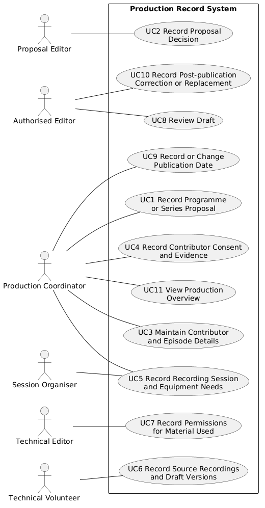

*Figure 1: Production Record System use-case diagram (source: `CA 1/Diagrams/use-case-model.puml.txt` in the group repository; committed image `CA 1/Diagrams/use-case-model.png`)*

#### 6.4 Modelling decisions

- **Simple associations only.** No include or extend relationships are used, because each use case is a complete actor goal.
- **Who records proposals and consent** (UC1, UC4) is an assumption. The scenario does not say, so both go to the production coordinator (A5, A6).
- **Held proposals.** A held proposal has a recorded decision, so it is not awaiting one, but it may need future attention. The overview lists proposals with no decision and held proposals separately. Showing held proposals is an inference (A13).
- **Reconsideration and contributor concerns** are not use cases. Reconsideration waits on Q2. Contributor concerns are deferred because a use case would require inventing handling policy (Q11). This is a scoping decision, not an oversight.

Draft states are kept apart, because confusing them is the scenario's central problem. `Draft.status` stores only the review state; **Blocked and Ready to be scheduled are derived**, never stored (RD-04).


| **Term**              | **Meaning**                                                                                                                   | **Stored or derived** |
| --------------------- | ----------------------------------------------------------------------------------------------------------------------------- | --------------------- |
| Awaiting review       | No review outcome is recorded, so the draft is not approved and cannot be published (BR3)                                     | Stored (status)       |
| Returned for changes  | The authorised editor returned the draft. Until it is reviewed again, this is an outstanding editorial decision (BR5, DEC-05) | Stored (status)       |
| Postponed             | A recorded review outcome. Not approved, so it cannot be published, but not blocked                                           | Stored (status)       |
| Withdrawn             | A recorded review outcome. Not approved and not published                                                                     | Stored (status)       |
| Approved              | An authorised editor has recorded approval for a channel (A9, RD-07)                                                          | Stored (status)       |
| Blocked               | An outstanding permission, consent or editorial decision prevents release (BR5)                                               | Derived               |
| Ready to be scheduled | Approved and nothing is outstanding                                                                                           | Derived               |

The model does not assume the system prevents an editor recording approval while something is outstanding, because the scenario does not say so. It states only that such a draft is not released.

#### 6.5 Detailed use case: UC2 Record a proposal decision

Chosen because it addresses the scenario's clearest problem: a friendly conversation being mistaken for approval.


| **Field**                    | **Specification**                                                                                                                                                                                                                                                                                                                                                                                                                                                                                                                                                                     |
| ---------------------------- | ------------------------------------------------------------------------------------------------------------------------------------------------------------------------------------------------------------------------------------------------------------------------------------------------------------------------------------------------------------------------------------------------------------------------------------------------------------------------------------------------------------------------------------------------------------------------------------- |
| Primary actor                | Proposal editor (provisional)                                                                                                                                                                                                                                                                                                                                                                                                                                                                                                                                                         |
| Goal                         | Record the editor's actual decision on a proposal, with any conditions, so that discussion is not mistaken for approval                                                                                                                                                                                                                                                                                                                                                                                                                                                               |
| Preconditions                | The proposal has been recorded (UC1). The editor has reviewed it for fit with purpose, resources and schedule, outside the system. The proposal has no decision, or its last decision was returned for revision or held                                                                                                                                                                                                                                                                                                                                                               |
| Trigger                      | The editor has reached a decision, or a returned or held proposal is ready to be decided again                                                                                                                                                                                                                                                                                                                                                                                                                                                                                        |
| Main success flow (accepted) | 1\. The editor identifies the proposal. 2. The system shows its details, earlier decisions and earlier conditions. 3. The editor states that the proposal is accepted. 4. The editor records any conditions, such as shortening the programme, confirming a contributor, changing the location or completing additional review. 5. The system records the decision with the date, the person who made it and the conditions. 6. The system shows the proposal as accepted with its conditions                                                                                         |
| Alternative flows            | 3a Rejected: the editor may note a reason; continue at step 5. 3b Returned for revision: the editor records what needs revising; continue at step 5; the proposal stays open for a later decision. 3c Held for future consideration: the editor may note when to look again; continue at step 5                                                                                                                                                                                                                                                                                       |
| Exception flows              | E1 Proposal is incomplete: the scenario does not say what is required before a decision (Q1), so the system does not block the decision; unknown details stay marked as not yet known; the editor may decide or return it (3b). E2 The last decision was returned or held: the editor records a new decision and the earlier one is kept. Reopening an accepted or rejected proposal is not covered, because it depends on what counts as a significant change (Q2). E3 The editor abandons the recording: no decision is recorded and the proposal still shows as having no decision |
| Postconditions               | Success: decision, date, person and conditions are kept; earlier decisions stay on record; a proposal with a recorded decision no longer shows as having none; a held proposal remains visible as held. Abandoned (E3): nothing changes                                                                                                                                                                                                                                                                                                                                               |
| Related items                | FR3, FR12, S1, G1, BR1, BR2                                                                                                                                                                                                                                                                                                                                                                                                                                                                                                                                                           |
| Open points                  | Who may record a decision for each programme type or channel is unresolved (Q5), so no rule is assumed. Whether a reason is required for rejection, or a period for a hold, is not stated, so both are optional                                                                                                                                                                                                                                                                                                                                                                       |

### 7. Gherkin

The CA1 scenarios GS1 to GS5 are kept with their identifiers. Each section adds scenarios for its use cases in its own feature file, tagged `@FRx @UCx @BRx` and a case type (`@success`, `@alternative`, `@failure`, `@boundary`), plus its scenario number (for example `@GS10`).


| Feature file                                   | Section                       | Use cases           | Scenario numbers |
| ---------------------------------------------- | ----------------------------- | ------------------- | ---------------- |
| `CA 1/Features/production_record.feature`      | CA1 baseline                  | UC2, UC8, UC9, UC11 | GS1–GS5         |
| `Feature_Files/Section_A_Proposal.feature`     | A – Proposal management      | UC1, UC2            | GS10–GS19       |
| `Feature_Files/Section_B_Contributors.feature` | B – Contributors and consent | UC3, UC4            | GS20–GS29       |
| `Feature_Files/Section_D_Review.feature`       | D – Review and publication   | UC8, UC9, UC10      | GS30–GS39       |
| `Feature_Files/Section_C_Recording.feature`    | C – Recording and drafts     | UC5, UC6, UC7       | GS40–GS49       |

Scenario number blocks were agreed by the group so the feature files can be merged without clashes. A section that needs more than ten scenarios asks the group for a further block.

Gaps carried from CA1: FR1, FR2, FR4, FR5, FR6 and FR7 had no scenario. FR1 and FR2 belong to Section A, FR4 and FR5 to Section B, and FR6 and FR7 to Section C. FR5 (consent) is first (RD-09). FR11 is now covered by GS35 and GS36 in Section D.

Scenarios must use the terms in Section 8, especially Blocked, awaiting review and ready to be scheduled.

### 8. Glossary


| **Term**                       | **Definition**                                                                                                                                                           |
| ------------------------------ | ------------------------------------------------------------------------------------------------------------------------------------------------------------------------ |
| Proposal                       | An idea for a programme with its subject, audience, format, duration, proposed contributors and preferred publication period. May begin as a short conversation or email |
| Episode                        | One planned or produced item within a proposal. A series is a proposal with several episodes                                                                             |
| Proposal decision              | An editor's recorded outcome on a proposal: accepted, rejected, returned for revision or held. Discussion without a recorded decision is not a decision                  |
| Partner organisation           | An external organisation that may propose programmes and wants progress information                                                                                      |
| Contributor                    | A person who takes part in an episode, such as a presenter, interviewee, performer or technical volunteer                                                                |
| Contribution                   | A contributor's role in one episode, with any agreed credit                                                                                                              |
| Consent                        | A contributor's agreement to the intended use of their contribution, given on paper, by email or at the start of a recording                                             |
| Permission                     | Authorisation to use third-party material such as music, an archive clip or externally supplied material. Different from consent                                         |
| Recording session              | An occasion on which contributors are recorded, in the studio, at an event or elsewhere. May be repeated or supplemented                                                 |
| Source recording               | A raw audio file from a recording session. One session can produce several                                                                                               |
| Draft                          | An edited version of an episode prepared for review. Several can exist for one episode, each with a sequential version number (RD-12)                                    |
| Draft review                   | An authorised editor's review of a draft for a publication channel, resulting in approved, returned for changes, postponed or withdrawn (RD-07)                          |
| Publication                    | The scheduled or actual release of an episode on a channel                                                                                                               |
| Publication channel            | A public channel through which an episode is released                                                                                                                    |
| Correction                     | A change after publication, either a metadata correction or a new audio version. The scenario does not define how they differ                                            |
| Blocked                        | Derived, not stored. A draft that may be technically complete but cannot be published because a permission, consent or editorial decision is outstanding (BR5, RD-04)    |
| Contributor confirmation       | Treated as the contributor's consent (Q14, DEC-05)                                                                                                                       |
| Outstanding editorial decision | A draft returned for changes and not yet reviewed again (Q15, DEC-05)                                                                                                    |
| Significant change             | A change to an approved proposal that may require reconsideration. Staff do not agree what counts                                                                        |

### 9. Domain model

The conceptual model uses the 15 classes from the CA1 analysis, with the CA2 changes in RD-04, RD-07 and RD-12. It has no methods, controllers, repositories, interface controls, keys or navigability. The arrow after each association name shows reading direction only.

<a id="fig-2"></a>

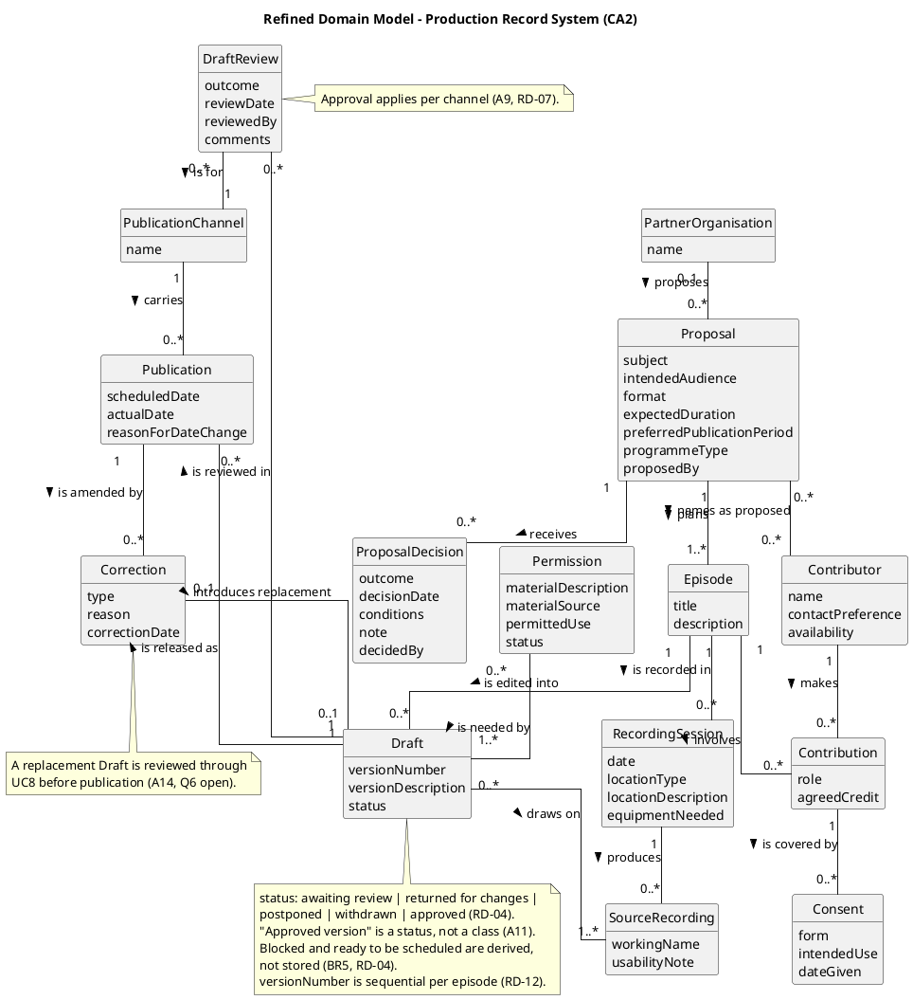

*Figure 2: Refined domain model (source: `Diagrams/Domain_Model/domain_Model.puml`)*

#### 9.1 Classes and attributes


| **Class**           | **Attributes**                                                                                                    | **From**          |
| ------------------- | ----------------------------------------------------------------------------------------------------------------- | ----------------- |
| Proposal            | subject, intendedAudience, format, expectedDuration, preferredPublicationPeriod, programmeType, proposedBy        | FR1               |
| ProposalDecision    | outcome, decisionDate, conditions, note, decidedBy                                                                | FR3               |
| PartnerOrganisation | name                                                                                                              | Proposals section |
| Episode             | title, description                                                                                                | FR2               |
| Contributor         | name, contactPreference, availability                                                                             | FR4               |
| Contribution        | role, agreedCredit                                                                                                | FR4               |
| Consent             | form, intendedUse, dateGiven                                                                                      | FR5               |
| RecordingSession    | date, locationType, locationDescription, equipmentNeeded                                                          | FR6               |
| SourceRecording     | workingName, usabilityNote                                                                                        | FR7               |
| Draft               | versionNumber, versionDescription, status (awaiting review, returned for changes, postponed, withdrawn, approved) | FR7, RD-04, RD-12 |
| Permission          | materialDescription, materialSource, permittedUse, status                                                         | FR8               |
| DraftReview         | outcome, reviewDate, reviewedBy, comments                                                                         | FR9               |
| Publication         | scheduledDate, actualDate, reasonForDateChange                                                                    | FR10              |
| PublicationChannel  | name                                                                                                              | FR10              |
| Correction          | type, reason, correctionDate                                                                                      | FR11              |

#### 9.2 Associations and multiplicity


| **Association**                           | **Multiplicity** | **Why**                                                                                                                                              |
| ----------------------------------------- | ---------------- | ---------------------------------------------------------------------------------------------------------------------------------------------------- |
| Partner proposes Proposal                 | 0..1 to 0..\*    | A proposal may come from staff or volunteers, so not always from a partner. Those proposers are recorded in the proposedBy attribute, not as classes |
| Proposal plans Episode                    | 1 to 1..\*       | A proposal has at least one episode; a series has several                                                                                            |
| Proposal receives ProposalDecision        | 1 to 0..\*       | A proposal can be returned and later accepted                                                                                                        |
| Proposal names as proposed Contributor    | 0..\* to 0..\*   | FR1 includes proposed contributors                                                                                                                   |
| Contributor makes Contribution            | 1 to 0..\*       | The same person contributes to several episodes in different roles                                                                                   |
| Episode involves Contribution             | 1 to 0..\*       | Each contribution is to one episode                                                                                                                  |
| Contribution is covered by Consent        | 1 to 0..\*       | A new consent may be needed (Q3)                                                                                                                     |
| Episode is recorded in RecordingSession   | 1 to 0..\*       | A session may be repeated or supplemented (A12)                                                                                                      |
| RecordingSession produces SourceRecording | 1 to 0..\*       | One session can create many files                                                                                                                    |
| Episode is edited into Draft              | 1 to 0..\*       | Several drafts can exist                                                                                                                             |
| Draft draws on SourceRecording            | 0..\* to 1..\*   | A draft is built from at least one source                                                                                                            |
| Permission is needed by Draft             | 0..\* to 1..\*   | A draft may need no permissions; a permission relates to at least one draft                                                                          |
| Draft is reviewed in DraftReview          | 1 to 0..\*       | A returned draft is reviewed again                                                                                                                   |
| DraftReview is for PublicationChannel     | 0..\* to 1       | Approval applies per channel (A9, BR3). Added in CA2 (RD-07)                                                                                         |
| Draft is released as Publication          | 1 to 0..\*       | An approved draft can go to more than one channel                                                                                                    |
| PublicationChannel carries Publication    | 1 to 0..\*       | A channel carries many publications                                                                                                                  |
| Publication is amended by Correction      | 1 to 0..\*       | A publication can be corrected more than once                                                                                                        |
| Correction introduces replacement Draft   | 0..1 to 0..1     | Only a new audio version brings a replacement; a metadata correction does not                                                                        |

Several multiplicities come from reasoning, not scenario evidence, for example zero or more consents per contribution and zero or more publications per draft. They are assumptions, to be confirmed with Q3 and Q4.

#### 9.3 Modelling decisions

- **No Series class (A10).** A series is a proposal with several episodes. A separate class would duplicate it.
- **Contribution links Contributor, Episode and Consent,** so one person can have a different role and consent per episode.
- **Consent and Permission are separate.** Consent comes from a contributor; permission is for third-party material.
- **DraftReview is for a PublicationChannel (RD-07).** Approval applies per channel (A9), so each review records the channel it is for.
- **Draft has a sequential versionNumber (RD-12).** It identifies each draft without deciding how versions relate (Q4).
- **Draft carries approved status (A11).** How versions relate is unresolved (Q4), so a richer version structure is not justified.
- **Publication links to Draft, not directly to Episode.** The episode is reached through the draft.
- **Blocked is not a class.** It is derived from outstanding permission, consent or decision (BR5).
- **Staff are attributes, not classes.** decidedBy and reviewedBy record who acted; staff are actors, not domain concepts.
- **Proposers.** Proposals can come from staff, volunteers or partners. Only partners are a class, because they are external organisations with their own interest in progress and dates. Staff and volunteers are roles inside the collective, so a proposal from one of them has no partner link and records the person in proposedBy. If a proposer ever needs its own history, a Proposer class could generalise the three.

### 10. Traceability

The Gherkin column shows the CA1 scenarios. Section feature files add further scenarios (Section 7); update this column when they are merged.


| **Req** | **Pri.** | **Scope** | **Goal** | **Use case** | **Gherkin** | **Domain concepts**                                                                         | **Rules**     |
| ------- | -------- | --------- | -------- | ------------ | ----------- | ------------------------------------------------------------------------------------------- | ------------- |
| FR1     | Must     | S1        | G13      | UC1          | none        | Proposal, Episode, PartnerOrganisation, Contributor                                         | none          |
| FR2     | Must     | S1        | G13      | UC1          | none        | Proposal, Episode                                                                           | A10           |
| FR3     | Must     | S1        | G1       | UC2          | GS1, GS2    | Proposal, ProposalDecision                                                                  | BR1, BR2      |
| FR4     | Must     | S2        | G14      | UC3          | none        | Contributor, Contribution, Episode                                                          | none          |
| FR5     | Must     | S3        | G10      | UC4          | none        | Consent, Contribution                                                                       | C5            |
| FR6     | Should   | S4        | G4, G5   | UC5          | none        | RecordingSession, Episode                                                                   | none          |
| FR7     | Must     | S5        | G6       | UC6          | none        | SourceRecording, Draft, RecordingSession, Episode                                           | A11           |
| FR8     | Must     | S7        | G7       | UC7, UC8     | GS4         | Permission, Draft                                                                           | BR5           |
| FR9     | Must     | S6        | G8       | UC8          | GS3, GS4    | DraftReview, Draft                                                                          | BR3, BR4      |
| FR10    | Should   | S8        | G12      | UC9          | GS5         | Publication, PublicationChannel, Draft                                                      | none          |
| FR11    | Should   | S9        | G9       | UC10         | none        | Correction, Publication, Draft                                                              | BR8           |
| FR12    | Must     | S10       | G3       | UC11         | GS2, GS4    | Proposal, ProposalDecision, Consent, Permission, DraftReview, RecordingSession, Publication | BR1, BR5, A13 |


| **NFR** | **Quality**    | **Linked to**     | **Rules** |
| ------- | -------------- | ----------------- | --------- |
| NFR1    | Access         | P9, S11           | BR6, BR7  |
| NFR2    | Performance    | FR12, UC11        | none      |
| NFR3    | Usability      | FR7, UC6          | none      |
| NFR4    | Retrievability | P1, all use cases | none      |

<a id="implementation-catalogue"></a>

## Prioritised Implementation Catalogue (CA2)

*Source file: `Group_Documents/Implementation_Catalogue/implementation-catalogue.md`*

**Scenario:** 29 Local Podcast Production Service (Kerry Community Media Collective)
**Board item:** #9 Create prioritised implementation catalogue
**Status:** Agreed. UC2 selected by the group as the main use case for detailed design (DEC-09).

### 1. Purpose

This catalogue records which use cases the group designs, in what order and to what depth, and why. The lecturer limited detailed design to one or two use cases (reconciliation record L6). The group agreed to take **UC2 Record a proposal decision** through full detailed design, with UC8 second if time allows (DEC-09).

### 2. Design depth


| Level                       | What it includes                                                                                                                        |
| --------------------------- | --------------------------------------------------------------------------------------------------------------------------------------- |
| **Full detailed design**    | Detailed use case, Gherkin, SSD, operation contracts, CRC cards, GRASP justification, object-interaction diagrams, design class diagram |
| **Second (if time allows)** | As above, started only once the first is complete                                                                                       |
| **Analysis and behaviour**  | Requirements review, Gherkin and, where produced, SSDs and contracts. Kept as analysis evidence; no interaction diagrams                |

### 3. Catalogue

Priority follows the requirements' MoSCoW priority in the baseline. Order reflects value, dependency and risk.


| Order | Use case                                     | Section | Priority | Business value                                                                                         | Depends on                                   | Design depth                                |
| ----- | -------------------------------------------- | ------- | -------- | ------------------------------------------------------------------------------------------------------ | -------------------------------------------- | ------------------------------------------- |
| 1     | **UC2 Record a proposal decision**           | A       | Must     | Stops an encouraging discussion being mistaken for approval: the scenario's clearest problem (P2, BR1) | UC1 (a proposal exists)                      | **Full detailed design** (agreed, DEC-09)   |
| 2     | **UC8 Review a draft**                       | D       | Must     | Shows whether a finished draft is approved, awaiting review or blocked, and why (P6, BR5, DEC-05)      | UC4, UC6, UC7 (consent, drafts, permissions) | **Second, if time allows** (agreed, DEC-09) |
| 3     | UC1 Record a programme or series proposal    | A       | Must     | Gives every proposal a single starting record, however incomplete (P1)                                 | –                                           | Analysis and behaviour                      |
| 4     | UC11 View the production overview            | Shared  | Must     | One place to see what needs action and what blocks publication (P1, P6)                                | Reads all other use cases                    | Analysis and behaviour                      |
| 5     | UC4 Record contributor consent               | B       | Must     | Consent in three forms recorded in one place (P4)                                                      | UC3                                          | Analysis and behaviour                      |
| 6     | UC7 Record permissions for material          | C       | Must     | Outstanding permissions visible before review (P6)                                                     | UC6                                          | Analysis and behaviour                      |
| 7     | UC6 Record source recordings and drafts      | C       | Must     | The correct source and draft can be identified (P3)                                                    | UC5                                          | Analysis and behaviour                      |
| 8     | UC3 Maintain contributor and episode details | B       | Must     | Roles and agreed credit kept per episode                                                               | UC1                                          | Analysis and behaviour                      |
| 9     | UC5 Record a recording session               | C       | Should   | Missing equipment noticed before a session (P8)                                                        | UC1                                          | Analysis and behaviour                      |
| 10    | UC9 Record or change a publication date      | D       | Should   | A realistic date, with reasons for changes (P5)                                                        | UC8                                          | Analysis and behaviour                      |
| 11    | UC10 Record a correction or replacement      | D       | Should   | Metadata corrections told apart from new audio (P7)                                                    | UC9                                          | Analysis and behaviour                      |

### 4. Why the group chose UC2

- **Clearest problem:** partners treating discussion as approval is the scenario's most direct complaint (BR1).
- **Behavioural richness:** four outcomes (BR2) and controlled failures give the interaction diagrams genuine alternatives.
- **Readiness:** detailed use case, SSD, contract CO4, CRC cards, GRASP and seven Gherkin scenarios already exist, so the remaining time goes into depth.
- **Manageable scope:** four to five classes (Proposal, ProposalDecision, DecisionOutcome, ProposalController, ProposalRepository) can be designed in full.
- **Low dependency:** needs only UC1, so it can be designed without waiting for other sections.
- **Group agreement:** proposed independently by two members and agreed by the whole group (DEC-09).

### 5. Why UC8 second

UC8 tackles the blocked-draft problem (BR5, DEC-05) and connects Consent (B), Permission (C) and DraftReview (D), so it would show how the sections integrate. It depends on three other use cases and more open questions (Q5, Q6), so it is designed only once UC2 is complete.

### 6. Work allocation for UC2

Every member contributes to the selected use case.


| Work                                                                                                  | Board item                             | Owner          |
| ----------------------------------------------------------------------------------------------------- | -------------------------------------- | -------------- |
| Interaction diagram – main flow (accepted with conditions)                                           | UC2 interaction diagram, main flow     | Rani           |
| Interaction diagrams – alternative outcomes and failures (rejected, returned, held; already decided) | UC2 interaction diagrams, alternatives | Arno           |
| Design class diagram for UC2                                                                          | #44                                    | Jack           |
| Consistency check: DCD, interaction diagrams and contracts                                            | #45                                    | Tsubasa        |
| Integrate CRC cards and agree the controller pattern                                                  | #43                                    | Arno           |
| UC8 detailed design, if time allows                                                                   | new card                               | Tsubasa (lead) |

### 7. Risks and dependencies


| Item                         | Effect                                             | Response                                            |
| ---------------------------- | -------------------------------------------------- | --------------------------------------------------- |
| Q2 (significant change) open | UC2 cannot reopen an accepted or rejected proposal | Designed as a controlled failure (CO4)              |
| Q5 (approval authority) open | The design cannot check who may decide             | The editor is recorded, not checked                 |
| DEC-07, DEC-08               | FR1 proposer and`ProposalDecision.note`            | Both are reflected in the UC2 design once agreed    |
| Time                         | UC8 may not be reached                             | UC2 alone satisfies the lecturer's instruction (L6) |

<a id="definition-of-done"></a>

## Definition of Done

*Source file: `Group_Documents/Definition_of_Done/definition-of-done.md`*

A backlog item is Done only when every point applies. A draft existing is not enough.

### All items

- [ ]  Editable source committed (.md, .puml, .feature) and any export (.png, .pdf) is readable
- [ ]  Commit message references the issue number
- [ ]  Terminology and identifiers (FR, BR, UC, RD, class names) match the glossary and baseline
- [ ]  Reviewed by a member other than the owner; comments resolved or recorded on the issue
- [ ]  Related models, requirements, decisions and Gherkin are still consistent
- [ ]  Any decision made is recorded in the decision log
- [ ]  Board card moved to Done, with links to the files
- [ ]  AI use recorded in the AI interaction log, if AI was used

### Diagrams (extra)

- [ ]  PlantUML source renders without errors
- [ ]  Every class, message and operation matches the design class diagram and contracts

### Gherkin (extra)

- [ ]  Each scenario is tagged with its FR, UC and type (success, alternative, failure, boundary)

<a id="part-2"></a>

# Part 2 – Section design

Each section is the work of one member and is reproduced in full. Section ownership is set in the analysis baseline (1.2). Design depth for each use case is set in the implementation catalogue (2 and 3).

<a id="section-a"></a>

## Section A: Proposal management

*Source file: `Individual_Contributions/Implementation_Catalogue/Section_A_Proposal_Rani/CA2_Section_A`*

Member 1: Rani Wheeza
CA1 source: Rani Wheeza's analysis dossier
Board item: #11 Review proposal-related requirements and use cases

This section reviews the CA1 analysis for proposals and proposal decisions against the Scenario 29 text and the revised analysis baseline. Evidence is cited as **Sc** (Scenario 29 document, with the section heading) or by CA1/baseline identifier. Planned scenarios belong to #15 and will be in `Section_A_Proposal.feature` (GS10–GS19).

### Problem statement

Proposals arrive in very different states: some are complete, others begin as a short conversation or email (Sc: Programme proposals and approval). A series may hold several planned episodes under one proposal. Partners sometimes treat an encouraging discussion as approval when no decision has been recorded, and approval may come with conditions (Sc: Programme proposals and approval). The production coordinator needs to see proposals awaiting decisions (Sc: Information and access).

The outcomes this section serves are a single starting record for every proposal and a clear, recorded decision so that discussion is not mistaken for approval (CA1 P1, P2; goals G1, G13).

### Scope of this section

#### In this section


| ID  | Name                                                                                       | Primary actor          | Priority |
| --- | ------------------------------------------------------------------------------------------ | ---------------------- | -------- |
| UC1 | Record a programme or series proposal. Details not yet known are recorded as not yet known | Production coordinator | Must     |
| UC2 | Record a proposal decision                                                                 | Proposal editor        | Must     |

S1 is the scope item for both use cases.

#### Outside this section


| Item                                                             | Owner                | Why it is outside                                                                                           |
| ---------------------------------------------------------------- | -------------------- | ----------------------------------------------------------------------------------------------------------- |
| Contributor details, roles and consent                           | Section B            | UC1 records only the*proposed* contributors named in a proposal. Roles, credit and consent are UC3 and UC4. |
| Production overview (proposals with no decision, held proposals) | Shared (UC11)        | GS2 already tests the distinction. Section A records the decisions the overview reads.                      |
| Reconsidering an approved proposal after a significant change    | Deferred (G2, RD-18) | "Significant" is undefined (Q2).                                                                            |
| Who may approve each programme type                              | Open (Q5)            | The proposal editor is a role; no approval authority is assumed.                                            |

### Requirements review

#### Review method

Each requirement, rule and assumption was checked against the scenario text for consistency, clarity, verifiability and traceability, without introducing rules the scenario does not state.

#### Functional requirements


| ID  | CA1 statement (summary)                                                                                                                                                                              | Decision                                                                                        | Reason                                                                                                                                                                                                                                                                                                                             | Evidence                                                   |
| --- | ---------------------------------------------------------------------------------------------------------------------------------------------------------------------------------------------------- | ----------------------------------------------------------------------------------------------- | ---------------------------------------------------------------------------------------------------------------------------------------------------------------------------------------------------------------------------------------------------------------------------------------------------------------------------------- | ---------------------------------------------------------- |
| FR1 | Staff can record a programme proposal with subject, intended audience, format, expected duration, proposed contributors and preferred publication period; unknown details recorded as not yet known. | **Update.** Add who proposed it (staff member, volunteer or partner organisation). Add Gherkin. | The scenario says programmes may be proposed by staff, volunteers or partners, and partners want progress on their proposals. The domain model already holds this (`proposedBy`, *PartnerOrganisation proposes Proposal*), but FR1 does not ask for it, so the attribute has no requirement behind it. No CA1 scenario covers FR1. | Sc: Context; Sc: Information and access; baseline 9.1, 9.2 |
| FR2 | Staff can record a series proposal with its planned episodes.                                                                                                                                        | **Keep.** Add Gherkin.                                                                          | Stated in the scenario. No CA1 scenario covers it.                                                                                                                                                                                                                                                                                 | Sc: Programme proposals and approval; A10                  |
| FR3 | An editor can record a decision as accepted, rejected, returned for revision or held, with date, person and any conditions.                                                                          | **Keep.** Add Gherkin for rejected, returned and held.                                          | GS1 covers accepted with a condition only. US2 accepts all four outcomes.                                                                                                                                                                                                                                                          | Sc: Programme proposals and approval; US2; GS1             |

#### Business rules


| ID  | CA1 statement (summary)                                                   | Decision  | Reason                                                                 | Evidence                                  |
| --- | ------------------------------------------------------------------------- | --------- | ---------------------------------------------------------------------- | ----------------------------------------- |
| BR1 | A proposal is not approved until a decision has been recorded.            | **Keep.** | The scenario's central proposal problem. GS2 tests it at the overview. | Sc: Programme proposals and approval; GS2 |
| BR2 | A proposal decision is accepted, rejected, returned for revision or held. | **Keep.** | Stated in the scenario. Planned scenarios record one outcome each.     | Sc: Programme proposals and approval      |

Approval conditions (shortening, confirming a contributor, changing location, further review) are recorded with the decision. The scenario does not say whether conditions are tracked to completion, so no rule is added.

#### Assumptions


| ID  | CA1 statement (summary)                                                       | Decision                | Reason                                                     |
| --- | ----------------------------------------------------------------------------- | ----------------------- | ---------------------------------------------------------- |
| A5  | Staff enter information on behalf of partners and contributors.               | **Keep as assumption.** | Direct partner access is unresolved (Q9).                  |
| A6  | The production coordinator records proposals.                                 | **Keep as assumption.** | The scenario does not say who records proposals (Q10).     |
| A10 | A series is a proposal with several planned episodes.                         | **Keep as assumption.** | Matches the scenario wording; no Series class (D5, RD-15). |
| A13 | The overview lists held proposals separately from proposals with no decision. | **Keep as assumption.** | An inference; GS2 relies on it.                            |

#### Open questions


| ID  | Question                                                               | Decision               | Effect on Section A                                                                        |
| --- | ---------------------------------------------------------------------- | ---------------------- | ------------------------------------------------------------------------------------------ |
| Q1  | What information is required before a proposal can receive a decision? | Carry forward.         | UC2 does not block an incomplete proposal (UC2 exception E1). No scenario tests a minimum. |
| Q2  | What counts as a significant change after approval?                    | Carry forward (RD-18). | No scenario reopens an accepted or rejected proposal.                                      |
| Q5  | Who may approve each programme type and channel?                       | Carry forward.         | Scenarios say "proposal editor" only.                                                      |
| Q9  | Do partners use the system directly?                                   | Carry forward.         | Scenarios have staff record partner proposals (A5).                                        |
| Q10 | Who records proposals?                                                 | Carry forward.         | Scenarios use the production coordinator (A6).                                             |
| Q13 | Can the proposal editor and authorised editor be the same person?      | Carry forward.         | No effect on Section A scenarios.                                                          |

### Use cases


| ID  | Decision                                | Reason                                                                                                                          |
| --- | --------------------------------------- | ------------------------------------------------------------------------------------------------------------------------------- |
| UC1 | **Keep. Add detailed specification.**   | CA1 has only a one-line description. SSDs (#21) need main and alternative flows.                                                |
| UC2 | **Keep. Convert to two-column format.** | CA1 specification is complete (dossier 6.5). Converted to the group's actor/system format (RD-11) so it maps onto SSD messages. |

#### UC1 Record a programme or series proposal


| Field         | Content                                                                       |
| ------------- | ----------------------------------------------------------------------------- |
| Primary actor | Production coordinator (A6)                                                   |
| Goal          | Record a proposal, however complete, so it is not lost or treated as decided  |
| Preconditions | None. The proposal may come from staff, a volunteer or a partner organisation |
| Trigger       | A proposal arrives as a form, email or conversation                           |
| Related       | FR1, FR2, S1, G13, A5, A6, A10                                                |

**Main success flow**


| Actor                                                                                                                                   | System                                                                             |
| --------------------------------------------------------------------------------------------------------------------------------------- | ---------------------------------------------------------------------------------- |
| 1. Starts a new proposal and enters who proposed it                                                                                     |                                                                                    |
|                                                                                                                                         | 2. Shows the proposal fields                                                       |
| 3. Enters the known details: subject, intended audience, format, expected duration, proposed contributors, preferred publication period |                                                                                    |
| 4. Enters the planned episode                                                                                                           |                                                                                    |
|                                                                                                                                         | 5. Records the proposal and episode; marks any detail not entered as not yet known |
|                                                                                                                                         | 6. Shows the proposal as having no recorded decision                               |

**Alternative flows**


| Flow                       | Actor                                | System                                           |
| -------------------------- | ------------------------------------ | ------------------------------------------------ |
| 1a Partner proposal        | Selects the partner organisation     | Links the proposal to that partner               |
| 3a Only a subject is known | Enters the subject only              | Step 5: all other details shown as not yet known |
| 4a Series                  | Enters several planned episodes      | Links every episode to the one proposal          |
| 6a Later details           | Adds a detail that was not yet known | Replaces "not yet known" with the value          |

**Postconditions:** The proposal exists with at least one episode and no recorded decision. It is visible to the production overview as awaiting a decision (BR1).

#### UC2 Record a proposal decision


| Field         | Content                                                                                                    |
| ------------- | ---------------------------------------------------------------------------------------------------------- |
| Primary actor | Proposal editor (provisional)                                                                              |
| Goal          | Record the editor's actual decision, with any conditions, so that discussion is not mistaken for approval  |
| Preconditions | The proposal is recorded (UC1). It has no decision, or its last decision was returned for revision or held |
| Trigger       | The editor has reached a decision, outside the system                                                      |
| Related       | FR3, FR12, S1, G1, BR1, BR2                                                                                |

**Main success flow (accepted)**


| Actor                             | System                                                               |
| --------------------------------- | -------------------------------------------------------------------- |
| 1. Selects the proposal           |                                                                      |
|                                   | 2. Shows its details, earlier decisions and earlier conditions       |
| 3. Records the outcome "accepted" |                                                                      |
| 4. Records any conditions         |                                                                      |
|                                   | 5. Records the decision with the date, the editor and the conditions |
|                                   | 6. Shows the proposal as accepted with its conditions                |

**Alternative and exception flows**


| Flow                                     | Actor                                                                  | System                                                               |
| ---------------------------------------- | ---------------------------------------------------------------------- | -------------------------------------------------------------------- |
| 3a Rejected                              | Records "rejected", optionally with a reason                           | Continue at 5                                                        |
| 3b Returned for revision                 | Records "returned for revision" and what needs revising                | Continue at 5; the proposal stays open for a later decision          |
| 3c Held                                  | Records "held for future consideration", optionally when to look again | Continue at 5; shown as held, not as awaiting a decision (A13)       |
| E1 Incomplete proposal                   | Decides anyway                                                         | Does not block the decision (Q1); unknown details stay not yet known |
| E2 Earlier decision was returned or held | Records a new decision                                                 | Keeps the earlier decision on record                                 |
| E3 Abandons                              | Leaves without saving                                                  | No decision recorded; the proposal still shows no decision           |

**Postconditions:** The decision, date, editor and conditions are kept and earlier decisions remain. A proposal with a recorded decision no longer shows as having none.

### Planned Gherkin coverage (for #15)

GS1 and GS2 keep their CA1 numbers. New scenarios use GS10–GS19.


| Scenario                                         | Type        | Covers                                              | Requirement | Use case | Rule     |
| ------------------------------------------------ | ----------- | --------------------------------------------------- | ----------- | -------- | -------- |
| GS1 Proposal accepted with a condition           | Success     | Kept from CA1                                       | FR3         | UC2      | BR1, BR2 |
| GS2 No decision vs held vs approved              | Boundary    | Kept from CA1                                       | FR3, FR12   | UC11     | BR1      |
| GS10 Partner proposal recorded with full details | Success     | Proposer and all FR1 details kept                   | FR1         | UC1      | –       |
| GS11 Proposal with only a subject                | Boundary    | Missing details shown as not yet known; no decision | FR1         | UC1      | BR1      |
| GS12 Series with three planned episodes          | Success     | All episodes linked to one proposal                 | FR2         | UC1      | A10      |
| GS13 Proposal rejected                           | Alternative | Outcome, person, date kept                          | FR3         | UC2      | BR2      |
| GS14 Returned for revision, then accepted        | Alternative | Both decisions kept; latest shown                   | FR3         | UC2      | BR2      |
| GS15 Proposal held for future consideration      | Alternative | Shown as held, not approved                         | FR3         | UC2      | BR2, A13 |
| GS16 Editor abandons recording a decision        | Failure     | Proposal still shows no decision                    | FR3         | UC2      | BR1      |

### Review decisions and limits

- **Requirement wording:** FR1 changes to include the proposer (needs group agreement and a decision-log entry). FR2 and FR3 are unchanged; the scenarios add coverage.
- **Identifiers:** GS1 and GS2 keep their CA1 numbers.
- **Incomplete proposals:** No scenario rejects a decision on an incomplete proposal, because Q1 is open.
- **Reconsideration:** No scenario reopens an accepted or rejected proposal (Q2, RD-18).
- **Conditions:** Conditions are recorded with the decision. Whether they are tracked to completion is not stated, so no scenario tests it.
- **Illustrative data:** Partner names, titles and dates are test data.

### Dependencies


| Dependency       | Effect                                                                                                   |
| ---------------- | -------------------------------------------------------------------------------------------------------- |
| FR1 update       | The group must agree adding the proposer to FR1 before the baseline is changed (proposed DEC-07).        |
| Q1, Q2, Q5       | Scenarios must not treat these as rules until answered.                                                  |
| Section B        | Proposed contributors named in UC1 are the same Contributor class Section B maintains; names must match. |
| UC11 (shared)    | The overview depends on decisions recorded in UC2. GS2 stays with UC11.                                  |
| Scenario numbers | GS10–GS19 as agreed in baseline Section 7.                                                              |

### System sequence diagrams (#21)


| Use case | Diagram                                                              | System operations                                              |
| -------- | -------------------------------------------------------------------- | -------------------------------------------------------------- |
| UC1      | `CA 2/Diagrams/System_Sequence_Diagrams/SSD_UC1_RecordProposal.puml` | `recordProposal`, `addPlannedEpisode`, `updateProposalDetails` |
| UC2      | `CA 2/Diagrams/System_Sequence_Diagrams/SSD_UC2_RecordDecision.puml` | `selectProposal` (query), `recordDecision`                     |

`selectProposal` only returns information and changes nothing, so it has no contract.

<a id="fig-3"></a>

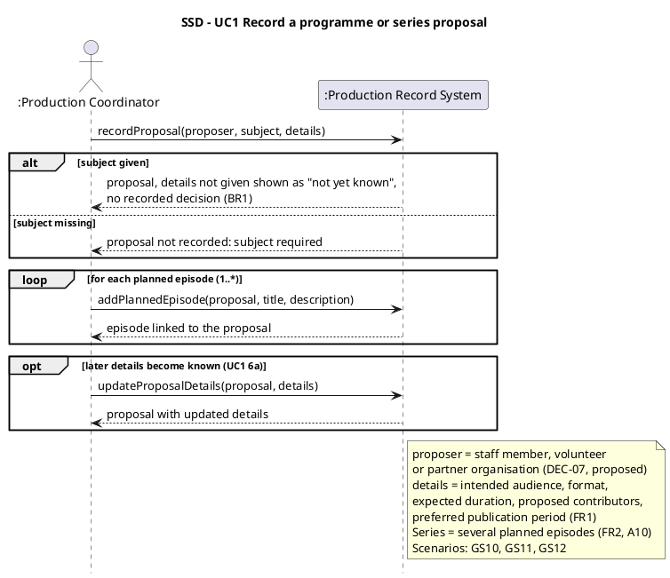

*Figure 3: SSD – UC1 Record a programme or series proposal (source: `Diagrams/System_Sequence_Diagrams/SSD_UC1_RecordProposal.puml`)*

<a id="fig-4"></a>

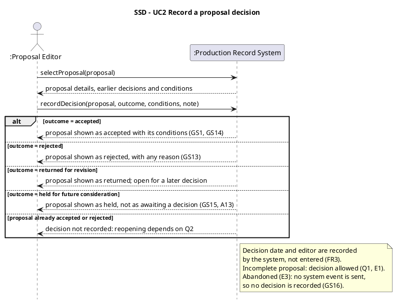

*Figure 4: SSD – UC2 Record a proposal decision (source: `Diagrams/System_Sequence_Diagrams/SSD_UC2_RecordDecision.puml`)*

### Operation contracts (#21)

#### CO1: recordProposal


| Item                | Content                                                                                                                                                                                                                                                                                                                                                                                                                                                                                                                                                           |
| ------------------- | ----------------------------------------------------------------------------------------------------------------------------------------------------------------------------------------------------------------------------------------------------------------------------------------------------------------------------------------------------------------------------------------------------------------------------------------------------------------------------------------------------------------------------------------------------------------- |
| Operation           | `recordProposal(proposer, subject, details)`                                                                                                                                                                                                                                                                                                                                                                                                                                                                                                                      |
| Cross-references    | UC1, FR1, FR2, BR1, A6, DEC-07 (proposed) · GS10, GS11                                                                                                                                                                                                                                                                                                                                                                                                                                                                                                           |
| Preconditions       | The user holds a production role that records proposals (A6).                                                                                                                                                                                                                                                                                                                                                                                                                                                                                                     |
| Postconditions      | A`Proposal` instance `p` was created. `p.subject` was set. Each detail given (intended audience, format, expected duration, preferred publication period) was set; each detail not given was marked not yet known. If the proposer is a partner organisation, `p` was associated with that `PartnerOrganisation` (created if not already recorded); otherwise `p.proposedBy` was set to the staff member or volunteer. `p` was associated with each proposed `Contributor`. No `ProposalDecision` was created, so `p` shows as having no recorded decision (BR1). |
| Controlled failures | Subject missing: nothing is created and the subject is requested.                                                                                                                                                                                                                                                                                                                                                                                                                                                                                                 |

#### CO2: addPlannedEpisode


| Item                | Content                                                                                                                                                 |
| ------------------- | ------------------------------------------------------------------------------------------------------------------------------------------------------- |
| Operation           | `addPlannedEpisode(proposal, title, description)`                                                                                                       |
| Cross-references    | UC1, FR1, FR2, A10 · GS12                                                                                                                              |
| Preconditions       | `proposal` exists.                                                                                                                                      |
| Postconditions      | An`Episode` instance `e` was created. `e.title` and, if given, `e.description` were set. `e` was associated with `proposal` (*Proposal plans Episode*). |
| Controlled failures | Proposal not found: nothing is created.                                                                                                                 |

#### CO3: updateProposalDetails


| Item                | Content                                                                                                                          |
| ------------------- | -------------------------------------------------------------------------------------------------------------------------------- |
| Operation           | `updateProposalDetails(proposal, details)`                                                                                       |
| Cross-references    | UC1 (6a), FR1 · GS11                                                                                                            |
| Preconditions       | `proposal` exists.                                                                                                               |
| Postconditions      | Each detail given replaced its previous value or "not yet known". Recorded decisions were not changed.                           |
| Controlled failures | Proposal not found: nothing changes.                                                                                             |
| Note                | Changing an accepted proposal does not trigger reconsideration, because what counts as a significant change is open (Q2, RD-18). |

#### CO4: recordDecision


| Item                | Content                                                                                                                                                                                                                                                                                                                                                                                                                                                                                     |
| ------------------- | ------------------------------------------------------------------------------------------------------------------------------------------------------------------------------------------------------------------------------------------------------------------------------------------------------------------------------------------------------------------------------------------------------------------------------------------------------------------------------------------- |
| Operation           | `recordDecision(proposal, outcome, conditions, note)`                                                                                                                                                                                                                                                                                                                                                                                                                                       |
| Cross-references    | UC2, FR3, BR1, BR2, A13 · GS1, GS2, GS13–GS16                                                                                                                                                                                                                                                                                                                                                                                                                                             |
| Preconditions       | `proposal` exists. It has no recorded decision, or its latest decision is returned for revision or held. The user acts as proposal editor (who may decide each programme type is open, Q5).                                                                                                                                                                                                                                                                                                 |
| Postconditions      | A`ProposalDecision` instance `d` was created. `d.outcome` was set to accepted, rejected, returned for revision or held (BR2). `d.decisionDate` was set to the current date and `d.decidedBy` to the editor. `d.conditions` and `d.note` were set if given. `d` was associated with `proposal` (*Proposal receives ProposalDecision*). Earlier decisions were not changed. The proposal's displayed state follows its latest decision; it is no longer shown as having no recorded decision. |
| Controlled failures | Latest decision is accepted or rejected: no decision is created (reopening depends on Q2). Outcome not one of the four in BR2: no decision is created.                                                                                                                                                                                                                                                                                                                                      |

#### Design notes from the SSDs and contracts

- **Proposal state is derived, not stored.** `Proposal` has no status attribute; "no recorded decision", "accepted", "held" and so on come from its latest `ProposalDecision`. This keeps one source of truth (BR1).
- **Missing attribute: `ProposalDecision.note`.** UC2 records a reason for rejection, what needs revising, or when to look again (GS13, GS14, GS15), but the domain model only has `conditions`. Conditions apply to an acceptance, so they are not the right place for these. Proposed: add `note` to `ProposalDecision` (needs a decision-log entry and a domain model update, #8).
- **Subject is the minimum to record a proposal.** Inferred from UC1 3a and GS11 (a proposal with only a subject). This is a design assumption for group agreement, not a scenario rule.
- **Partner organisations** are created when first named, because no use case records them separately.
- **Proposed contributors** link to the `Contributor` class maintained by Section B. Names must match Section B's records.

### CRC cards (#28)

The CRC cards assign the work in the Section A operation contracts (CO1–CO4) to classes. Domain classes come from the refined domain model (#8). Three design classes are added: a use-case controller and two repositories. They are justified in the GRASP section.

#### Proposal


| Responsibilities                                                                                            | Collaborators           |
| ----------------------------------------------------------------------------------------------------------- | ----------------------- |
| Know its subject and details, marking each detail not yet given as not yet known (FR1)                      | –                      |
| Know who proposed it: a staff member or volunteer (`proposedBy`) or a partner organisation (DEC-07)         | PartnerOrganisation     |
| Know its proposed contributors                                                                              | Contributor (Section B) |
| Update a detail that was not yet known (CO3)                                                                | –                      |
| Create and hold its planned episodes (CO2, FR2)                                                             | Episode                 |
| Create and hold its decisions, keeping earlier ones (CO4)                                                   | ProposalDecision        |
| Check whether a new decision may be recorded: none yet, or latest is returned or held (CO4 failure)         | ProposalDecision        |
| Answer its current state from its latest decision: awaiting a decision, held, accepted, rejected (BR1, A13) | ProposalDecision        |

#### Episode


| Responsibilities                                                                   | Collaborators                                     |
| ---------------------------------------------------------------------------------- | ------------------------------------------------- |
| Know its title and description                                                     | –                                                |
| Know the proposal that plans it                                                    | Proposal                                          |
| Be the shared anchor for later work: contributions, sessions and drafts link to it | Contribution (B), RecordingSession (C), Draft (C) |

#### ProposalDecision


| Responsibilities                                                                          | Collaborators   |
| ----------------------------------------------------------------------------------------- | --------------- |
| Know its outcome, decision date, editor, conditions and note (FR3, DEC-08)                | DecisionOutcome |
| Know whether its outcome leaves the proposal open for another decision (returned or held) | DecisionOutcome |

#### DecisionOutcome (enumeration)


| Responsibilities                                                                                              | Collaborators |
| ------------------------------------------------------------------------------------------------------------- | ------------- |
| Define the only four outcomes: accepted, rejected, returned for revision, held for future consideration (BR2) | –            |

#### PartnerOrganisation


| Responsibilities                                         | Collaborators |
| -------------------------------------------------------- | ------------- |
| Know its name                                            | –            |
| Know the proposals it has made, for progress information | Proposal      |

#### ProposalController (design class)


| Responsibilities                                                                                                                           | Collaborators                                     |
| ------------------------------------------------------------------------------------------------------------------------------------------ | ------------------------------------------------- |
| Receive the Section A system operations:`recordProposal`, `addPlannedEpisode`, `updateProposalDetails`, `selectProposal`, `recordDecision` | –                                                |
| Create a new Proposal from the data in`recordProposal`                                                                                     | Proposal                                          |
| Find proposals and partners, and save new ones                                                                                             | ProposalRepository, PartnerOrganisationRepository |
| Pass the editor and today's date into`recordDecision`                                                                                      | Clock                                             |
| Delegate every rule to the domain objects; make no decisions itself                                                                        | Proposal                                          |

#### ProposalRepository and PartnerOrganisationRepository (design classes)


| Responsibilities                                                  | Collaborators       |
| ----------------------------------------------------------------- | ------------------- |
| Store and find proposals by identifier                            | Proposal            |
| Find a partner by name, or store a new one when first named (CO1) | PartnerOrganisation |

#### Clock (interface)


| Responsibilities                           | Collaborators |
| ------------------------------------------ | ------------- |
| Provide the current date for`decisionDate` | –            |

### GRASP justification (#32)


| Principle                | Assignment                                                                                                          | Reason                                                                                                                                                                                                                     |
| ------------------------ | ------------------------------------------------------------------------------------------------------------------- | -------------------------------------------------------------------------------------------------------------------------------------------------------------------------------------------------------------------------- |
| **Controller**           | `ProposalController` receives all five Section A system operations.                                                 | A use-case controller for UC1 and UC2. It keeps the user interface out of the domain, and it covers one section only, so it does not become a single controller for the whole system. Each section has its own controller. |
| **Creator**              | `Proposal` creates `Episode` and `ProposalDecision`.                                                                | Proposal contains its episodes (*plans*, 1..\*) and records its decisions (*receives*). Both are created only in the context of one proposal.                                                                              |
| **Creator**              | `ProposalController` creates `Proposal`.                                                                            | No domain object contains proposals, and the controller holds the initialising data passed in`recordProposal`.                                                                                                             |
| **Information Expert**   | `Proposal` decides whether a new decision may be recorded and what its current state is.                            | Proposal holds its decision history, which is the information these answers need.                                                                                                                                          |
| **Information Expert**   | `ProposalDecision` knows whether its outcome leaves the proposal open.                                              | The outcome is its own data.                                                                                                                                                                                               |
| **High Cohesion**        | The controller only receives, finds, delegates and saves. Rules stay in`Proposal` and `ProposalDecision`.           | Each class has one focused purpose; the controller does not accumulate business rules.                                                                                                                                     |
| **Low Coupling**         | The controller depends on`Proposal` and the repository interfaces, not on `Episode` or `ProposalDecision` directly. | Changes inside a proposal do not ripple out to the controller.                                                                                                                                                             |
| **Pure Fabrication**     | `ProposalRepository` and `PartnerOrganisationRepository`.                                                           | Storing and finding objects is not a responsibility of any domain concept. Giving it to`Proposal` would mix persistence into domain logic.                                                                                 |
| **Protected Variations** | `Clock` interface for the current date; `DecisionOutcome` enumeration for outcomes.                                 | The date source can be replaced by a fixed clock in tests. The enumeration keeps invalid outcomes out (BR2) and isolates the list if the collective adds one.                                                              |

#### Rejected alternatives


| Alternative                                     | Why rejected                                                                                                                                   |
| ----------------------------------------------- | ---------------------------------------------------------------------------------------------------------------------------------------------- |
| A stored`status` attribute on `Proposal`        | The state would duplicate what the latest decision already says, and the two could disagree. Deriving it keeps one source of truth (BR1, A13). |
| The State pattern for proposal states           | Decisions are a recorded history, not a lifecycle of behaviour changes. A derived state is simpler and enough.                                 |
| One controller for the whole system             | It would collect every system operation and become a God controller, which the brief warns against.                                            |
| `ProposalController` checking the decision rule | It would move Proposal's knowledge into the controller and lower cohesion.                                                                     |

#### Operation-to-responsibility map

This map feeds the Section A object-interaction diagram (#36).


| System operation                                      | Controller         | Expert / creator                                                                    | Objects created or changed                           |
| ----------------------------------------------------- | ------------------ | ----------------------------------------------------------------------------------- | ---------------------------------------------------- |
| `recordProposal(proposer, subject, details)`          | ProposalController | ProposalController (creates); PartnerOrganisationRepository (find or store partner) | new Proposal; new PartnerOrganisation if first named |
| `addPlannedEpisode(proposal, title, description)`     | ProposalController | Proposal (creates)                                                                  | new Episode                                          |
| `updateProposalDetails(proposal, details)`            | ProposalController | Proposal                                                                            | Proposal details changed                             |
| `selectProposal(proposal)`                            | ProposalController | Proposal                                                                            | none (query)                                         |
| `recordDecision(proposal, outcome, conditions, note)` | ProposalController | Proposal (checks rule, creates)                                                     | new ProposalDecision                                 |

<a id="section-b"></a>

## Section B: Contributors and Consent

*Source file: `Individual_Contributions/Implementation_Catalogue/Section_B_Contributors_Arno/CA2_Section_B.md`*

Member 2: Arno Coetzer
CA1 source: Rani Wheeza's analysis dossier (T00244793)

Evidence references E1 to E39 identify items in the Evidence Document, Source Material for Section B. This section reviews the CA1 analysis for contributors and consent. It also identifies information that the CA1 analysis does not state.

### Problem statement

Rani's problem statement describes records in different locations. It also identifies the need to restrict access to sensitive information (E1).

This section gives more information about contributors and consent. The information comes from E2 to E7 and E18 to E21.

Contributors can give consent in three forms (E2, E19):

- **Paper:** The contributor gives consent on paper.
- **Email:** The contributor gives consent by email.
- **Verbal consent:** The contributor gives consent at the start of a recording.

Before publication, staff must examine paper forms, emails and recordings for consent. These separate checks can make complete consent records difficult to confirm (E3).

Staff cannot publish a completed draft while a contributor confirmation, permission or editorial decision remains outstanding (E4, E18). Contributors also need information about the intended use of their recordings and their agreed credit (E7, E13).

Access to sensitive contributor information must follow production roles (E18). Incorrect access could cause harm to privacy and reduce contributor trust (E5, E21).

The analysis identifies a risk, not an actual privacy breach. It does not state how frequently the problems occur (E1).

### Requirements Review

This review covers the CA1 requirements that affect Section B. For each item, the review gives a decision and a reason.

#### Review method

An unresolved question is not a reason to assume a new rule. The Outstanding Questions section will record the question for a group decision.

A requirement does not need a change only because it has no Gherkin scenario. This review keeps FR4 and FR5 unchanged. The Updated Gherkin Scenarios section gives their new test coverage.

#### Functional and non-functional requirements

The CA1 statements below are summaries, not direct quotations. The decisions distinguish requirement changes from additional tests and class-design work.


| ID   | CA1 statement: summary                                                                                     | Decision                                  | Reason                                                                                                                                                                                                                                                 | Evidence                |
| ---- | ---------------------------------------------------------------------------------------------------------- | ----------------------------------------- | ------------------------------------------------------------------------------------------------------------------------------------------------------------------------------------------------------------------------------------------------------ | ----------------------- |
| FR4  | Staff can record contributor roles, contact preferences, availability and agreed attribution for episodes. | Keep. Add Gherkin scenarios.              | FR4 identifies the required information. CA1 gives a verification method but no Gherkin scenario. New scenarios cover roles, agreed credit, contact preferences and availability. Class responsibilities do not require a change to FR4.               | E15, E27, E29, E33, E35 |
| FR5  | Staff can record consent for an episode, with its form, intended use, date and evidence location.          | Keep. Add Gherkin scenarios.              | FR5 identifies the required consent information. CA1 gives a verification method but no Gherkin scenario. New scenarios cover the three consent forms and all required details. A separate test applies BR5 when required consent remains outstanding. | E16, E18, E33, E34, E36 |
| NFR1 | A partner or volunteer view displays no internal editorial note, if the system provides that view.         | Propose an extension. Keep the condition. | NFR1 covers internal editorial notes. E1 and R5 also identify sensitive contributor information. E5 identifies private correspondence that volunteers must not see. Q7 must define other access permissions. Q9 must resolve direct access.            | E1, E5, E17, E21, E37   |

##### Gherkin coverage and design actions

- **FR4 coverage:** The US3 scenarios cover roles across episodes and agreed credit for each contribution. They also test contact preferences and availability. The term “agreed credit” has the same meaning as “agreed attribution” in FR4 (E15, E29, E35).
- **FR5 coverage:** The US4 scenarios cover each consent form and all four required details. These details are form, intended use, date and evidence location. The consent-blocking scenario follows BR5 and must agree with Section D (E16, E18, E25, E36).
- **Consent design:** The design must include evidence location because FR5 and US4 already require this information. The attributes in E29 do not include evidence location. This action corrects the design without a change to FR5 (E16, E29, E36).
- **Consent scope:** The model connects Consent to Contribution. It does not establish whether one consent can cover two roles on one episode. The group must answer this question before the design assumes one consent per role (E30, E31, E32).

##### Proposed NFR1 extension

The proposed extension retains the existing restriction on internal editorial notes. The group must agree on the other permissions under Q7.

Proposed requirement:

> If the system provides a partner or volunteer view, the view must not display internal editorial notes. Access to private correspondence and sensitive contributor information must follow the agreed permissions for that production role.

Proposed verification:

> The test confirms that the view displays no internal editorial notes. It also compares access to other information with the agreed role permissions.

Q7 must define the information that each role can see. Q9 must establish whether partners and contributors have direct access.

The proposal does not prohibit access to all contributor information. It requires access to follow the agreed permissions.

#### Business rules

The review keeps BR5, BR6 and BR7. The scenarios test specific results from these rules.


| ID  | CA1 statement: summary                                                                                     | Decision | Reason                                                                                                                                                                                                                                       | Evidence               |
| --- | ---------------------------------------------------------------------------------------------------------- | -------- | -------------------------------------------------------------------------------------------------------------------------------------------------------------------------------------------------------------------------------------------- | ---------------------- |
| BR5 | An outstanding permission, contributor confirmation or editorial decision prevents publication of a draft. | Keep.    | The scenario states this rule. The system derives the blocked condition from outstanding items. Section B tests outstanding consent as a contributor-confirmation blocker. The terms must agree with Section D and the baseline GS3 and GS4. | E4, E18, E25, E26, E32 |
| BR6 | Access to information follows production roles.                                                            | Keep.    | The scenario states this rule. NFR1 and GS25 test one access restriction. They do not define or test all role permissions. Production roles describe responsibilities, not job titles.                                                       | E12, E18, E19          |
| BR7 | Partners do not automatically see internal editorial notes.                                                | Keep.    | The scenario states this rule. The word “automatically” does not define a permission to share notes. Q7 must resolve the applicable permissions. The existing NFR1 restriction remains the test basis for provided views.                  | E5, E18, E37           |

#### Constraint and assumptions

The review keeps C5 and the three assumptions. A5 and A6 remain provisional until the group answers the related questions.


| ID | CA1 statement: summary                                                           | Decision               | Reason                                                                                                                                                                          | Evidence      |
| -- | -------------------------------------------------------------------------------- | ---------------------- | ------------------------------------------------------------------------------------------------------------------------------------------------------------------------------- | ------------- |
| C5 | Contributors can give consent on paper, by email or at the start of a recording. | Keep.                  | The scenario identifies the three forms. Consent has a`form` attribute, not a separate class for each form. For verbal consent, the evidence location identifies the recording. | E2, E19, E27  |
| A2 | Paper forms remain in use. The system records consent and its evidence location. | Keep as an assumption. | Evidence location helps staff find the paper form. This information addresses R3: a record could appear complete while the paper evidence remains separate.                     | E20, E21      |
| A5 | Staff enter information for partners and contributors.                           | Keep as provisional.   | Decision D1 treats partners and contributors as offstage stakeholders. The group must review this assumption if Q9 establishes direct access.                                   | E11, E20, E38 |
| A6 | The production coordinator records proposals, contributors and consent.          | Keep as provisional.   | The scenario does not identify who records consent. The GRASP justification uses the coordinator assumption. Q10 can change that assumption.                                    | E13, E20, E24 |

#### Open questions

The review does not answer the open questions. The table shows their effects on Section B.


| ID  | Question                                                                           | Decision       | Effect on Section B                                                                                                                                                                                 | Evidence                    |
| --- | ---------------------------------------------------------------------------------- | -------------- | --------------------------------------------------------------------------------------------------------------------------------------------------------------------------------------------------- | --------------------------- |
| Q3  | When does reuse, substantial editing or an additional channel require new consent? | Carry forward. | The answer affects consent renewal and the number of consent records for a contribution. It could also affect the required consent attributes. No expiry or renewal rule applies without agreement. | E8, E21 (R2), E22, E31, E39 |
| Q7  | What information can volunteers, contributors and partners see?                    | Carry forward. | The answer defines the permissions for the proposed NFR1 extension.                                                                                                                                 | E22, E37                    |
| Q9  | Do partners and contributors use the system directly?                              | Carry forward. | Direct access would require a review of actor roles and A5. It would also determine which conditional access tests apply.                                                                           | E11, E22, E38               |
| Q10 | Who records consent and proposals?                                                 | Carry forward. | The answer can change the assumed consent-entry actor. The design must then review the related Controller responsibilities.                                                                         | E22, E24                    |
| Q11 | How must the system record contributor concerns, and who can see them?             | Keep deferred. | Decision D2 excludes this process from the first release. Section B does not design that process.                                                                                                   | E14, E22, E38               |

The review also identifies two questions for the Outstanding Questions section. The group must decide whether one consent can cover two roles on one episode. The group must also decide whether the system needs a consent-withdrawal process.

#### Review summary

FR4 and FR5 remain unchanged. New Gherkin scenarios improve their test coverage and traceability.

The Consent design must include evidence location to satisfy FR5. Section B and Section D must agree on the test for outstanding consent under BR5.

The proposed NFR1 extension depends on the role permissions under Q7. The review keeps the business rules, constraint and assumptions.

A5 and A6 remain provisional. The Outstanding Questions section will retain the unresolved questions for group decisions.

### Updated Gherkin Scenarios

The new scenarios add test coverage for FR4 and FR5 without changes to those requirements. They also cover outstanding consent and the conditional access restriction in NFR1.

#### Existing scenarios

The CA1 feature file contains GS1 to GS5. GS3 and GS4 provide the relevant publication-workflow tests.

Neither scenario directly tests the entry of contributor details or consent evidence. The baseline also has no Gherkin coverage for US3, US4 or US12.


| Existing item                                                             | Review result                                                                                                                          | Action                                                                                                          |
| ------------------------------------------------------------------------- | -------------------------------------------------------------------------------------------------------------------------------------- | --------------------------------------------------------------------------------------------------------------- |
| GS3: Authorised editor approves a reviewed draft with nothing outstanding | All contributor consents must be confirmed before the successful review. The scenario does not test consent entry or evidence details. | Keep unchanged. Use it as the successful workflow baseline.                                                     |
| GS4: Technically complete draft blocked by an outstanding permission      | The scenario tests an archive-clip permission blocker. Third-party permission is not contributor consent.                              | Keep unchanged. Add GS24 for outstanding contributor consent. Use the same publication and blocked-state terms. |
| US3 / FR4 / UC3                                                           | The baseline has no Gherkin. Required coverage includes roles, agreed credit, contact preferences and availability.                    | Add GS20 and GS21.                                                                                              |
| US4 / FR5 / UC4                                                           | The baseline has no Gherkin. Required coverage includes the three consent forms and all four required consent details.                 | Add GS22 and GS23. Add the missing-consent failure in GS24.                                                     |
| US12 / NFR1                                                               | The baseline has no Gherkin. A provided partner or volunteer view must display no internal editorial notes.                            | Add conditional scenario outline GS25. Do not assume a login requirement.                                       |

The review uses these baseline files. The links identify the original requirements and scenarios.

- **Feature file:** [CA1 production_record.feature](https://github.com/Rani-Wheeza/Local-Podcast-Production-Service/blob/HEAD/CA%201/Features/production_record.feature).
- **User stories:** [CA1 user-stories.md](https://github.com/Rani-Wheeza/Local-Podcast-Production-Service/blob/HEAD/CA%201/Requirements/user-stories.md).
- **Analysis dossier:** [CA1 analysis dossier](https://github.com/Rani-Wheeza/Local-Podcast-Production-Service/blob/HEAD/CA%201/Report/CA1_Analysis_Dossier.md).

#### New scenario coverage

The file [`Section_B_Contributors.feature`](#app-feature-b) contains the complete Gherkin scenarios. The scenario numbers GS20 to GS25 come from the Section B range GS20 to GS29 (DEC-06). It uses `Rule:` blocks and tags for requirements, use cases, scenario types and scenario numbers.

The file also uses story tags and applicable rule or constraint tags. These tags connect each scenario to its source requirements.


| Scenario                                                   | Type                              | Test coverage                                                                                                                            | Requirement    | Use case                                                                             | Rule or constraint                       | Evidence                             |
| ---------------------------------------------------------- | --------------------------------- | ---------------------------------------------------------------------------------------------------------------------------------------- | -------------- | ------------------------------------------------------------------------------------ | ---------------------------------------- | ------------------------------------ |
| GS20: One contributor has two roles on the same episode    | Boundary                          | A second role does not replace the first. Each contribution retains its agreed credit. Both contributions refer to the same contributor. | FR4            | UC3                                                                                  | CA1 identifies no separate rule for FR4. | E15, E27, E29, E35                   |
| GS21: Different roles and credit across two episodes       | Success                           | Each episode retains its role and agreed credit. The contributor record retains contact preferences and availability.                    | FR4            | UC3                                                                                  | CA1 identifies no separate rule for FR4. | E15, E29, E35                        |
| GS22: Record each supported consent form                   | Success; three examples           | Each consent form retains its form, intended use, date and evidence location.                                                            | FR5            | UC4                                                                                  | C5; A2 for paper evidence                | E16, E19, E20, E36                   |
| GS23: Enter consent after the date given                   | Alternative                       | The consent record retains the actual consent date, not the entry date. The record also retains the other required details.              | FR5            | UC4                                                                                  | C5; A2                                   | E16, E19, E20, E29, E36              |
| GS24: Outstanding contributor consent prevents publication | Failure; cross-section            | The system does not release the completed draft. The system identifies the outstanding consent as the blocker.                           | FR5, FR9, FR12 | UC4 supplies consent information. UC8 reviews the draft. UC11 displays the overview. | BR5                                      | E18, E25, E26; baseline US8 and US11 |
| GS25: Provided restricted views exclude internal notes     | Conditional success; two examples | A provided partner or volunteer view displays no internal editorial notes.                                                               | NFR1           | CA1 has no separate access use case.                                                 | BR6, BR7                                 | E17, E18, E37                        |

#### Review decisions and limits

- **Requirement wording:** FR4 and FR5 remain unchanged. The new scenarios improve test coverage. Class responsibilities do not change these requirements.
- **Two roles on one episode:** GS20 tests the boundary case in the Section B instructions. The CA1 FR4 test covers different roles across two episodes. The group must confirm the additional boundary case. GS20 does not decide whether one consent covers both roles.
- **Evidence location:** GS22 tests an evidence location for each consent form. The verbal example identifies a recording and a time range. The paper example identifies a physical form. The scenario does not require an upload, digitisation or automatic evidence check.
- **Later entry of consent:** GS23 assumes the contributor already gave consent. Staff enter that consent later. The scenario does not permit publication without consent or require a separate entry-date attribute. The interpretation follows `dateGiven` in E29.
- **Consent and permission:** GS24 assumes the archive-clip permission is granted and all other contributor consents are confirmed. This test isolates one outstanding consent. It does not replace GS4.
- **Publication authority:** Section B supplies consent information. Section D controls the release decision. A consent record does not automatically approve a draft.
- **Conditional views:** GS25 applies only to views that the system provides. The `@conditional` tag does not automatically skip a test. A future test runner needs a rule to select the applicable examples.
- **Sensitive contributor information:** The Section B instructions request a partner-view test for contributor details. Q7 does not yet define the required permissions. GS25 therefore tests internal editorial notes only. A separate test needs an agreed permission rule.
- **Provisional actor:** A6 assigns data entry to the production coordinator. Q10 must confirm who records consent. The scenarios do not establish final access rights.
- **Shared test data:** The baseline supplies “Episode 2: The Last Currach Builder” and “podcast feed”. “Aoife Murphy” and “Episode 3: Harbour Memories” are fictional test data. The new evidence references and dates are also fictional test data. The group must agree on common test data before integration.

#### Decisions required before integration

The group must resolve the dependencies below before final integration. Until then, the scenarios must not assume new operational rules.


| Dependency       | Required decision                                                         | Effect on scenarios                                                                                                                     |
| ---------------- | ------------------------------------------------------------------------- | --------------------------------------------------------------------------------------------------------------------------------------- |
| Q3               | Conditions that require new consent                                       | New tests can cover reuse, substantial edits and additional channels after agreement. No automatic expiry or validity rule applies yet. |
| Q7               | Access permissions for contributor information and private correspondence | New tests need the agreed permissions for each role.                                                                                    |
| Q9               | Direct access for partners and contributors                               | The answer determines which conditional views and tests apply. No login requirement applies without agreement.                          |
| Q10              | The role that records consent                                             | The scenarios must use a different actor if the coordinator assumption changes.                                                         |
| Multiple roles   | Whether one consent can cover multiple contributions on one episode       | New tests can cover consent scope after agreement. GS20 tests roles and credit only.                                                    |
| Section D        | Common terms for blockers and release decisions                           | GS24 must agree with GS3, GS4 and Section D's updated scenarios.                                                                        |
| Common test data | Shared names, episodes, dates and records                                 | Test-data changes must preserve the behaviour that each scenario tests.                                                                 |
| Scenario numbers | Resolved. DEC-06 gives the numbers GS20 to GS29 to Section B.             | GS20 to GS25 are in use. GS26 to GS29 are free for the Q3 scenarios.                                                                    |

The scenarios do not establish rules for missing-field rejection, consent withdrawal or automatic validation. The group must agree on these behaviours before new tests treat them as requirements.

### System sequence diagrams and operation contracts

> **Not in the repository at compile time.** SSDs for UC3 and UC4 and the Section B operation contracts (#22, owner Arno, in progress). The operations are named in the CRC cards and the operation-to-responsibility map below.

### CRC Cards

The CRC cards give the Section B system operations to classes. The domain classes come from the refined domain model. Section B adds two design classes: a use-case controller and a repository. The GRASP section gives the reasons for these classes.

Each card uses the same layout as Section A (#28). Each responsibility refers to a requirement or a scenario.

#### Contributor


| Responsibilities                                          | Collaborators |
| --------------------------------------------------------- | ------------- |
| Know its name, contact preference and availability (FR4). | –            |
| Know its contributions to all episodes (GS21).            | Contribution  |
| Change its contact preference and availability (FR4).     | –            |

#### Contribution


| Responsibilities                                             | Collaborators        |
| ------------------------------------------------------------ | -------------------- |
| Know its role and agreed credit for one episode (FR4, GS20). | –                   |
| Know its contributor and its episode.                        | Contributor, Episode |
| Create and keep its consent records (FR5, GS22).             | Consent              |
| Tell if the necessary consent is outstanding (BR5, GS24).    | Consent              |

#### Episode (Section A, Rani): rows to add


| Responsibilities                                                                                                                                                            | Collaborators             |
| --------------------------------------------------------------------------------------------------------------------------------------------------------------------------- | ------------------------- |
| Create and keep its contributions. Keep each role and credit separate (FR4, GS20).                                                                                          | Contribution, Contributor |
| Tell if the necessary consent for a contribution is outstanding. The draft review uses this answer (BR5, GS24).                                                             | Contribution              |
| Give the contributions that have no consent record (`outstandingConsents()`). The draft review and the overview use this list to name each contributor (BR5, GS24, CO11.2). | Contribution              |

#### Consent


| Responsibilities                                                                                   | Collaborators |
| -------------------------------------------------------------------------------------------------- | ------------- |
| Know its form, intended use, date given and evidence location (FR5, C5, GS22).                     | ConsentForm   |
| Keep the date when the contributor gave consent. Do not use the date when staff entered it (GS23). | –            |
| Know the contribution that it is for.                                                              | Contribution  |

Assumption until the client answers Q3: one Consent record for a Contribution satisfies BR5 for all drafts and all channels of the episode.

#### ConsentForm (enumeration)


| Responsibilities                                                                               | Collaborators |
| ---------------------------------------------------------------------------------------------- | ------------- |
| Identify the three permitted forms: paper, email, and verbal at the start of a recording (C5). | –            |

#### ContributorConsentController (design class)


| Responsibilities                                                                                                                                      | Collaborators                                                                     |
| ----------------------------------------------------------------------------------------------------------------------------------------------------- | --------------------------------------------------------------------------------- |
| Receive the Section B system operations:`recordContributor`, `recordContribution`, `updateContributorDetails`, `selectContribution`, `recordConsent`. | –                                                                                |
| Create a new Contributor from the data in`recordContributor`.                                                                                         | Contributor                                                                       |
| Find contributors and episodes. Save new contributors and episodes.                                                                                   | ContributorRepository, EpisodeRepository (TODO: the group must agree this in #43) |
| Send the contribution to Episode. Send the consent to Contribution.                                                                                   | Episode, Contribution                                                             |
| Send all rules to the domain objects. Do not make decisions.                                                                                          | Contributor, Episode, Contribution                                                |

#### ContributorRepository (design class)


| Responsibilities                                                                                      | Collaborators |
| ----------------------------------------------------------------------------------------------------- | ------------- |
| Keep contributors and find them by identifier.                                                        | Contributor   |
| Find a contributor by name. This makes sure that the system records each person only one time (GS20). | Contributor   |

### GRASP Justification

Each row gives the class that has the responsibility. Each row also tells why this class has it, and why other classes do not.


| Principle                | Assignment                                                                                                                                                                                     | Reason                                                                                                                                                                                                                                                                                                             |
| ------------------------ | ---------------------------------------------------------------------------------------------------------------------------------------------------------------------------------------------- | ------------------------------------------------------------------------------------------------------------------------------------------------------------------------------------------------------------------------------------------------------------------------------------------------------------------ |
| **Information Expert**   | `Consent` keeps its form, intended use, date and evidence location.                                                                                                                            | These items are the data of Consent (FR5). A question about the details of one consent uses only this data. An example is the location of the evidence.                                                                                                                                                            |
| **Information Expert**   | `Contribution` tells if its necessary consent is outstanding.                                                                                                                                  | Contribution keeps its consent records. BR5 uses this data. No other class keeps these records.                                                                                                                                                                                                                    |
| **Information Expert**   | `Episode` tells if the consent for one of its contributions is outstanding (`hasOutstandingConsent()`). `Episode` also gives the contributions that have no consent (`outstandingConsents()`). | Episode keeps its contributions, and it can ask each contribution. Thus, Section D asks Episode only (GS24). GS24 and CO11.2 must name each contributor. A boolean cannot do this. Thus, Episode also gives the list.                                                                                              |
| **Creator**              | `Episode` creates `Contribution`.                                                                                                                                                              | Episode keeps its contributions. Each contribution is for only one episode. GS20 makes sure that the episode shows the two contributions.                                                                                                                                                                          |
| **Creator**              | `Contribution` creates `Consent`.                                                                                                                                                              | A contributor gives consent for one contribution (FR5). Thus, Contribution records its consents. Contribution also tells if consent is outstanding, so it already keeps the consent records. The answer to OQ-B1 can change this decision.                                                                         |
| **Creator**              | `ContributorConsentController` creates `Contributor`.                                                                                                                                          | No domain class contains contributors. The controller has the data from`recordContributor`. Section A uses the same reason: ProposalController creates Proposal.                                                                                                                                                   |
| **Controller**           | `ContributorConsentController` receives the UC3 and UC4 operations.                                                                                                                            | Each section has one use-case controller. Sections A and D use the same method. This keeps the user interface separate from the domain. It also prevents one controller for all of the system.                                                                                                                     |
| **High Cohesion**        | The controller only receives, finds, sends and saves. The consent rules stay in`Contribution` and `Consent`.                                                                                   | Each class has one purpose. Contributor keeps personal details. Contribution keeps the role, credit and consent. Consent keeps the evidence.                                                                                                                                                                       |
| **Low Coupling**         | Section D examines consent through`Episode.hasOutstandingConsent()` and `Episode.outstandingConsents()`.                                                                                       | Section D already uses Episode. Section D does not use Consent. Section D uses the Contribution objects in the list only to show the contributor name. Thus, most changes to consent (Q3, OQ-B1) have an effect only on Contribution and Consent.                                                                  |
| **Pure Fabrication**     | `ContributorRepository`                                                                                                                                                                        | No domain concept has the responsibility to keep and find contributors. If Contributor has this responsibility, the domain logic and the storage logic become mixed. The search by name keeps one record for each person (GS20).                                                                                   |
| **Protected Variations** | `ConsentForm` enumeration                                                                                                                                                                      | The enumeration limits the type of the form to the three permitted values (C5). Thus, a Consent cannot keep a form that is not permitted. The`recordConsent` contract (CB4) must give the controlled failure for an input form that is not permitted. If the collective adds a form, only the enumeration changes. |

#### Rejected alternatives


| Alternative                                                                 | Reason for rejection                                                                                                                                                                                                                                       |
| --------------------------------------------------------------------------- | ---------------------------------------------------------------------------------------------------------------------------------------------------------------------------------------------------------------------------------------------------------- |
| One class for each consent form (PaperConsent, EmailConsent, VerbalConsent) | The forms have the same attributes and the same behaviour. C5 needs only a`form` value. For verbal consent, the evidence location identifies the recording.                                                                                                |
| A`consentStatus` flag on `Draft`                                            | The flag copies the data in the consent records. The flag and the records can then be different. The system calculates the status from the records. Thus, the records are the only source of truth. Section A uses the same reason for the proposal state. |
| `Contributor` creates `Contribution`                                        | Contributor must then know about episodes. This increases coupling. Each contribution is for one episode.                                                                                                                                                  |
| The controller creates`Contribution`                                        | A class that contains contributions (Episode) exists. Thus, the controller has no Creator reason. Also, the controller then does domain work.                                                                                                              |
| The controller or`Contributor` creates `Consent`                            | The controller: a class that contains consents (Contribution) exists. Contributor: a consent is for one use on one episode. Contributor does not know this context.                                                                                        |
| Section D asks each`Contribution`                                           | Section D must then use Contribution and Episode. This increases coupling. A change to consent can then have an effect on Section D.                                                                                                                       |

#### Operation-to-responsibility map


| System operation                | Controller                   | Expert or creator                      | Objects that the operation creates or changes                                         |
| ------------------------------- | ---------------------------- | -------------------------------------- | ------------------------------------------------------------------------------------- |
| `recordContributor(...)`        | ContributorConsentController | ContributorConsentController (creates) | A new Contributor                                                                     |
| `recordContribution(...)`       | ContributorConsentController | Episode (creates)                      | A new Contribution, linked to the Contributor and the Episode                         |
| `updateContributorDetails(...)` | ContributorConsentController | Contributor (expert)                   | The contact preference and availability of the Contributor                            |
| `selectContribution(...)`       | ContributorConsentController | Episode (expert)                       | None. This is a query. It has no contract (the same as`selectProposal` in Section A). |
| `recordConsent(...)`            | ContributorConsentController | Contribution (creates)                 | A new Consent, linked to the Contribution                                             |

### Access and Permission Responsibilities

This section records only the access rules that the baseline gives or assumes. All other cells are open until the group gets the answers to Q7 and Q9. This section does not add new rules.

Access follows production roles. Access does not follow people (BR6). One person can have more than one role. That person gets the access of all of their roles (E12).

#### Roles


| Production role                      | Source       | Direct access to the system                                                                        |
| ------------------------------------ | ------------ | -------------------------------------------------------------------------------------------------- |
| Production coordinator               | A6, UC3, UC4 | Yes (A6). This is provisional until the answer to Q10.                                             |
| Proposal editor or authorised editor | UC2, UC8     | Yes (the actors in Sections A and D).                                                              |
| Volunteer                            | NFR1         | Open (Q9).                                                                                         |
| Partner organisation                 | A5, D1       | No. Staff enter the information for partners (A5). This is provisional until the answer to Q9.     |
| Contributor                          | A5, D1       | No. Staff enter the information for contributors (A5). This is provisional until the answer to Q9. |

#### Permission matrix (agreed items only)

"Open" means that the baseline does not give a rule. "If provided" means that the rule applies only to a partner view or volunteer view that the system provides (NFR1, Q9).


| Information                                            | Coordinator                                | Editor                                                         | Volunteer              | Partner                                                         | Contributor | Basis            |
| ------------------------------------------------------ | ------------------------------------------ | -------------------------------------------------------------- | ---------------------- | --------------------------------------------------------------- | ----------- | ---------------- |
| Contributor name, role and agreed credit               | Yes. The coordinator records it (A6, UC3). | Yes. The editor examines the credits before publication (BR3). | Open                   | Open                                                            | Open        | FR4, BR3, A6, Q7 |
| Contact preference and availability                    | Yes. The coordinator records it (A6, UC3). | Open                                                           | Open                   | Open                                                            | Open        | FR4, A6, Q7, R5  |
| Consent form, intended use, date and evidence location | Yes. The coordinator records it (A6, UC4). | Open                                                           | Open                   | Open                                                            | Open        | FR5, A6, Q7      |
| Outstanding consent for an episode                     | Yes. The overview shows it (GS24, UC11).   | Yes. The editor uses it in the draft review (BR5, GS24).       | Open                   | Open                                                            | Open        | BR5, GS24        |
| Private correspondence                                 | Open                                       | Open                                                           | No (E5)                | Open                                                            | Open        | E5, Q7           |
| Internal editorial notes                               | Open                                       | Open                                                           | No, if provided (NFR1) | No, if provided (BR7, NFR1)                                     | Open        | NFR1, BR7, GS25  |
| Production progress                                    | Yes (UC11)                                 | Open                                                           | Open                   | Yes, if provided. The view does not show internal notes (US12). | Open        | US12, NFR1       |

#### Tests that are available now


| Rule                                                                                 | Test |
| ------------------------------------------------------------------------------------ | ---- |
| A partner view or volunteer view does not show internal editorial notes (NFR1, BR7). | GS25 |
| The draft review and the coordinator overview show outstanding consent (BR5).        | GS24 |

The group must get the answer to Q7 before it can write tests for the other cells.

#### Class responsibility


| Responsibility                                                                     | Class | Status                                                                                             |
| ---------------------------------------------------------------------------------- | ----- | -------------------------------------------------------------------------------------------------- |
| Remove internal editorial notes from a partner view or volunteer view (NFR1, GS25) | Open  | The group gives this responsibility to a class after the answer to Q9. Q9 tells which views exist. |
| Identify the information that each role can see                                    | Open  | This depends on the answer to Q7.                                                                  |

The Section B classes (Contributor, Contribution, Consent) only record information. Their CRC cards do not contain access rules.

#### Open items


| Question           | Effect on this section                                                                                                      |
| ------------------ | --------------------------------------------------------------------------------------------------------------------------- |
| Q7                 | The answer gives a value to each "Open" cell in the matrix.                                                                 |
| Q9                 | The answer tells if volunteers, partners and contributors have direct access. It also tells which "if provided" rows apply. |
| Q10                | The answer tells if the coordinator is the role that records contributors and consent.                                      |
| Q11 (deferred, D2) | The answer tells who can see contributor concerns. This item is not in the scope of the first release.                      |

### Outstanding Questions

Each question asks about the work of Kerry Community Media Collective. The group cannot answer these questions. Thus, the group sends all of them to the lecturer, who acts as the client. Until the client gives an answer, the design records the question. The design does not assume a rule.

#### Questions for the client


| ID    | Question for the client                                                                                            | Reason for the question                                                              | Effect on Section B                                                                       | Design until the answer                                                                                                                          | Status            |
| ----- | ------------------------------------------------------------------------------------------------------------------ | ------------------------------------------------------------------------------------ | ----------------------------------------------------------------------------------------- | ------------------------------------------------------------------------------------------------------------------------------------------------ | ----------------- |
| Q3    | When does the collective ask for new consent? For example, for a reused recording, a large edit, or a new channel. | The collective can use an episode again without valid consent (R2).                  | Consent attributes, GS22 to GS24                                                          | No expiry rule. No renewal rule. One consent for each contribution. One consent record satisfies BR5 for all drafts and channels of the episode. | Open              |
| Q7    | Which information can volunteers, contributors and partners see?                                                   | Incorrect access can show sensitive contributor information (R5).                    | All "Open" cells in the access matrix                                                     | The design applies only the agreed rules (NFR1, BR7, E5).                                                                                        | Open              |
| Q9    | Do partners and contributors use the system directly? Or do staff enter all information for them?                  | If they have direct access, they become actors. This changes the users of each view. | Roles table, A5, GS25                                                                     | Staff enter the information for them (A5). This is provisional.                                                                                  | Open              |
| Q10   | Which role records consent?                                                                                        | The SSD actor and the user of the controller depend on the answer.                   | UC3 and UC4 actor, A6                                                                     | The production coordinator records consent (A6). This is provisional.                                                                            | Open              |
| OQ-B1 | Can one consent be for two roles of one person on one episode? For example, presenter and performer.               | The answer tells if Consent is for one Contribution or for more than one.            | The multiplicity between Consent and Contribution, the Creator decision for Consent, GS20 | One consent for each contribution. Contribution creates Consent.                                                                                 | Open (new in CA2) |
| OQ-B2 | Can a contributor withdraw consent? What does the collective do then?                                              | A withdrawal can stop an episode that is planned or already published.               | Consent, BR5, the Section D publication workflow                                          | The design has no withdrawal procedure.                                                                                                          | Open (new in CA2) |
| Q11   | How does the collective record contributor concerns? Who can see them?                                             | Decision D2 deferred this item.                                                      | Not in the first release                                                                  | Not in the scope (D2).                                                                                                                           | Deferred          |

#### Use of the answers


| If the answer is...                                       | Necessary change                                                                                              |
| --------------------------------------------------------- | ------------------------------------------------------------------------------------------------------------- |
| Q3 gives conditions for renewal                           | Add consent attributes or a renewal rule. Add new scenarios with the numbers GS26 to GS29.                    |
| Q7 gives the permissions                                  | Fill the open cells in the access matrix. Give the access responsibility to a class. Add tests.               |
| Q9 tells that partners or contributors have direct access | Add them as actors. Examine A5 and GS25 again.                                                                |
| Q10 gives a different role                                | Change the SSD actor and the text of the scenarios.                                                           |
| OQ-B1 is "yes"                                            | Change Consent so that it can be for more than one contribution. Examine the Creator decision and GS20 again. |
| OQ-B2 is "yes"                                            | Add a withdrawal operation. Agree its effect on publication with Section D.                                   |

#### Record of questions to the client


| ID    | Date of the question | Answer | Date of the answer | Decision log |
| ----- | -------------------- | ------ | ------------------ | ------------ |
| Q3    |                      |        |                    |              |
| Q7    |                      |        |                    |              |
| Q9    |                      |        |                    |              |
| Q10   |                      |        |                    |              |
| OQ-B1 |                      |        |                    |              |
| OQ-B2 |                      |        |                    |              |

<a id="section-c"></a>

## Section C: Recording, Source Recordings and Permissions

*Source file: `Individual_Contributions/Implementation_Catalogue/Section_C_Recording_Jack/CA2_Section_C.md`*

Member 3: Jack O'Mahoney
CA1 source: Rani Wheeza's analysis dossier (T00244793)

Source files: [CA1 analysis dossier](https://github.com/Rani-Wheeza/Local-Podcast-Production-Service/blob/main/CA%201/Report/CA1_Analysis_Dossier.md), [CA1 user stories](https://github.com/Rani-Wheeza/Local-Podcast-Production-Service/blob/main/CA%201/Requirements/user-stories.md), [CA1 feature file](https://github.com/Rani-Wheeza/Local-Podcast-Production-Service/blob/main/CA%201/Features/production_record.feature), and [CA2 reconciliation record](#reconciliation-record).

This section covers recording sessions, source recordings, draft versions and permissions. It reviews and designs UC5, UC6 and UC7.

### Section C tasks

Task Order:

- [X]  #13 Review recording-session and draft requirements
- [X]  #17 Update relevant Gherkin scenarios
- [X]  #41 Review relationships between recordings and drafts
- [X]  #23 Produce SSDs and operation contracts for UC5–UC7
- [X]  #30 Create CRC cards for RecordingSession, SourceRecording, Draft and Permission

### Task #13 — Review recording-session and draft requirements

#### Problem statement

- Recording sessions may need equipment or support that is missing (S4, G4, G5).
- A session can produce several source recordings, and working filenames may not show which files are usable (S5, G6).
- Several drafts can exist for one episode, so their relationships to source recordings and their approval status need to be clear (FR7, UC6, A11, Q4).
- Outstanding permission for music, archive clips or external material can block publication (S7, G7, BR5).
- CA1 assumes the system stores information about audio files, not the audio itself (A1); large files may not be practical to upload from outside the studio (C3). Q8 is resolved as storing file information and references only, not storing the audio itself (D8, RD-16).

#### Scope of this section

#### In this section


| ID  | Name                                                                       | Related requirements |
| --- | -------------------------------------------------------------------------- | -------------------- |
| UC5 | Record a recording session and equipment needs, including any missing item | FR6                  |
| UC6 | Record source recordings and draft versions                                | FR7                  |
| UC7 | Record permissions for material used                                       | FR8                  |

#### Outside this section


| Item                                   | Owner         | Why it is outside                                                                                                                    |
| -------------------------------------- | ------------- | ------------------------------------------------------------------------------------------------------------------------------------ |
| Draft review and publication decisions | Section D     | UC8 records the authorised editor's review outcome (FR9); Section C records source and permission information used by that workflow. |
| Contributor consent                    | Section B     | UC4 records contributor consent (FR5); Section C records permission for third-party material, a separate concept.                    |
| The production overview                | Shared / UC11 | Section C records source information; the overview is a separate use case (FR12).                                                    |

#### Requirements Review

##### Functional requirements


| ID  | CA1 statement: summary                                                                                                                                | Priority | CA1 verification                                                                                  | Decision | Reason                                                                                                                                                 | Evidence             |
| --- | ----------------------------------------------------------------------------------------------------------------------------------------------------- | -------- | ------------------------------------------------------------------------------------------------- | -------- | ------------------------------------------------------------------------------------------------------------------------------------------------------ | -------------------- |
| FR6 | Record a session's date, location, required equipment and any required item reported missing.                                                         | Should   | Record a session needing a recorder, mark one component missing, and check the session shows it.  | Keep     | A missing cable, recorder or microphone can stop a session, so staff need to record the required equipment and any missing items (S4, G4, G5).         | S4, G4, G5, UC5; US5 |
| FR7 | Record source recordings and drafts of an episode, show their relationships, and identify which draft is approved.                                    | Must     | Record one session with several files and two drafts; check each draft links to its sources.      | Keep     | Working filenames make the correct source hard to find, and several drafts can exist for one episode, so each draft needs clear source links (S5, G6). | S5, G6, UC6; US6     |
| FR8 | Let the technical editor record permission status for music, archive clips and external material against the draft, and show outstanding permissions. | Must     | Record one granted and one outstanding permission on a draft; check the outstanding one is shown. | Keep     | An outstanding permission can block a finished draft, so permission status must be recorded against the draft and made visible (S7, G7).               | S7, G7, UC7; US7     |

##### Relevant rules and assumptions


| ID  | Rule, constraint or assumption                                                                                                               | Effect on Section C                                                                                                                                                                   | Decision or status                             |
| --- | -------------------------------------------------------------------------------------------------------------------------------------------- | ------------------------------------------------------------------------------------------------------------------------------------------------------------------------------------- | ---------------------------------------------- |
| BR3 | An authorised editor reviews a draft, including its permissions, before publication.                                                         | Section C records permissions for the draft. Section D handles the authorised editor's review before publication. This keeps permission tracking separate from the approval decision. | Keep as detailed review is covered by UC8      |
| BR5 | A draft with an outstanding permission, contributor confirmation or editorial decision is blocked from publication.                          | Missing permissions or consent can block publication. A draft returned for changes is blocked until it is reviewed again.                                                             | Keep                                           |
| C3  | Large audio files are not always practical to upload from outside the studio.                                                                | Avoid assuming large audio files must be uploaded; consider file information or references instead.                                                                                   | Keep                                           |
| A1  | The system holds information about audio files, not the audio itself.                                                                        | UC6 stores details about source recordings rather than the audio content itself.                                                                                                      | Keep                                           |
| A11 | An approved draft is a status of a draft, not a separate item.                                                                               | In UC6, mark an existing Draft as approved rather than creating a separate approved-draft record.                                                                                     | Keep                                           |
| A12 | Each recording session relates to one episode.                                                                                               | Associate each session with one episode; an episode may have multiple sessions.                                                                                                       | Keep                                           |
| A14 | If a replacement is modelled as a Draft and then published, BR3 applies and it is reviewed through UC8 before publication (Q6 remains open). | If Section C records a replacement draft, its review remains part of UC8 in Section D.                                                                                                | Keep as an assumption; do not resolve Q6 here. |

##### Open questions


| ID | Question                                                                        | Effect on Section C                                                                                                        | Status                                                                                      |
| -- | ------------------------------------------------------------------------------- | -------------------------------------------------------------------------------------------------------------------------- | ------------------------------------------------------------------------------------------- |
| Q4 | How are source recordings, drafts and approved versions identified and related? | This affects how UC6 links source recordings to drafts. RD-12 numbers drafts, but their relationships are still undecided. | Carry forward.                                                                              |
| Q8 | Does the system hold audio files or only references to them?                    | This affects whether UC6 stores audio or just keeps track of the files.                                                    | Resolved: storing audio was rejected; the system records file information only (D8, RD-16). |

Q4 remains open. Q8 is resolved: the system records information about audio files, not the audio itself.

### Task #17 — Update relevant Gherkin scenarios

#### Existing scenarios

- CA1 has no Gherkin scenario for FR6/UC5 or FR7/UC6 (US5 and US6 list no Gherkin).
- CA1 GS4 covers a draft blocked by an outstanding archive-clip permission. It belongs to UC8 and tests the publication consequence of FR8/BR5; coordinate with Section D rather than replacing it.

The relevant CA1 GS4 behaviour is: given a complete, edited draft with an outstanding archive-clip permission, when the authorised editor reviews it for publication, the draft is not released and is shown as blocked by that permission.

#### New scenario coverage

CA1 user stories and acceptance criteria to preserve:


| Story | CA1 user story                                                                                                                                                                        | Priority / business value                                                      | Acceptance criteria                                                                                                                                          |
| ----- | ------------------------------------------------------------------------------------------------------------------------------------------------------------------------------------- | ------------------------------------------------------------------------------ | ------------------------------------------------------------------------------------------------------------------------------------------------------------ |
| US5   | As a session organiser, I want to record a session's date, location and equipment needs and flag a missing item, so that a missing cable or microphone is noticed before the session. | Should; reduces stopped sessions (P8).                                         | The session lists its equipment; a missing component shows on the session. CA1 does not assume the system prevents a session proceeding.                     |
| US6   | As a technical volunteer, I want to record which files came from a session and which drafts use them, so that the correct source is easy to identify.                                 | Must; addresses working filenames and several drafts (P3).                     | Several files from one session can be recorded; each draft links to its sources; the approved draft can be identified. Q4 leaves version relationships open. |
| US7   | As a technical editor, I want to record permission for music, archive clips and external material against the draft that uses it, so that outstanding permissions are visible.        | Must; prevents a finished draft being blocked by an unnoticed permission (P6). | Granted and outstanding permissions can be recorded on a draft; outstanding permissions are shown. CA1 links GS4.                                            |


| Scenario                                                             | Type        | Test coverage                                                                                  | Requirement | Use case | Rule or constraint                                                                                             |
| -------------------------------------------------------------------- | ----------- | ---------------------------------------------------------------------------------------------- | ----------- | -------- | -------------------------------------------------------------------------------------------------------------- |
| GS40: Record a session and its missing equipment                     | Success     | The session retains its date, location, required equipment and the component reported missing. | FR6 / US5   | UC5      | Missing equipment is visible, but the system does not assume the session cannot proceed.                       |
| GS41: Missing equipment remains visible without stopping the session | Boundary    | Missing equipment is shown on the session even though staff continue with the planning record. | FR6 / US5   | UC5      | No rule is assumed that prevents the session from being recorded or proceeding.                                |
| GS42: Record several source recordings for one session               | Success     | Several files are linked to the same recording session and keep their working filenames.       | FR7 / US6   | UC6      | One session may produce several source recordings.                                                             |
| GS43: Link sources to a draft                                        | Success     | An existing draft identifies the source recordings used to create it.                          | FR7 / US6   | UC6      | A draft links to its sources rather than relying on filenames to identify them.                                |
| GS44: Identify the approved draft                                    | Alternative | One existing draft is marked as approved while another draft remains awaiting review.          | FR7 / US6   | UC6      | A11: approved is a status of a draft, not a separate draft record. RD-04 lists the agreed draft-status values. |
| GS45: Record granted and outstanding permissions                     | Success     | A granted permission and an outstanding permission are retained against the same draft.        | FR8 / US7   | UC7      | Permission status is associated with the draft that uses the material.                                         |
| GS46: Display an outstanding permission                              | Boundary    | Viewing a draft makes its outstanding permission visible.                                      | FR8 / US7   | UC7      | BR5: an outstanding permission can block publication, but the review decision remains with UC8.                |

### Task #41 — Review relationships between recordings and drafts

Review these CA1 associations and multiplicities against the agreed group domain model. Record a decision or flag uncertainty; Q4 is still open.


| Relationship                         | Current model                                                                                          | Review or decision                                                               | Open question or impact                                                                                                                                   |
| ------------------------------------ | ------------------------------------------------------------------------------------------------------ | -------------------------------------------------------------------------------- | --------------------------------------------------------------------------------------------------------------------------------------------------------- |
| Episode and RecordingSession         | One Episode to zero or more sessions; each session relates to one Episode (A12).                       | Agrees with the group model.                                                     | None; A12 covers this.                                                                                                                                    |
| RecordingSession and SourceRecording | One session produces zero or more source recordings.                                                   | Agrees with the group model.                                                     | None.                                                                                                                                                     |
| Episode and Draft                    | One Episode may have zero or more drafts; several drafts can exist.                                    | Agrees: each Draft belongs to one Episode.                                       | Q4: how draft versions relate is still open.                                                                                                              |
| Draft and SourceRecording            | A draft draws on one or more source recordings; a source recording may be used by zero or more drafts. | Agrees with the group model.                                                     | Q4: how draft versions relate is still open.                                                                                                              |
| Draft and Permission                 | A draft may need zero or more permissions; a permission may relate to one or more drafts.              | Agrees with the group model: one Permission record may cover one or more drafts. | The interpretation of a shared Permission status across linked drafts remains undecided under Q4. No separate interpretation is recorded in this section. |

### Task #23 — Produce SSDs (UC5–UC7)

#### System Sequence Diagrams

The tables below show the actor's requests and the system's responses. Each table is followed by its rendered SSD and the PlantUML source used to create it. The `.puml` source files and `.png` images are also in [System_Sequence_Diagrams](https://github.com/Rani-Wheeza/Local-Podcast-Production-Service/tree/main/CA%202/Diagrams/System_Sequence_Diagrams).

##### UC5: Record a recording session and equipment needs

Use case: Record a recording session and equipment needs, including any missing item (FR6).
Primary actor: Production coordinator, with session organiser.
Goal: Plan a session and its equipment, including room, kit and technical support (G4, G5).

Main success scenario: Record a session and show a reported missing item (GS40).


| Actor                                                                                                                                     | System                                                                                                  |
| ----------------------------------------------------------------------------------------------------------------------------------------- | ------------------------------------------------------------------------------------------------------- |
| The production coordinator selects the episode and provides the session date, location, required equipment and any item reported missing. |                                                                                                         |
|                                                                                                                                           | The system records the session against the episode and shows the missing item with the equipment needs. |

<a id="fig-5"></a>


*Figure 5: SSD – UC5 Record a recording session (source: `Diagrams/System_Sequence_Diagrams/SSD_UC5_RecordSession.puml`)*

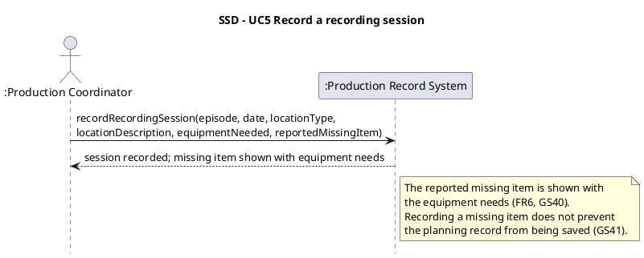

Alternative scenario: No item is reported missing.


| Actor                                                                                                                  | System                                                                                        |
| ---------------------------------------------------------------------------------------------------------------------- | --------------------------------------------------------------------------------------------- |
| The production coordinator records the session date, location and required equipment without reporting a missing item. |                                                                                               |
|                                                                                                                        | The system records the session and shows its equipment needs without marking an item missing. |

<a id="fig-6"></a>


*Figure 6: SSD – UC5 Record a session with no missing equipment (source: `Diagrams/System_Sequence_Diagrams/SSD_UC5_MissingEquipment.puml`)*

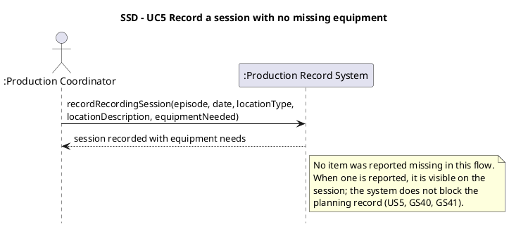

##### UC6: Record source recordings and draft versions

Use case: Record source recordings and draft versions; an approved draft is not assumed to be the version published (FR7).
Primary actor: Technical volunteer.
Goal: Record a session's files and mark which are usable (G6).

Main success scenario: Record several source files, link them to drafts, and show each draft's status (GS42–GS44).


| Actor                                                                                                             | System                                                                  |
| ----------------------------------------------------------------------------------------------------------------- | ----------------------------------------------------------------------- |
| The technical volunteer records each source file from the session, including its working name and usability note. |                                                                         |
|                                                                                                                   | The system records each SourceRecording against the session.            |
| The technical volunteer records each draft for the episode and selects the source recordings it uses.             |                                                                         |
|                                                                                                                   | The system records each Draft and its source links.                     |
| The technical volunteer records the current status supplied by the authorised review process for each draft.      |                                                                         |
|                                                                                                                   | The system shows each draft with its linked sources and current status. |

<a id="fig-7"></a>

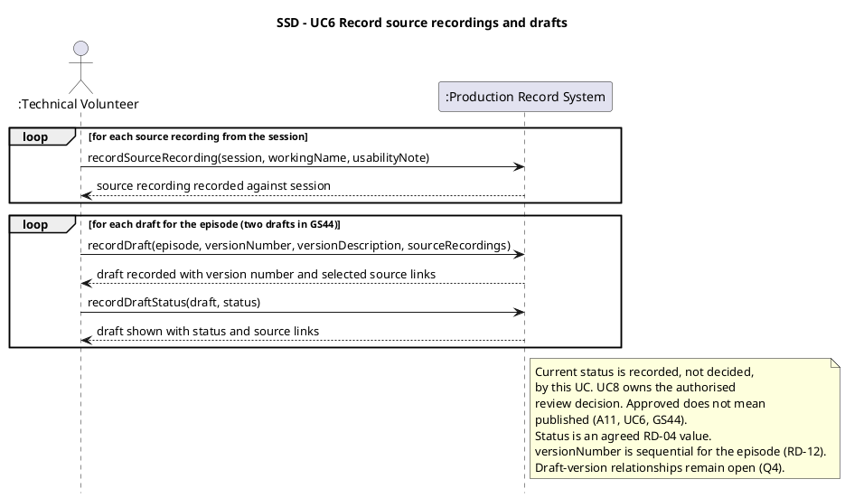

*Figure 7: SSD – UC6 Record source recordings and drafts (source: `Diagrams/System_Sequence_Diagrams/SSD_UC6_RecordSourcesAndDrafts.puml`)*

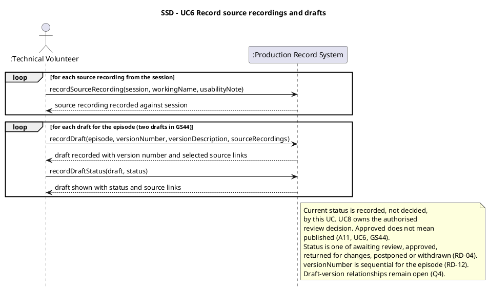

Alternative scenario: A draft remains awaiting review; its status is visible and the system does not infer approval from another draft or from its sources.


| Actor                                                                     | System                                                                             |
| ------------------------------------------------------------------------- | ---------------------------------------------------------------------------------- |
| The technical volunteer records the status "awaiting review" for a draft. |                                                                                    |
|                                                                           | The system shows that draft as awaiting review and preserves its own source links. |

<a id="fig-8"></a>


*Figure 8: SSD – UC6 Show a draft awaiting review (source: `Diagrams/System_Sequence_Diagrams/SSD_UC6_DraftAwaitingReview.puml`)*

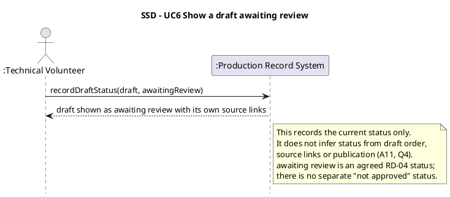

##### UC7: Record permissions for material used

Use case: Record permissions for material used (FR8).
Primary actor: Technical editor.
Goal: Record permissions for music, archive clips and external material (G7).

Main success scenario: Record granted permission for material used by a draft.


| Actor                                                                                                                     | System                                                                                               |
| ------------------------------------------------------------------------------------------------------------------------- | ---------------------------------------------------------------------------------------------------- |
| The technical editor records the material description, source, permitted use, status and the draft or drafts that use it. |                                                                                                      |
|                                                                                                                           | The system records the Permission against the selected draft or drafts and shows its granted status. |

<a id="fig-9"></a>


*Figure 9: SSD – UC7 Record granted permission (source: `Diagrams/System_Sequence_Diagrams/SSD_UC7_GrantedPermission.puml`)*

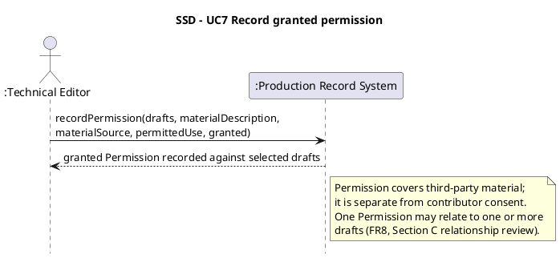

Alternative scenario: Record an outstanding permission and show it on the affected draft (GS45–GS46).


| Actor                                                                                                                      | System                                                                                                                    |
| -------------------------------------------------------------------------------------------------------------------------- | ------------------------------------------------------------------------------------------------------------------------- |
| The technical editor records the material and permitted use with status "outstanding", then views the draft's permissions. |                                                                                                                           |
|                                                                                                                            | The system records the Permission and identifies it as outstanding; the draft's other permission statuses remain visible. |

<a id="fig-10"></a>


*Figure 10: SSD – UC7 Show an outstanding permission (source: `Diagrams/System_Sequence_Diagrams/SSD_UC7_OutstandingPermission.puml`)*

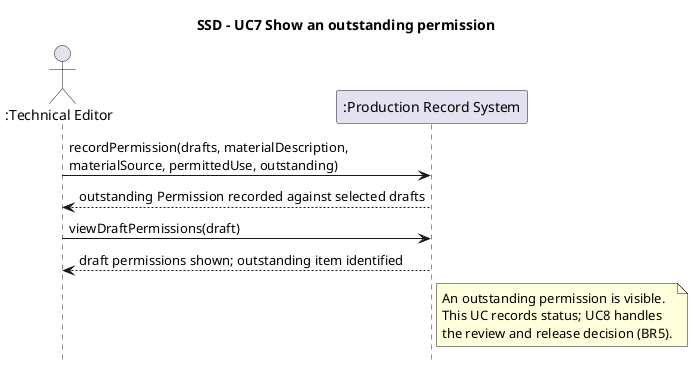

### Operation contracts

#### OC05: recordRecordingSession


| Item                | Content                                                                                                                                                                                                                                                      |
| ------------------- | ------------------------------------------------------------------------------------------------------------------------------------------------------------------------------------------------------------------------------------------------------------ |
| Operation           | `recordRecordingSession(episode, date, locationType, locationDescription, equipmentNeeded, reportedMissingItem)`                                                                                                                                             |
| Cross-references    | UC5, FR6, US5, GS40, GS41                                                                                                                                                                                                                                    |
| Preconditions       | The episode exists.`equipmentNeeded` is supplied. `reportedMissingItem` is optional.                                                                                                                                                                         |
| Postconditions      | `RecordingSession` created; associated with the episode; date, location and equipment needs recorded. If supplied, `reportedMissingItem` is recorded and visible with the session. No failure or success rule prevents the planning record from being saved. |
| Controlled failures | Episode not found: no session is created.                                                                                                                                                                                                                    |

#### OC06: recordSourceRecording


| Item                | Content                                                                                                       |
| ------------------- | ------------------------------------------------------------------------------------------------------------- |
| Operation           | `recordSourceRecording(session, workingName, usabilityNote)`                                                  |
| Cross-references    | UC6, FR7, US6, GS42                                                                                           |
| Preconditions       | The recording session exists.                                                                                 |
| Postconditions      | `SourceRecording` created; associated with the recording session; `workingName` and `usabilityNote` recorded. |
| Controlled failures | Recording session not found: no source recording is created.                                                  |

#### OC07: recordDraft


| Item                | Content                                                                                                                                                                                                                                                                                                                                           |
| ------------------- | ------------------------------------------------------------------------------------------------------------------------------------------------------------------------------------------------------------------------------------------------------------------------------------------------------------------------------------------------- |
| Operation           | `recordDraft(episode, versionNumber, versionDescription, sourceRecordings)`                                                                                                                                                                                                                                                                       |
| Cross-references    | UC6, FR7, US6, GS43, GS44, RD-12                                                                                                                                                                                                                                                                                                                  |
| Preconditions       | The episode exists.`sourceRecordings` identifies at least one existing source recording. `versionNumber` is sequential for the episode.                                                                                                                                                                                                           |
| Postconditions      | `Draft` created; associated with the episode; `versionNumber` and `versionDescription` recorded; each selected source recording associated with the draft. The operation returns the recorded `Draft`, including its version number. A newly recorded draft starts as `awaiting review`, unless a separately supplied current status is recorded. |
| Controlled failures | Episode or a selected source recording not found: no draft or associations are created.                                                                                                                                                                                                                                                           |

#### OC08: recordDraftStatus


| Item                | Content                                                                                                                |
| ------------------- | ---------------------------------------------------------------------------------------------------------------------- |
| Operation           | `recordDraftStatus(draft, status)`                                                                                     |
| Cross-references    | UC6, FR7, US6, GS44, RD-04                                                                                             |
| Preconditions       | The draft exists.`status` is one of `awaiting review`, `approved`, `returned for changes`, `postponed` or `withdrawn`. |
| Postconditions      | `Draft.status` = the supplied status. No `DraftReview` or publication decision is created; UC8 owns that workflow.     |
| Controlled failures | Draft not found or status is not an agreed RD-04 value: the draft is unchanged.                                        |

#### OC09: recordPermission


| Item                | Content                                                                                                                     |
| ------------------- | --------------------------------------------------------------------------------------------------------------------------- |
| Operation           | `recordPermission(drafts, materialDescription, materialSource, permittedUse, status)`                                       |
| Cross-references    | UC7, FR8, US7, GS45, GS46                                                                                                   |
| Preconditions       | At least one draft exists.`status` is `granted` or `outstanding`.                                                           |
| Postconditions      | `Permission` created; material description, source, permitted use and status recorded; associated with each selected draft. |
| Controlled failures | A selected draft not found: no permission or partial draft associations are created.                                        |

#### OC10: viewDraftPermissions


| Item                | Content                                                                                         |
| ------------------- | ----------------------------------------------------------------------------------------------- |
| Operation           | `viewDraftPermissions(draft)`                                                                   |
| Cross-references    | UC7, FR8, BR5, GS46                                                                             |
| Preconditions       | The draft exists.                                                                               |
| Postconditions      | None. The operation returns the draft's permissions and identifies any`outstanding` permission. |
| Controlled failures | Draft not found: nothing is returned.                                                           |

### Task #30 — Create CRC cards

#### RecordingSession

- **Responsibilities:**
  - Know and Keep the session date and location.
  - Record the required equipment.
  - Record and show any reported missing equipment item.
  - Associate the session with one episode.
  - Keep links to the source recordings produced by the session.
- **Collaborators:**
  - Episode
  - SourceRecording
  - EquipmentItem

#### SourceRecording

- **Responsibilities:**
  - Know and keep the working filename and usability note.
  - Associate the recording with the recording session that produced it.
  - Keep links to the drafts that use the source recording
- **Collaborators:**
  - RecordingSession
  - Draft

#### Draft

- **Responsibilities:**
  - Know and keep the sequential version number, draft description and current status.
  - Use only the agreed RD-04 status values: awaiting review, approved, returned for changes, postponed or withdrawn.
  - Associate the draft with its episode
  - Keep links to the source recordings used to make the draft
  - Return the draft and its version number when a draft is recorded (RD-12).
- **Collaborators:**
  - Episode
  - SourceRecording
  - Permission

#### Permission

- **Responsibilities:**
  - Know and keep the material description and source.
  - Record the permitted use.
  - Record the permission status as granted or outstanding.
  - Associate the permission with one or however many drafts that use the material.
  - Make an outstanding permission visible to the draft and review workflow.
- **Collaborators:**
  - Draft

### Summary

Section C covers UC5–UC7 and records recording sessions, source recordings, drafts and permissions. Missing equipment remains visible, drafts link to their source recordings, and outstanding permissions remain associated with the relevant draft. Publication review remains outside this section.

<a id="section-d"></a>

## Section D: Review and publication

*Source file: `Individual_Contributions/Implementation_Catalogue/Section_D_Review_Tsubasa/CA2_Section D.md`*

Member 4: Tsubasa Hirose
CA1 source: Rani Wheeza's analysis dossier (T00244793)

Evidence references ED01 to ED41 identify items in [Evidence_Document_Source_Material.md](#app-evidence-d). This section reviews the CA1 analysis for review, publication and correction. It also identifies information that the CA1 analysis does not state.

The scenarios are in [Section_D_Review.feature](#app-feature-d). The CRC cards and GRASP notes are in this catalogue. The system sequence diagrams are in the diagrams folder.

### Problem statement

Rani's problem statement describes records held in different places, including review notes and publication information. It also identifies the need to restrict editorial discussion and sensitive contributor information by role (ED01). The stated purpose includes the record from proposal to publication and any later correction (ED09).

Review comments are recorded in separate email threads (ED02). A requested change could be missed. The dossier marks that missed change as inferred, not as a confirmed frequency (ED03). Publication dates change, and a partner wants an explanation (ED04). A finished draft can be blocked by an outstanding permission, contributor confirmation or editorial decision (ED05). Staff must distinguish a metadata correction from a new audio version (ED06).

The outcomes this section serves are publication readiness, publication information and version clarity (ED07).

### Scope of this section

#### In this section


| ID   | Name                                                                                                             | Evidence | Priority |
| ---- | ---------------------------------------------------------------------------------------------------------------- | -------- | -------- |
| UC8  | Review a draft. The authorised editor records the outcome.                                                       | ED27     | Must     |
| UC9  | Record or change a publication date, keeping the earlier date and the reason.                                    | ED27     | Should   |
| UC10 | Record a post-publication correction or replacement, identified as a metadata correction or a new audio version. | ED27     | Should   |

S6, S8 and S9 are the scope items for these use cases (ED10).

#### Outside this section


| Item                                                       | Owner            | Why it is outside                                                                                                                                                                           |
| ---------------------------------------------------------- | ---------------- | ------------------------------------------------------------------------------------------------------------------------------------------------------------------------------------------- |
| Recording a proposal and its editorial decision            | Section A        | UC2 records the proposal decision. UC8 starts at review of a draft (ED26, ED27).                                                                                                            |
| Creating and versioning drafts                             | Section C        | UC6 records source recordings and draft versions. An approved draft is not assumed to be the version published (ED26).                                                                      |
| Recording contributor consent                              | Section B        | UC4 records consent. The Section D scenarios read whether consent is confirmed. They do not record it (ED26).                                                                               |
| Recording permissions for material                         | Section C        | UC7 and FR8. Section C says record permissions for material used.                                                                                                                           |
| The production overview                                    | Shared           | UC11 and FR12 list several overview categories (ED19, ED26). GS4 shows one blocked draft. This section adds no overview scenario.                                                           |
| Recording contributor concerns before or after publication | Deferred (RD-17) | The scenario says concerns may be raised and a consistent record is wanted, but gives no process, owner or visibility rule. Building it would invent policy (Q11). Remains deferred (RD-17) |

### Requirements Review

This review covers the CA1 requirements that affect Section D. For each item, the review gives a decision and a reason.

#### Review method

Requirements, business rules and assumptions were reviewed for consistency, clarity, verifiability and traceability against the CA1 baseline without introducing unconfirmed rules.

#### Functional requirements

The CA1 statements below are summaries, not direct quotations. The decisions distinguish requirement changes from additional tests.


| ID   | CA1 statement: summary                                                                                                                                                                                      | Decision                          | Reason                                                                                                                                                                                                                                                | Evidence               |
| ---- | ----------------------------------------------------------------------------------------------------------------------------------------------------------------------------------------------------------- | --------------------------------- | ----------------------------------------------------------------------------------------------------------------------------------------------------------------------------------------------------------------------------------------------------- | ---------------------- |
| FR9  | An authorised editor can record a draft review as approved, returned for changes, postponed or withdrawn, with the date, the person and the comments kept against that draft.                               | Keep. Add Gherkin scenarios.      | FR9 names the four outcomes and the fields to keep. CA1 verifies them by recording each outcome. GS3 and GS4 already cover approval and a blocked draft. GS30, GS31, GS32 and GS33 cover the remaining acceptance criteria of US8.                    | ED15, ED37, ED40       |
| FR10 | Staff can record an episode's publication date and channel, and the reason when the date changes.                                                                                                           | Keep. Add the recording scenario. | FR10 states the date, the channel and the reason for a change. It does not state that the system rejects a date. US9's acceptance criterion covers the moved date. GS34 covers the first recording of the date and channel. GS5 covers the change.    | ED16, ED21, ED38       |
| FR11 | An authorised editor can record a post-publication correction or replacement, linked to the original publication, identified as a metadata correction or a new audio version, with the date and the person. | Keep. Add Gherkin scenarios.      | FR11's verification is to record one of each and check the link, the type, the person and the date. CA1 has no Gherkin for UC10. GS35 and GS36 add that check. Q6 leaves the handling open, so the scenarios do not state what a correction triggers. | ED17, ED21, ED31, ED39 |
| FR8  | The technical editor can record permission status for music, archive clips and external material, and the draft shows which permissions are outstanding.                                                    | Keep.                             | Section D does not record the permission. GS3 and GS30 include a granted archive-clip permission. GS4 shows an outstanding one as the reason the draft is not released.                                                                               | ED18                   |
| FR12 | The production coordinator can see the listed production categories and what is blocking each draft.                                                                                                        | Keep.                             | GS4 shows one draft blocked by an outstanding permission. The scenario does not cover the other FR12 categories. This review adds no overview scenario.                                                                                               | ED19                   |

FR10 and FR11 remain Should. The dossier gives that priority because the process can still run without them in a first release, while the scenario names a real problem for each (ED20).

#### Decision


| ID   | Decision | Reason                                                                                                                                                                                                            |
| ---- | -------- | ----------------------------------------------------------------------------------------------------------------------------------------------------------------------------------------------------------------- |
| UC8  | Keep     | The use case records approval, returned for changes, postponed and withdrawn. A draft returned for changes and not reviewed again is shown as blocked (BR5, DEC-05). The scenarios are GS3, GS4 and GS30 to GS33. |
| UC9  | Keep     | The use case records the publication date, the channel and the reason for a change. No rule says the system rejects a publication date. The scenarios are GS34 and GS5.                                           |
| UC10 | Keep     | The use case records a correction linked to the original publication, with its type, the person and the date. What happens next stays open (Q6). The scenarios are GS35 and GS36.                                 |

#### Business rules

The review keeps BR3, BR4, BR5 and BR8. The scenarios test specific results from these rules.


| ID  | CA1 statement: summary                                                                                                      | Decision | Reason                                                                                                                                                                                                                                                                                                                                                                                                                                                                                                                                                              | Evidence         |
| --- | --------------------------------------------------------------------------------------------------------------------------- | -------- | ------------------------------------------------------------------------------------------------------------------------------------------------------------------------------------------------------------------------------------------------------------------------------------------------------------------------------------------------------------------------------------------------------------------------------------------------------------------------------------------------------------------------------------------------------------------- | ---------------- |
| BR3 | An authorised editor reviews a draft, its title, description, credits, permissions and intended channel before publication. | Keep.    | The scenario states this rule. GS3 records approval by an authorised editor for one channel. The scenarios do not decide who may approve each programme type or channel.                                                                                                                                                                                                                                                                                                                                                                                            | ED23, ED25       |
| BR4 | A review outcome is approved, returned for changes, postponed or withdrawn.                                                 | Keep.    | The scenario states these four outcomes. GS3, GS31, GS32 and GS33 record one each.                                                                                                                                                                                                                                                                                                                                                                                                                                                                                  | ED23, ED15       |
| BR5 | An outstanding permission, contributor confirmation or editorial decision blocks publication.                               | Keep.    | The scenario states this rule. GS4 shows a technically complete draft not released, and shown as blocked by an outstanding archive-clip permission. The CA1 model states that the draft is not released. It does not state that the system prevents the editor from recording approval while something is outstanding. GS4 does not add that prevention. GS31 records the outcome "returned for changes". Until that draft is reviewed again, the outstanding editorial decision is shown as blocked (BR5, DEC-05). GS32 and GS33 do not show the draft as blocked. | ED05, ED23, ED28 |
| BR8 | A metadata correction can be distinguished from a new audio version.                                                        | Keep.    | The rule is implied. The dossier says how the two differ is not defined. GS35 and GS36 show the recorded type. They do not define the difference beyond that type.                                                                                                                                                                                                                                                                                                                                                                                                  | ED06, ED23, ED32 |

GS31, GS32 and GS33 show the draft as not approved and not ready to be scheduled. Only GS31 shows the draft as blocked. GS32 and GS33 do not.

#### Assumptions

The review keeps the five assumptions as assumptions. The scenarios do not confirm them.


| ID  | CA1 statement: summary                                                                                     | Decision               | Reason                                                                                                                                                                    | Evidence                  |
| --- | ---------------------------------------------------------------------------------------------------------- | ---------------------- | ------------------------------------------------------------------------------------------------------------------------------------------------------------------------- | ------------------------- |
| A7  | Each episode in a series has its own review and publication record.                                        | Keep as an assumption. | The scenarios use one episode, "Episode 2: The Last Currach Builder". They do not test a series.                                                                          | ED24, ED29                |
| A8  | Only an authorised editor records a release decision.                                                      | Keep as an assumption. | GS3, GS35 and GS36 use the authorised editor. They do not test another role recording the release. Q5 remains open.                                                       | ED24, ED25                |
| A9  | Approval to publish applies per channel.                                                                   | Keep as an assumption. | GS3 approves the draft for the "podcast feed" channel, as in the CA1 scenario. The scenario does not test approval for every channel at once, and it does not confirm A9. | ED24, ED30                |
| A11 | An approved draft is a status of a draft, not a separate item.                                             | Keep as an assumption. | The scenarios show the draft as approved. They do not introduce a separate approved-version item. How versions relate remains Q4.                                         | ED24, ED35                |
| A14 | If a replacement is modelled as a Draft and then published, it is reviewed through UC8 before publication. | Keep as an assumption. | The baseline records this assumption (RD-08). GS35 and GS36 do not test it. Q6 stays open.                                                                                | analysis-baseline.md, A14 |

#### Open questions

The review does not answer the open questions. The table shows their effects on Section D.


| ID  | Question                                                              | Decision       | Effect on Section D                                                                                                                                                                        | Evidence               |
| --- | --------------------------------------------------------------------- | -------------- | ------------------------------------------------------------------------------------------------------------------------------------------------------------------------------------------ | ---------------------- |
| Q5  | Who may approve each programme type and publication channel?          | Carry forward. | The scenarios say "authorised editor". They do not name the person or the programme types that person may approve.                                                                         | ED08, ED25, ED41       |
| Q6  | How are corrections, replacements and withdrawal requests handled?    | Carry forward. | GS35 and GS36 record the correction and its type. They do not state what happens next. GS33 records the review outcome "withdrawn". It does not state how a withdrawal request is handled. | ED08, ED25, ED31, ED39 |
| Q7  | What may volunteers, contributors and partners see?                   | Carry forward. | No scenario tests who can see a review comment. A visibility test needs the agreed permissions.                                                                                            | ED25, ED33             |
| Q13 | Can the proposal editor and the authorised editor be the same person? | Carry forward. | The scenarios use the authorised editor for draft review. They do not decide whether that person may also be the proposal editor.                                                          | ED12, ED14, ED25       |

### Usecase

#### UC8 - Review a draft. The authorised editor records the outcome


| Field         | Content                                                                                                                                                     |
| ------------- | ----------------------------------------------------------------------------------------------------------------------------------------------------------- |
| Primary actor | Authorised editor                                                                                                                                           |
| Goal          | Record the outcome and comments against the draft, so the release decision is the editor's. A draft with nothing outstanding is not approved automatically. |
| Preconditions | A draft has been recorded (UC6). Outstanding consent or permission need not be cleared before an outcome is recorded.                                       |
| Trigger       | The authorised editor reviews the draft and records an outcome.                                                                                             |
| Related       | FR9, FR8, S6, G8, BR3, BR4, BR5, DEC-05                                                                                                                     |

**Main success flow (Authorised editor approves a reviewed draft with nothing outstanding)**


| Actor                                                       | System                                                                                                                                  |
| ----------------------------------------------------------- | --------------------------------------------------------------------------------------------------------------------------------------- |
| 1. Selects the draft to review                              |                                                                                                                                         |
|                                                             | 2. Shows that every contributor consent for the episode is confirmed and that the archive-clip permission is granted                    |
| 3. Records the outcome "approved" for a publication channel |                                                                                                                                         |
|                                                             | 4. Records the approval for that channel with the editor's name and the date, and shows the draft as approved and ready to be scheduled |

**Principal extensions**


| Point                     | Condition                                                                                         | Outcome                                                                                                                  |
| ------------------------- | ------------------------------------------------------------------------------------------------- | ------------------------------------------------------------------------------------------------------------------------ |
| 2a Outstanding permission | An archive-clip permission is still outstanding when the editor reviews the draft for publication | Not released. Shown as blocked by the outstanding archive-clip permission.                                               |
| 2b No outcome recorded    | No review outcome has been recorded, and the production coordinator views the draft               | Shown as awaiting review. Not shown as approved or ready to be scheduled.                                                |
| 3a Returned for changes   | The editor records "returned for changes" with a comment                                          | Shown as returned for changes, and as blocked by an outstanding editorial decision. The comment, name and date are kept. |
| 3b Postponed              | The editor records "postponed" with a comment                                                     | Shown as postponed. Not shown as blocked. The comment, name and date are kept.                                           |
| 3c Withdrawn              | The editor records "withdrawn" with a comment                                                     | Shown as withdrawn. Not shown as blocked. The comment, name and date are kept.                                           |

**Postconditions:** The approval is kept for that channel with the editor's name and the date. The draft is shown as approved and ready to be scheduled.

### Updated Gherkin Scenarios

The new scenarios add test coverage for FR9, FR10 and FR11 without changes to those requirements.

#### Existing scenarios

The CA1 feature file contains GS1 to GS5. GS3, GS4 and GS5 are the scenarios this section keeps. Their identifiers stay the same (ED30, ED36).


| Existing item                                                             | Review result                                                                                                                                                                                          | Action                                                                                                                                |
| ------------------------------------------------------------------------- | ------------------------------------------------------------------------------------------------------------------------------------------------------------------------------------------------------ | ------------------------------------------------------------------------------------------------------------------------------------- |
| GS3: Authorised editor approves a reviewed draft with nothing outstanding | The draft is approved for the "podcast feed" channel with the editor's name and the date, and is shown as ready to be scheduled. Consent and the archive-clip permission are given as already settled. | Keep the scenario and the identifier GS3.                                                                                             |
| GS4: Technically complete draft blocked by an outstanding permission      | The draft is not released and is shown as blocked by the outstanding archive-clip permission.                                                                                                          | Keep the scenario and the identifier GS4.                                                                                             |
| GS5: Publication date moved because another programme is urgent           | The episode moves from 14 November to 28 November. The record keeps the earlier date and the reason.                                                                                                   | Keep the identifier GS5. The scenario now also names the "podcast feed" channel and quotes the reason already given in the When step. |
| US8 / FR9 / UC8                                                           | CA1 Gherkin covers approval and the permission failure. US8 also accepts returned, postponed and withdrawn, and rejects automatic approval.                                                            | Add GS30, GS31, GS32 and GS33.                                                                                                        |
| US9 / FR10 / UC9                                                          | CA1 Gherkin covers the moved date. FR10 also states the first recording of the date and channel.                                                                                                       | Add GS34. Do not add a failure scenario.                                                                                              |
| US10 / FR11 / UC10                                                        | CA1 has no Gherkin. The acceptance criteria are the link, the type, the person and the date.                                                                                                           | Add GS35 and GS36. Do not add a failure scenario.                                                                                     |

The review uses these baseline files:

- **Feature file:** [CA1 production_record.feature](https://github.com/Rani-Wheeza/Local-Podcast-Production-Service/blob/HEAD/CA%201/Features/production_record.feature).
- **User stories:** [CA1 user-stories.md](https://github.com/Rani-Wheeza/Local-Podcast-Production-Service/blob/HEAD/CA%201/Requirements/user-stories.md).
- **Analysis dossier:** [CA1 analysis dossier](https://github.com/Rani-Wheeza/Local-Podcast-Production-Service/blob/HEAD/CA%201/Report/CA1_Analysis_Dossier.md).

#### New scenario coverage

[Section_D_Review.feature](#app-feature-d) contains the Section D scenarios. It uses `Rule:` blocks and tags for requirements, use cases, scenario types and scenario numbers.

New scenarios start at GS30. The group must confirm the numbers before the feature files are merged.


| Scenario                                                                  | Type        | Test coverage                                                                                                                                                                                             | Requirement    | Use case | Rule or constraint                              | Evidence               |
| ------------------------------------------------------------------------- | ----------- | --------------------------------------------------------------------------------------------------------------------------------------------------------------------------------------------------------- | -------------- | -------- | ----------------------------------------------- | ---------------------- |
| GS3: Authorised editor approves a reviewed draft with nothing outstanding | Success     | The authorised editor's approval, name and date are recorded for the named channel. The draft is shown as ready to be scheduled.                                                                          | FR9            | UC8      | BR3                                             | ED15, ED27, ED30, ED40 |
| GS4: Technically complete draft blocked by an outstanding permission      | Failure     | The draft is not released. It is shown as blocked by the outstanding archive-clip permission.                                                                                                             | FR8, FR9, FR12 | UC8      | BR5                                             | ED18, ED19, ED23, ED28 |
| GS30: A draft with nothing outstanding is not approved automatically      | Boundary    | With consent confirmed, permission granted and no review outcome, the draft is shown as awaiting review. It is not shown as approved or ready to be scheduled.                                            | FR9            | UC8      | BR3                                             | ED27, ED28, ED37, ED40 |
| GS31: Authorised editor returns a draft for changes                       | Alternative | The outcome "returned for changes", the comment, the editor's name and the date are kept. The draft is shown as blocked by an outstanding editorial decision, not approved and not ready to be scheduled. | FR9            | UC8      | BR4, BR5                                        | ED15, ED23, ED37       |
| GS32: Authorised editor postpones a draft                                 | Alternative | The outcome "postponed", the comment, the editor's name and the date are kept. The draft is not approved and not ready to be scheduled.                                                                   | FR9            | UC8      | BR4                                             | ED15, ED23, ED37       |
| GS33: Authorised editor records a draft as withdrawn                      | Alternative | The outcome "withdrawn", the comment, the editor's name and the date are kept. The draft is not approved and not ready to be scheduled.                                                                   | FR9            | UC8      | BR4                                             | ED15, ED23, ED37       |
| GS34: Publication date and channel are recorded                           | Success     | An approved draft that is ready to be scheduled is shown as scheduled for 14 November on the "podcast feed" channel.                                                                                      | FR10           | UC9      | CA1 states no separate rejection rule for FR10. | ED16, ED27, ED38       |
| GS5: Publication date moved because another programme is urgent           | Alternative | The date changes from 14 November to 28 November on the same channel. The earlier date and the reason "another programme has become urgent" are kept.                                                     | FR10           | UC9      | CA1 states no separate rejection rule for FR10. | ED04, ED16, ED30, ED38 |
| GS35: A metadata correction stays linked to the original publication      | Success     | The correction is linked to the original publication, shown as a metadata correction, and not shown as a new audio version. It shows the editor's name and the date.                                      | FR11           | UC10     | BR8                                             | ED17, ED23, ED39       |
| GS36: A new audio version stays linked to the original publication        | Success     | The new audio version is linked to the original publication, shown as a new audio version, and not shown as a metadata correction. It shows the editor's name and the date.                               | FR11           | UC10     | BR8                                             | ED17, ED23, ED39       |

#### Review decisions and limits

- **Requirement wording:** FR8, FR9, FR10, FR11 and FR12 remain unchanged. The scenarios add test coverage.
- **Identifiers:** GS3, GS4 and GS5 keep their CA1 numbers. The feature file places GS5 after GS34 and states that GS5 keeps its CA1 number.
- **No automatic approval:** GS30 follows US8 and UC8. A draft with nothing outstanding is not approved until the authorised editor records approval (ED27, ED37, ED40).
- **Returned, postponed and withdrawn:** These are BR4 outcomes. Each scenario records one outcome. None of them describes a later process. Only "returned for changes" is shown as blocked.
- **Withdrawal request:** Q6 asks how a withdrawal request is handled. GS33 records the review outcome "withdrawn". It does not answer Q6.
- **Outstanding permission:** GS4 isolates one outstanding archive-clip permission. It does not replace a test for outstanding consent. Section D does not record consent or permission.
- **Approval while something is outstanding:** The CA1 model does not say the system prevents the editor from recording approval in that case. It says the draft is not released (ED28). GS4 follows that limit.
- **Publication date:** UC9 has no failure scenario. FR10 records a date, a channel and the reason for a change. No rule says the system rejects a publication date (ED16, ED21). GS34 starts from a draft that is already approved and ready to be scheduled. It does not test a date on a draft that is not in that state.
- **Corrections:** UC10 has no failure scenario. Q6 leaves the handling of a correction or replacement open. GS35 and GS36 only record the link, the type, the editor's name and the date (ED17, ED31).
- **One draft:** GS31, GS32 and GS33 keep the comment against the draft in the scenario. They use one draft, so they do not show a comment kept off a second draft.
- **Illustrative data:** Episode titles, the channel name, the dates and the review comments are illustrative test data (ED29).

#### Dependencies

The group must resolve the dependencies below before final integration. Until then, the scenarios must not treat the open questions or the assumptions as confirmed rules.


| Dependency       | Required decision                                                            | Effect on scenarios                                                                         |
| ---------------- | ---------------------------------------------------------------------------- | ------------------------------------------------------------------------------------------- |
| Q5               | Who may approve each programme type and publication channel                  | The scenarios continue to say "authorised editor" until the group names the authority.      |
| Q6               | How corrections, replacements and withdrawal requests are handled            | Further tests can cover that handling after agreement. GS33, GS35 and GS36 do not state it. |
| Q7               | What volunteers, contributors and partners may see                           | A test of review-comment visibility needs the agreed permissions.                           |
| Q13              | Whether the proposal editor and the authorised editor may be the same person | The draft-review scenarios keep the authorised editor. They do not settle the role overlap. |
| A7, A8, A9, A11  | Whether these assumptions are confirmed                                      | No scenario may treat them as business rules before agreement.                              |
| Later sections   | Common terms for blockers and release decisions                              | A section that adds a blocker or a release scenario must use the same terms as GS3 and GS4. |
| Scenario numbers | GS30 to GS36 in this feature                                                 | The group must confirm that the numbers do not collide before merge.                        |
| Common test data | Shared episode titles, channel names and dates                               | A change to the test data must preserve the behaviour that each scenario tests.             |

### SSD (System Sequence Diagram)


| Use case | Diagram                                                                      | System operations                                                  |
| -------- | ---------------------------------------------------------------------------- | ------------------------------------------------------------------ |
| UC8      | `CA 2/Diagrams/System_Sequence_Diagrams/SSD_UC8_ReviewDraft.puml`            | selectDraft(draft); recordReview(draft, channel, outcome, comment) |
| UC8      | `CA 2/Diagrams/System_Sequence_Diagrams/SSD_UC8_AwaitingReview.puml`         | viewDraft(draft)                                                   |
| UC9      | `CA 2/Diagrams/System_Sequence_Diagrams/SSD_UC9_RecordPublication.puml`      | recordPublicationDate(draft, channel, date)                        |
| UC9      | `CA 2/Diagrams/System_Sequence_Diagrams/SSD_UC9_ChangePublicationDate.puml`  | changePublicationDate(draft, channel, newDate, reason)             |
| UC10     | `CA 2/Diagrams/System_Sequence_Diagrams/SSD_UC10_RecordPostPublication.puml` | recordCorrection(publication, type, correctionDetails)             |

<a id="fig-11"></a>

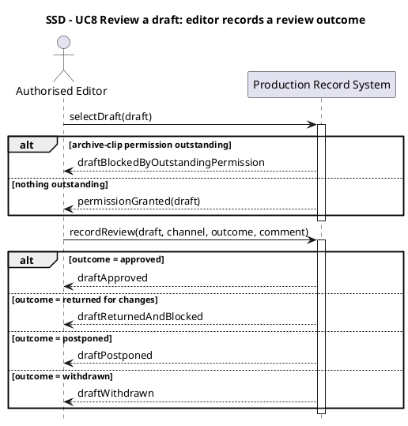

*Figure 11: SSD – UC8 Review a draft: editor records a review outcome (source: `Diagrams/System_Sequence_Diagrams/SSD_UC8_ReviewDraft.puml`)*

<a id="fig-12"></a>

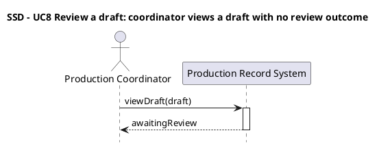

*Figure 12: SSD – UC8 Review a draft: coordinator views a draft with no review outcome (source: `Diagrams/System_Sequence_Diagrams/SSD_UC8_AwaitingReview.puml`)*

<a id="fig-13"></a>

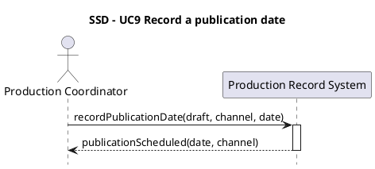

*Figure 13: SSD – UC9 Record a publication date (source: `Diagrams/System_Sequence_Diagrams/SSD_UC9_RecordPublication.puml`)*

<a id="fig-14"></a>

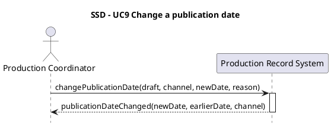

*Figure 14: SSD – UC9 Change a publication date (source: `Diagrams/System_Sequence_Diagrams/SSD_UC9_ChangePublicationDate.puml`)*

<a id="fig-15"></a>

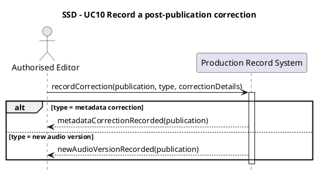

*Figure 15: SSD – UC10 Record a post-publication correction (source: `Diagrams/System_Sequence_Diagrams/SSD_UC10_RecordPostPublication.puml`)*

### Operation Contract

#### OC01: recordReview


| Contract field   | Content                                                                                                                                                                                                                                                                                                                                                                                                                                                                                  |
| ---------------- | ---------------------------------------------------------------------------------------------------------------------------------------------------------------------------------------------------------------------------------------------------------------------------------------------------------------------------------------------------------------------------------------------------------------------------------------------------------------------------------------- |
| Operation        | `recordReview(draft, channel, outcome, comment)`                                                                                                                                                                                                                                                                                                                                                                                                                                         |
| Cross-references | UC8, FR9, BR3, BR4, BR5, DEC-05, GS3, GS4, GS31, GS32, GS33                                                                                                                                                                                                                                                                                                                                                                                                                              |
| Preconditions    | A`Draft` exists.                                                                                                                                                                                                                                                                                                                                                                                                                                                                         |
| Postconditions   | `DraftReview` created<br>Association with `Draft`<br>Association with `PublicationChannel`<br>`DraftReview.outcome` = approved, returned for changes, postponed or withdrawn<br>`DraftReview.reviewDate` = current date<br>`DraftReview.reviewedBy` = editor<br>`DraftReview.comments` = comment<br>Approved: `Draft.status` = approved<br>Returned for changes: `Draft.status` = returned for changes<br>Postponed: `Draft.status` = postponed<br>Withdrawn: `Draft.status` = withdrawn |

#### OC02: recordPublicationDate


| Contract field   | Content                                                                                                                                                              |
| ---------------- | -------------------------------------------------------------------------------------------------------------------------------------------------------------------- |
| Operation        | `recordPublicationDate(draft, channel, date)`                                                                                                                        |
| Cross-references | UC9, FR10, GS34                                                                                                                                                      |
| Preconditions    | `Draft.status` = approved<br>Derived ready to be scheduled                                                                                                           |
| Postconditions   | `Publication` created<br>Association with `Draft`<br>Association with `PublicationChannel`<br>`Publication.scheduledDate` = date<br>`Publication.status` = scheduled |

#### OC03: changePublicationDate


| Contract field   | Content                                                                                                                                                                                                                                                                                                                               |
| ---------------- | ------------------------------------------------------------------------------------------------------------------------------------------------------------------------------------------------------------------------------------------------------------------------------------------------------------------------------------- |
| Operation        | `changePublicationDate(draft, channel, newDate, reason)`                                                                                                                                                                                                                                                                              |
| Cross-references | UC9, FR10, GS5                                                                                                                                                                                                                                                                                                                        |
| Preconditions    | A`Publication` for that draft and channel exists<br>`Publication.status` = scheduled                                                                                                                                                                                                                                                  |
| Postconditions   | `PublicationDateChange` created<br>Association with `Publication`<br>`PublicationDateChange.earlierDate` = previous `Publication.scheduledDate`<br>`PublicationDateChange.newDate` = newDate<br>`PublicationDateChange.reason` = reason<br>`PublicationDateChange.changeDate` = current date<br>`Publication.scheduledDate` = newDate |

#### OC04: recordCorrection


| Contract field   | Content                                                                                                                                                                                                |
| ---------------- | ------------------------------------------------------------------------------------------------------------------------------------------------------------------------------------------------------ |
| Operation        | `recordCorrection(publication, type, details)`                                                                                                                                                         |
| Cross-references | UC10, FR11, BR8, GS35, GS36                                                                                                                                                                            |
| Preconditions    | A`Publication` exists<br>`Publication.status` = published                                                                                                                                              |
| Postconditions   | `Correction` created<br>Association with `Publication`<br>`Correction.type` = type<br>`Correction.details` = details<br>`Correction.recordedBy` = editor<br>`Correction.correctionDate` = current date |

### CRC Cards

The CRC cards assign every effect of OC01–OC04 to a class. `Draft` is Section C's class; only the responsibilities these operations need are listed here. Design classes are one use-case controller, a clock and two enumerations.

#### Draft (Section C)


| Responsibilities                                           | Collaborators                            |
| ---------------------------------------------------------- | ---------------------------------------- |
| Know its version, description and review status (RD-04)    | –                                       |
| Create a`DraftReview` for one channel (OC01, FR9)          | DraftReview, PublicationChannel          |
| Set its status to the review outcome (OC01)                | –                                       |
| Know whether it is blocked (derived, RD-04, BR5)           | DraftReview, Permission (C), Consent (B) |
| Know whether it is ready to be scheduled (derived, RD-04)  | DraftReview, Permission (C), Consent (B) |
| Know whether an editorial decision is outstanding (DEC-05) | DraftReview                              |
| Know whether it has been reviewed (GS30)                   | –                                       |
| Create and hold a publication for one channel (OC02, FR10) | Publication, PublicationChannel          |

#### DraftReview


| Responsibilities                                         | Collaborators      |
| -------------------------------------------------------- | ------------------ |
| Know its outcome, review date, editor and comments (FR9) | ReviewOutcome      |
| Know the one draft it reviews (RD-07)                    | Draft              |
| Know the one channel it is for (RD-07, A9)               | PublicationChannel |

#### ReviewOutcome (enumeration)


| Responsibilities                                                                          | Collaborators |
| ----------------------------------------------------------------------------------------- | ------------- |
| Define the only four outcomes: approved, returned for changes, postponed, withdrawn (BR4) | –            |

#### Publication


| Responsibilities                                       | Collaborators         |
| ------------------------------------------------------ | --------------------- |
| Know its scheduled date (FR10)                         | –                    |
| Know whether it is scheduled or published (OC02, OC04) | –                    |
| Set its scheduled date (OC02, OC03)                    | –                    |
| Set its status to scheduled (OC02)                     | –                    |
| Know the draft it releases                             | Draft                 |
| Know the channel that carries it                       | PublicationChannel    |
| Create and hold a date-change record (OC03, GS5)       | PublicationDateChange |
| Create and hold a correction (OC04, FR11)              | Correction            |

#### PublicationDateChange


| Responsibilities                                                    | Collaborators |
| ------------------------------------------------------------------- | ------------- |
| Know its earlier date, new date, reason and change date (OC03, GS5) | Publication   |

#### PublicationChannel


| Responsibilities | Collaborators |
| ---------------- | ------------- |
| Know its name    | –            |

#### Correction


| Responsibilities                             | Collaborators  |
| -------------------------------------------- | -------------- |
| Know its type (BR8)                          | CorrectionType |
| Know its details (OC04)                      | –             |
| Know the editor who recorded it (OC04, FR11) | –             |
| Know its correction date (FR11)              | –             |
| Know the publication it amends               | Publication    |

#### CorrectionType (enumeration)


| Responsibilities                                                   | Collaborators |
| ------------------------------------------------------------------ | ------------- |
| Define the two types: metadata correction, new audio version (BR8) | –            |

#### ReviewPublicationController (design class)


| Responsibilities                                                                                                           | Collaborators      |
| -------------------------------------------------------------------------------------------------------------------------- | ------------------ |
| Receive`selectDraft`, `viewDraft`, `recordReview`, `recordPublicationDate`, `changePublicationDate` and `recordCorrection` | –                 |
| Pass the editor and today's date into`recordReview` and `recordCorrection`, and today's date into `changePublicationDate`  | Clock              |
| Delegate every rule to the domain objects                                                                                  | Draft, Publication |

#### Clock (interface)


| Responsibilities                                                            | Collaborators |
| --------------------------------------------------------------------------- | ------------- |
| Provide the current date for`reviewDate`, `correctionDate` and `changeDate` | –            |

### GRASP Justification


| Responsibility                                                      | Assigned class              | GRASP principle    | Alternative considered                                             | Reason rejected                                                                                                                                |
| ------------------------------------------------------------------- | --------------------------- | ------------------ | ------------------------------------------------------------------ | ---------------------------------------------------------------------------------------------------------------------------------------------- |
| Create the review for one channel and set the draft status          | Draft                       | Creator            | The controller creates the review                                  | The review exists only for that draft. The controller would take on domain work.                                                               |
| Create the publication for one channel                              | Draft                       | Creator            | The channel, or the controller, creates it                         | The draft is what is released. The channel is recorded on the publication.                                                                     |
| Keep the earlier date, the new date, the reason and the change date | PublicationDateChange       | Information Expert | `Publication.reasonForDateChange` holds the reason                 | A later change would overwrite the earlier date and the reason.                                                                                |
| Know its name only                                                  | PublicationChannel          | Low Coupling       | The channel also knows its reviews and publications                | No operation starts at the channel and follows those links.                                                                                    |
| Receive the six operations and delegate them                        | ReviewPublicationController | Controller         | One controller per use case, or a repository that saves the result | The three use cases share the draft and the publication. The operations already receive the objects, so a repository would be database access. |

<a id="part-3"></a>

# Part 3 – Shared and integrated design

<a id="uc11"></a>

## UC11 View the production overview: SSD and operation contracts

*Source file: `Behavioural_Design/Operation_Contracts/UC11_Production_Overview.md`*

**Board item:** #25 SSD and operation contracts – UC11 production overview (shared)
**Owner:** Rani | **Reviewer:** _name_
**Diagram:** `CA 2/Diagrams/System_Sequence_Diagrams/SSD_UC11_ViewProductionOverview.puml`

UC11 reads records made in every section, so this file also fixes how each overview list is derived. Sections A–D must use the same rules when they mark something as blocked or awaiting a decision.

<a id="fig-16"></a>

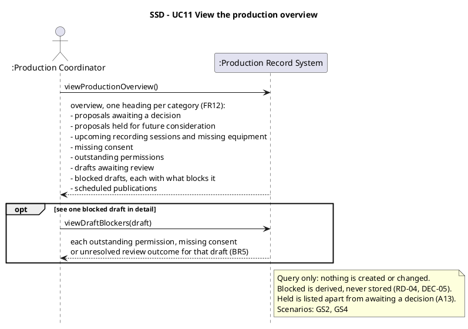

*Figure 16: SSD – UC11 View the production overview (source: `Diagrams/System_Sequence_Diagrams/SSD_UC11_ViewProductionOverview.puml`)*

### System operations


| Operation                  | Type  | Contract |
| -------------------------- | ----- | -------- |
| `viewProductionOverview()` | Query | CO11.1   |
| `viewDraftBlockers(draft)` | Query | CO11.2   |

Both operations change nothing. Their contracts state what is returned and how it is derived, because that is where the business rules apply.

### CO11.1: viewProductionOverview


| Item                | Content                                                    |
| ------------------- | ---------------------------------------------------------- |
| Operation           | `viewProductionOverview()`                                 |
| Cross-references    | UC11, FR12, S10, G3, BR1, BR5, A13, DEC-05 · GS2, GS4     |
| Preconditions       | The user acts as production coordinator.                   |
| Postconditions      | None. No object is created, changed or associated.         |
| Returns             | One heading per category, derived as in the table below.   |
| Controlled failures | A category with no entries is shown as empty, not omitted. |


| Category                                | Derived from                                                                             | Rule                                                                            |
| --------------------------------------- | ---------------------------------------------------------------------------------------- | ------------------------------------------------------------------------------- |
| Proposals awaiting a decision           | `Proposal` with no `ProposalDecision`, or whose latest decision is returned for revision | BR1 · returned-for-revision is an inference from UC2 (the proposal stays open) |
| Proposals held for future consideration | `Proposal` whose latest `ProposalDecision.outcome` is held                               | A13 · listed apart from the category above                                     |
| Upcoming recording sessions             | `RecordingSession` with `date` today or later                                            | FR6                                                                             |
| Missing equipment                       | Upcoming`RecordingSession` with an item reported missing                                 | FR6 · does not stop the session (US5)                                          |
| Missing consent                         | `Contribution` on an episode with no `Consent`                                           | FR5, BR5, DEC-05                                                                |
| Outstanding permissions                 | `Permission` with status outstanding, with the drafts that need it                       | FR8, BR5                                                                        |
| Drafts awaiting review                  | `Draft.status` = awaiting review                                                         | FR9, BR3                                                                        |
| Blocked drafts                          | `Draft` with at least one blocker (see below), each blocker named                        | BR5, DEC-05                                                                     |
| Scheduled publications                  | `Publication` with a `scheduledDate` and no `actualDate`                                 | FR10                                                                            |

**A draft is blocked when any of these is true (BR5, DEC-05):**

1. a `Permission` it needs has status outstanding;
2. a `Contribution` on its episode has no `Consent` ("contributor confirmation", Q14);
3. its `status` is returned for changes and it has not been reviewed again (outstanding editorial decision, Q15).

A draft that is awaiting review, postponed or withdrawn is **not** blocked by its status alone. Blocked is independent of review status: a draft can be both awaiting review and blocked (GS4).

### CO11.2: viewDraftBlockers


| Item                | Content                                                                                                                                                                                                     |
| ------------------- | ----------------------------------------------------------------------------------------------------------------------------------------------------------------------------------------------------------- |
| Operation           | `viewDraftBlockers(draft)`                                                                                                                                                                                  |
| Cross-references    | UC11, FR12, BR5, DEC-05 · GS4                                                                                                                                                                              |
| Preconditions       | `draft` exists. The user acts as production coordinator.                                                                                                                                                    |
| Postconditions      | None.                                                                                                                                                                                                       |
| Returns             | Each blocker for`draft`, by the three rules above: the permission and its material, the contributor and episode missing consent, or the review outcome and date. An empty list if the draft is not blocked. |
| Controlled failures | Draft not found: nothing is returned.                                                                                                                                                                       |

### Notes for the group

- **Gherkin gap:** only GS2 and GS4 touch UC11. The other categories have no scenario. UC11 is shared and has no number block. Proposed: GS50–GS59 for shared scenarios (a decision-log entry if agreed).
- **Inference to confirm:** a proposal returned for revision is listed as awaiting a decision, because UC2 keeps it open for a later decision.
- **Access:** this overview is for internal staff. A partner view, if one exists, must not show internal editorial notes (BR7, NFR1, Q9).
- **Performance:** NFR2's proposed 5-second target applies to this operation (Q12).

<a id="integrated-crc"></a>

## Integrated CRC Cards (CA2)

*Source file: `Object_Oriented_Design/CRC_Cards/integrated-crc-cards.md`*

**Board item:** #43 Integrate CRC cards and agree the controller pattern
**Owner:** Arno · **Reviewer:** To be agreed (R13)
**Status:** Proposed. The owners must agree the changes in section 3.

This file collects the CRC cards from the four sections. Each card stays in the file of its owner. This file gives a list of the cards. It also records the items that the sections must agree. The file `Object_Oriented_Design/GRASP/controller-pattern-decision.md` records the controller pattern.

### 1. Sources


| Section                       | Owner   | Source file                                                                                     | CRC status                                                   |
| ----------------------------- | ------- | ----------------------------------------------------------------------------------------------- | ------------------------------------------------------------ |
| A – Proposal management      | Rani    | `Individual_Contributions/Implementation_Catalogue/Section_A_Proposal_Rani/CA2_Section_A` (#28) | Done                                                         |
| B – Contributors and consent | Arno    | `.../Section_B_Contributors_Arno/CA2_Section_B.md`                                              | Done                                                         |
| C – Recording and drafts     | Jack    | `.../Section_C_Recording_Jack/CA2_Section_C.md` (#30)                                           | Done. No controller card. The GRASP section is not complete. |
| D – Review and publication   | Tsubasa | `.../Section_D_Review_Tsubasa/CA2_Section D.md`                                                 | Done                                                         |

### 2. List of classes


| Class                                             | Type        | Section that owns it | Used by                         | Notes                                                                                            |
| ------------------------------------------------- | ----------- | -------------------- | ------------------------------- | ------------------------------------------------------------------------------------------------ |
| Proposal                                          | Domain      | A                    | B (proposed contributors), UC11 | The latest decision gives the state.                                                             |
| Episode                                           | Domain      | A                    | B, C, D, UC11                   | Shared anchor. Creates Contribution. Gives`hasOutstandingConsent()` and `outstandingConsents()`. |
| ProposalDecision                                  | Domain      | A                    |                                 |                                                                                                  |
| DecisionOutcome                                   | Enumeration | A                    |                                 |                                                                                                  |
| PartnerOrganisation                               | Domain      | A                    |                                 |                                                                                                  |
| Contributor                                       | Domain      | B                    | A                               |                                                                                                  |
| Contribution                                      | Domain      | B                    | Episode, UC11                   | Creates Consent. Tells if consent is outstanding.                                                |
| Consent                                           | Domain      | B                    |                                 |                                                                                                  |
| ConsentForm                                       | Enumeration | B                    |                                 |                                                                                                  |
| RecordingSession                                  | Domain      | C                    | UC11                            |                                                                                                  |
| SourceRecording                                   | Domain      | C                    |                                 |                                                                                                  |
| EquipmentItem                                     | Domain      | C                    |                                 | RecordingSession shows it as a collaborator. It has no card.                                     |
| Draft                                             | Domain      | C                    | D, UC11                         | Sections C and D both give it responsibilities (see 3.1).                                        |
| Permission                                        | Domain      | C                    | D, UC11                         |                                                                                                  |
| DraftReview                                       | Domain      | D                    |                                 |                                                                                                  |
| ReviewOutcome                                     | Enumeration | D                    |                                 |                                                                                                  |
| Publication                                       | Domain      | D                    | UC11                            |                                                                                                  |
| PublicationDateChange                             | Domain      | D                    |                                 |                                                                                                  |
| PublicationChannel                                | Domain      | D                    |                                 |                                                                                                  |
| Correction                                        | Domain      | D                    |                                 |                                                                                                  |
| CorrectionType                                    | Enumeration | D                    |                                 |                                                                                                  |
| Clock                                             | Interface   | Shared               | A, D                            | One shared interface (see 3.4).                                                                  |
| ProposalController                                | Controller  | A                    |                                 |                                                                                                  |
| ContributorConsentController                      | Controller  | B                    |                                 |                                                                                                  |
| RecordingDraftController                          | Controller  | C                    |                                 | Proposed name. A card is necessary.                                                              |
| ReviewPublicationController                       | Controller  | D                    |                                 |                                                                                                  |
| ProductionOverviewController                      | Controller  | Shared (UC11)        |                                 | Only reads data. The card is in section 4.                                                       |
| ProposalRepository, PartnerOrganisationRepository | Repository  | A                    |                                 |                                                                                                  |
| ContributorRepository                             | Repository  | B                    |                                 |                                                                                                  |
| EpisodeRepository                                 | Repository  | Shared               | B, C                            | Proposed (see 3.6).                                                                              |

### 3. Conflicts between sections and changes


| #    | Classes                                     | Conflict                                                                                                                                                                          | Proposed change                                                                                                                                                                                | Owner who must agree | Done |
| ---- | ------------------------------------------- | --------------------------------------------------------------------------------------------------------------------------------------------------------------------------------- | ---------------------------------------------------------------------------------------------------------------------------------------------------------------------------------------------- | -------------------- | ---- |
| 3.1  | Draft (C) / Draft (D)                       | Sections C and D both give responsibilities to Draft.                                                                                                                             | Make one Draft card. Section C owns it. Add the rows from Section D (review status, blockers) and mark them "used by D".                                                                       | Jack, Tsubasa        |      |
| 3.2  | Contribution (B) / Draft or DraftReview (D) | Which class tells if consent is outstanding for BR5 (GS24)?                                                                                                                       | Section D asks`Episode.hasOutstandingConsent()`. Section D gets the names from `Episode.outstandingConsents()` (GS24, CO11.2). Episode asks each Contribution. Section D does not use Consent. | Tsubasa              |      |
| 3.3  | Permission (C) / DraftReview (D)            | Which class tells if a permission is outstanding for BR5 (GS4)?                                                                                                                   | Section D asks Draft. Draft asks its Permissions. Draft already shows Permission as a collaborator.                                                                                            | Jack, Tsubasa        |      |
| 3.4  | Clock (A) / Clock (D)                       | Two sections define Clock.                                                                                                                                                        | Use one shared`Clock` interface for all controllers.                                                                                                                                           | Rani, Tsubasa        |      |
| 3.5  | Episode (A) / Contribution (B)              | Which class creates a Contribution?                                                                                                                                               | Episode creates Contribution. Rani adds three rows to the Episode card: "create contributions",`hasOutstandingConsent()` and `outstandingConsents()`.                                          | Rani                 |      |
| 3.6  | Episode (A, B, C)                           | Sections B and C must find episodes. Only Proposal has a repository.                                                                                                              | Add a shared`EpisodeRepository`. Or, find episodes through Proposal.                                                                                                                           | Rani, Jack           |      |
| 3.7  | Section C                                   | Section C has no controller card.                                                                                                                                                 | Add a RecordingDraftController card (see controller-pattern-decision.md).                                                                                                                      | Jack                 |      |
| 3.8  | Section C                                   | EquipmentItem is a collaborator, but it has no card.                                                                                                                              | Add a card. Or, make missing equipment an attribute of RecordingSession.                                                                                                                       | Jack                 |      |
| 3.9  | Draft (C) / DraftReview (D)                 | Two operations record the draft status:`recordDraftStatus` (C, OC08) and `recordReview` (D, OC01). OC08 lets a volunteer set any status. This can bypass the editor review (BR3). | OC08 records only the status before review (for example, awaiting review). Only OC01 records review outcomes.                                                                                  | Jack, Tsubasa        |      |
| 3.10 | Draft (C) / DraftReview (D)                 | DraftReview is for one channel, but`Draft.status` has one value for all channels.                                                                                                 | Calculate the release status for each channel from the DraftReview records. Or, record that one review covers all channels.                                                                    | Jack, Tsubasa        |      |
| 3.11 | ReviewPublicationController (D)             | Section D rejects repositories. Proposed DEC-10 uses repositories to find and save objects.                                                                                       | Section D uses repositories to find drafts and publications. Or, DEC-10 records the exception.                                                                                                 | Tsubasa, All         |      |
| 3.12 | Domain model (all sections)                 | The domain model does not agree with the contracts. Examples: no`Consent.evidenceLocation`, no `PublicationDateChange`, no `Publication.status`, no `EquipmentItem`.              | Each owner adds the attributes and classes that their contracts use. Then the group updates the domain model.                                                                                  | All                  |      |

### 4. New card: ProductionOverviewController (design class)


| Responsibilities                                                                                   | Collaborators                                                       |
| -------------------------------------------------------------------------------------------------- | ------------------------------------------------------------------- |
| Receive the UC11 system operations:`viewProductionOverview`, `viewDraftBlockers` (CO11.1, CO11.2). | –                                                                  |
| Collect each overview category. Ask the class that keeps the data.                                 | Proposal, RecordingSession, Episode, Draft, Permission, Publication |
| Find the objects for the overview.                                                                 | Repositories                                                        |
| Do not create, change or save data. CO11.1 and CO11.2 have no postconditions.                      | –                                                                  |

### 5. Location of the cards

The final cards stay in the file of each section. This prevents different versions of a card. After the group agrees the changes in section 3, each owner changes their own file. Then, the owner puts a tick in the "Done" column.

<a id="controller-decision"></a>

## Controller Pattern Decision (CA2)

*Source file: `Object_Oriented_Design/GRASP/controller-pattern-decision.md`*

**Board item:** #43 Integrate CRC cards and agree the controller pattern
**Owner:** Arno · **Reviewer:** TODO
**Status:** Proposed. The group must agree this decision at the group meeting. Then, add DEC-10 to the decision log.

### 1. Decision

The design has **one use-case controller for each section**. The design also has a separate **ProductionOverviewController** for UC11. This controller only reads data.


| Controller                                                   | Section | Use cases      | System operations                                                                                                                 | Source                        |
| ------------------------------------------------------------ | ------- | -------------- | --------------------------------------------------------------------------------------------------------------------------------- | ----------------------------- |
| ProposalController                                           | A       | UC1, UC2       | `recordProposal`, `addPlannedEpisode`, `updateProposalDetails`, `selectProposal`, `recordDecision`                                | Section A GRASP (#32)         |
| ContributorConsentController                                 | B       | UC3, UC4       | `recordContributor`, `recordContribution`, `updateContributorDetails`, `selectContribution`, `recordConsent`                      | Section B GRASP               |
| RecordingDraftController (proposed name; Jack must agree it) | C       | UC5, UC6, UC7  | `recordRecordingSession`, `recordSourceRecording`, `recordDraft`, `recordDraftStatus`, `recordPermission`, `viewDraftPermissions` | Section C SSDs (#23)          |
| ReviewPublicationController                                  | D       | UC8, UC9, UC10 | `selectDraft`, `viewDraft`, `recordReview`, `recordPublicationDate`, `changePublicationDate`, `recordCorrection`                  | Section D CRC cards           |
| **ProductionOverviewController**                             | Shared  | UC11           | `viewProductionOverview`, `viewDraftBlockers`                                                                                     | UC11 contracts CO11.1, CO11.2 |

### 2. Reasons for a separate ProductionOverviewController

- **Controller:** UC11 is a separate use case. Thus, it has its own use-case controller. All other use cases use the same method.
- **High Cohesion:** The controller has one purpose. It reads the status from all sections. It does not create, change or save data. CO11.1 and CO11.2 have no postconditions.
- **Low Coupling:** The controller asks the domain objects for their data. For example, it uses `episode.outstandingConsents()` (Section B). It also asks the draft for its outstanding permissions (Section C). It does not use other controllers.
- **Information Expert:** For each overview category, the class that keeps the data gives the answer. The controller only collects the answers.

### 3. Source of each overview category


| Category (CO11.1)                                   | Class that gives the answer                                                                                    | Section |
| --------------------------------------------------- | -------------------------------------------------------------------------------------------------------------- | ------- |
| Proposals that wait for a decision; held proposals  | `Proposal.currentState()`                                                                                      | A       |
| Recording sessions in the future; missing equipment | `RecordingSession`                                                                                             | C       |
| Missing consent                                     | `Episode.outstandingConsents()` gives each contribution that has no consent. Episode asks each `Contribution`. | B       |
| Outstanding permissions                             | The`Permission` status, through `Draft`                                                                        | C       |
| Drafts that wait for review; blocked drafts         | The`Draft` status and blockers                                                                                 | C, D    |
| Scheduled publications                              | `Publication`                                                                                                  | D       |

### 4. Rejected alternatives


| Alternative                                                               | Reason for rejection                                                                                                                             |
| ------------------------------------------------------------------------- | ------------------------------------------------------------------------------------------------------------------------------------------------ |
| A facade controller: one`ProductionRecordSystem` for all operations       | This controller receives approximately 24 operations. It becomes a God controller. The brief tells the group not to use this type of controller. |
| UC11 in a controller that exists, for example ReviewPublicationController | That controller must then get data from all four sections. Its cohesion decreases. It becomes almost a facade controller.                        |
| No controller for UC11: the user interface reads the domain objects       | This does not obey the Controller principle. It also puts system logic in the user interface.                                                    |

### 5. Rules for all controllers

- Receive system operations, find objects, send the work to domain objects, and save. Do not make business decisions.
- Get the current date from the shared `Clock` interface.
- Use repositories to find and save objects (Pure Fabrication). Do not use the domain classes for this work.
- Do not call the controller of a different section. Send questions between sections to domain objects.

### 6. Decision log entry

```markdown
## DEC-10: Controller pattern for CA2 design

- **Date:** TODO
- **Context:** Each section designed its own controller. UC11 reads data from all sections. UC11 had no controller (#43).
- **Decision:** One use-case controller for each section (A to D). Also, one ProductionOverviewController for UC11. This controller only reads data.
- **Reasoning:** Each controller keeps high cohesion. The design does not use one facade controller. UC11 only reads data. Thus, its controller is small. It asks the domain objects for their data.
- **Rejected alternatives:** A facade controller. UC11 in a controller that exists. No controller for UC11.
- **Consequences:** Section C gives a name to its controller (proposed: RecordingDraftController). The DCD (#44) shows five controllers and the shared Clock.
- **Evidence:** Object_Oriented_Design/GRASP/controller-pattern-decision.md, #43
```

<a id="part-4"></a>

# .Part 4 – Detailed design: UC2 Record a proposal decision

UC2 is the use case the group takes through full detailed design (DEC-09, implementation catalogue 3 and 4). Its earlier artefacts are in this dossier:


| Artefact                                                                 | Where                                                                        |
| ------------------------------------------------------------------------ | ---------------------------------------------------------------------------- |
| Detailed use case                                                        | [Analysis baseline](#analysis-baseline) 6.5 and [Section A](#section-a), UC2 |
| Gherkin scenarios GS1, GS13, GS14, GS15, GS16 (and GS2 for the overview) | [Appendix A](#app-feature-a)                                                 |
| System sequence diagram                                                  | [Section A](#section-a), System sequence diagrams                            |
| Operation contract CO4                                                   | [Section A](#section-a), Operation contracts                                 |
| CRC cards and GRASP justification                                        | [Section A](#section-a), CRC cards and GRASP justification                   |
| Controller pattern                                                       | [Controller pattern decision](#controller-decision)                          |

<a id="uc2-oid"></a>

## Object-interaction diagrams

### Main flow: accepted with conditions (GS1)

> **Not in the repository at compile time.** Interaction diagram for the UC2 main flow (#36, owner Rani). `Diagrams/Object_Interaction_Diagrams/` holds the four alternative-flow diagrams only.

### Alternative: rejected (GS13)

<a id="fig-17"></a>

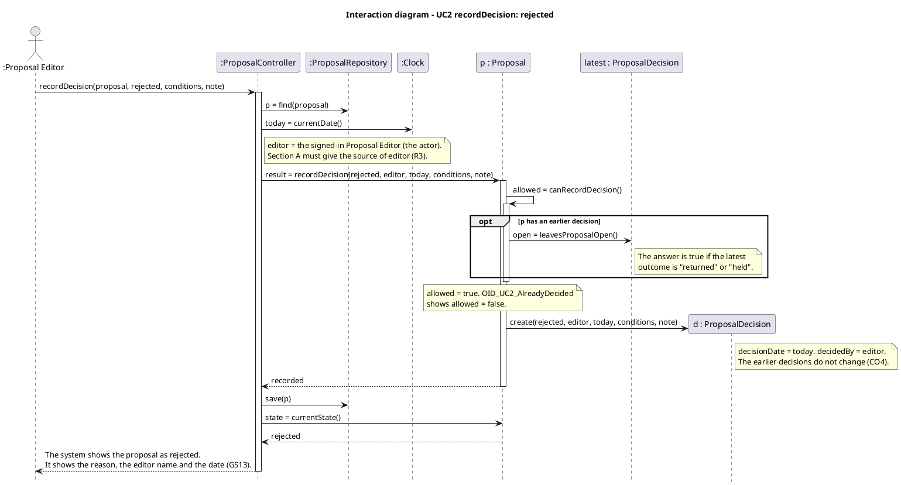

*Figure 17: Interaction diagram – UC2 recordDecision: rejected (GS13) (source: `Diagrams/Object_Interaction_Diagrams/OID_UC2_Rejected.puml`)*

### Alternative: returned for revision (GS14)

<a id="fig-18"></a>

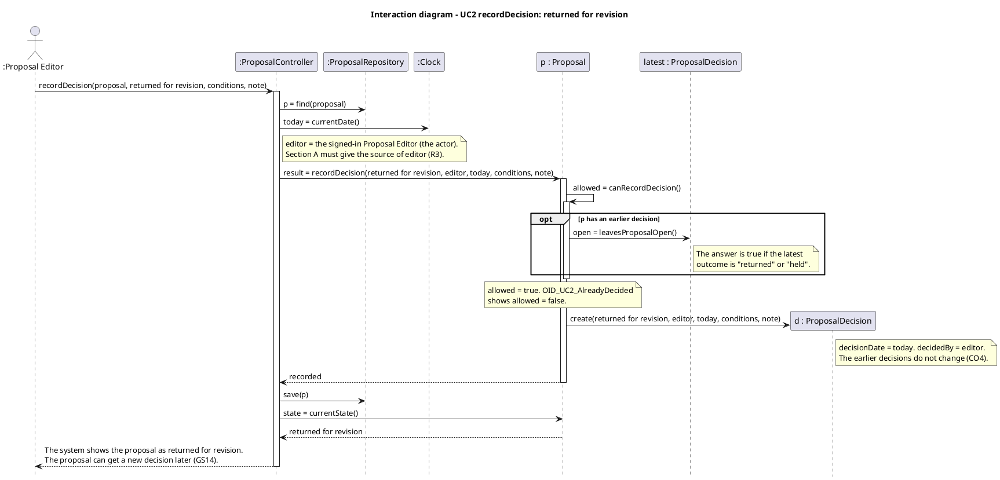

*Figure 18: Interaction diagram – UC2 recordDecision: returned for revision (GS14) (source: `Diagrams/Object_Interaction_Diagrams/OID_UC2_Returned.puml`)*

### Alternative: held for future consideration (GS15)

<a id="fig-19"></a>

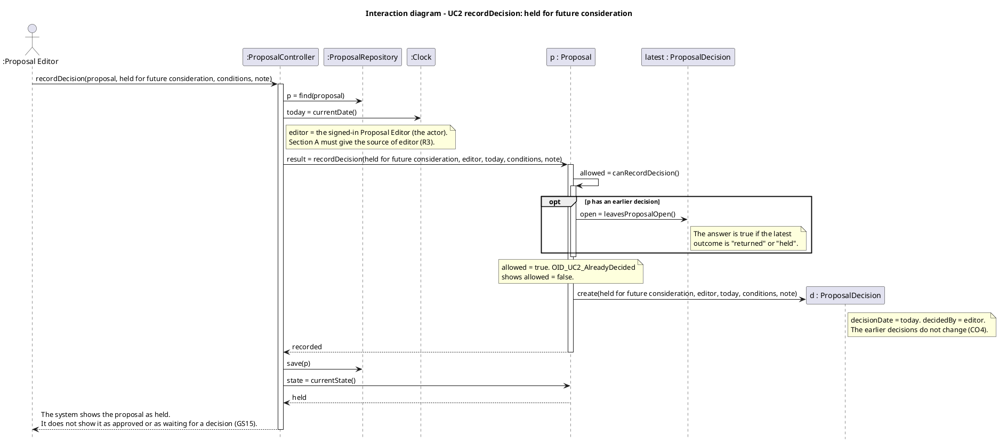

*Figure 19: Interaction diagram – UC2 recordDecision: held for future consideration (GS15) (source: `Diagrams/Object_Interaction_Diagrams/OID_UC2_Held.puml`)*

### Controlled failure: proposal already accepted or rejected (CO4)

<a id="fig-20"></a>

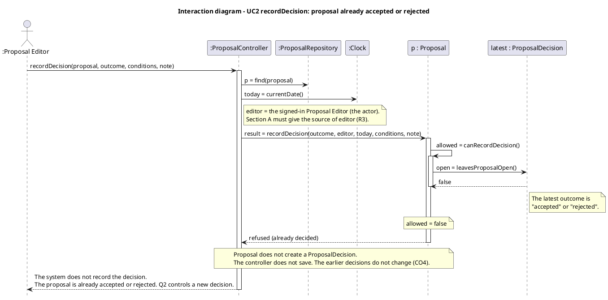

*Figure 20: Interaction diagram – UC2 recordDecision: proposal already accepted or rejected (CO4 controlled failure) (source: `Diagrams/Object_Interaction_Diagrams/OID_UC2_AlreadyDecided.puml`)*

GS16 (the editor leaves without saving) sends no system event, so it has no interaction diagram (SSD note for UC2, Section A).

<a id="uc2-dcd"></a>

## Design class diagram

> **Not in the repository at compile time.** Design class diagram for UC2 (#44, owner Jack). `Diagrams/Design_Class_Diagram/` holds a placeholder file only.

<a id="uc2-consistency"></a>

## Consistency check

> **Not in the repository at compile time.** Consistency check of the design class diagram, interaction diagrams and contracts (#45, owner Tsubasa). It depends on #36 and #44.

<a id="part-5"></a>

# Part 5 – Decisions and reviews

<a id="decision-log"></a>

## Group Decision Log (CA2)

*Source file: `Decisions_and_Reviews/Decision_Log/Decision_Log.md`*

Short dated records of significant group decisions. Each entry states the context, the decision, the reasoning and the consequences.

**Status values:** Proposed (drafted, not yet agreed) · Agreed (confirmed by the group) · Superseded (replaced by a later decision)

Identifiers such as FR, BR, UC, D and RD refer to the Scenario 29 CA1 dossier and the reconciliation record.


| ID     | Date       | Title                                                       | Status                        |
| ------ | ---------- | ----------------------------------------------------------- | ----------------------------- |
| DEC-01 | _02/11/26_ | Scenario 29 selected for CA2                                | Agreed (lecturer approved)    |
| DEC-02 | _02/11/26_ | GitHub Projects used as the group board                     | Agreed                        |
| DEC-03 | _04/11/26_ | Scope changes from lecturer instructions                    | Agreed (lecturer instruction) |
| DEC-04 | _09/11/26_ | Reconciliation decisions recorded separately                | Agreed                        |
| DEC-06 | _17/11/26_ | Gherkin scenario numbers allocated by section               | Agreed                        |
| DEC-07 | _18/11/26_ | Add the proposer to FR1                                     | Agreed                        |
| DEC-08 | _24/11/26_ | Add a note to ProposalDecision                              | Agreed                        |
| DEC-09 | _25/11/26_ | UC2 selected for detailed design; UC8 second if time allows | Agreed                        |

---

### DEC-01: Scenario 29 selected for CA2

- **Date:** _02/11/26_ · Lecturer approval: _02/11/26_
- **Context:** Each member proposed their CA1 scenario: 29 Local Podcast Production Service (Rani), 31 KETCo (Arno), 11 Atlantic Edge Experiences (Jack) and 36 Banking Operations (Tsubasa). The group compared them against scope, behavioural richness, OO potential, sliceability, testability and comparability.
- **Decision:** Scenario 29, Local Podcast Production Service, is the basis for all CA2 work.
- **Reasoning:** It has a clear and manageable boundary, connected workflows with alternative outcomes (decisions, reviews, corrections) and well-defined domain concepts. See the scenario suitability matrix.
- **Rejected alternatives:** Scenarios 31, 11 and 36. Reasons are recorded in the matrix.
- **Consequences:** All CA2 artefacts build on the Scenario 29 analysis. The other three CA1s are used for method, not content (reconciliation record, RD-14).
- **Evidence:** `Group_Documents/Scenario_Suitability_Matrix/` · issue #2

### DEC-02: GitHub Projects used as the group board

- **Date:** _02/11/26_
- **Context:** The brief names Trello or Microsoft Planner for the board. It also allows the authoritative backlog to be kept in GitHub Issues.
- **Decision:** Use GitHub Projects (kanban) with every backlog item as a GitHub issue, instead of Trello or Planner.
- **Reasoning:** Keeping the board, issues, commits and pull requests in one place lets each commit link to its card through the issue number. This makes progress and review easier to trace, and avoids keeping two tools in step.
- **Rejected alternatives:** Trello or Planner mirrored from GitHub Issues. Rejected because keeping two tools synchronised adds work without adding evidence.
- **Consequences:** Board columns follow the brief: Backlog, Ready, In Progress, Peer Review, Blocked, Done. Commit messages reference issue numbers, for example `(#6)`. Board captures are exported for submission. _Confirm with the lecturer that this is acceptable._
- **Evidence:** Project board · issue #5

### DEC-03: Scope changes from lecturer instructions

- **Date:** _04/11/26_
- **Context:** After scenario approval, the lecturer changed the assessment.
- **Decision:** The group follows these instructions:
  1. CA3 will not run, so no CA3 slice specifications are produced.
  2. Four artefacts are removed from CA2: architecture and integration contract, CA3 slice specifications, technology decision record, and project and contribution evidence.
  3. CA2 is now worth 30% of the module instead of 15%.
- **Reasoning:** Lecturer instruction.
- **Consequences:** The backlog card for architecture and integration contracts was deleted, and contribution evidence was removed from the walkthrough card. The implementation catalogue is ordered by value, dependency and risk instead of CA3 slices. The `Architecture/Integration_Contracts/` and `Individual_Contributions/` folders are no longer needed. _Ask the lecturer how the rubric marks for the removed artefacts are redistributed._
- **Evidence:** Reconciliation record, Section 3 (L2–L4)

### DEC-04: Reconciliation decisions recorded separately

- **Date:** _09/11/26_
- **Context:** Reconciling the CA1 analyses produced 19 decisions (RD-01 to RD-19), including corrections to the Scenario 29 analysis.
- **Decision:** The reconciliation record holds the RD decisions in full. This log does not repeat them. Once the group agrees them, add one line here: "RD-01 to RD-19 agreed on _11/11/26_, except _changes_."
- **Reasoning:** Avoids two copies of the same decisions drifting apart.
- **Consequences:** CA1 decisions D1, D2, D4, D5, D6, D8 and D10 carry forward (RD-03). From now on, new design decisions are logged here, for example controller choice, responsibility allocation and changes to the domain model.
- **Evidence:** `Group_Documents/Reconciliation_Record/CA1_Reconciliation_Record.md` · issue #6

### DEC-05: Q14 and Q15 resolved by group decision

- **Date:** _13/11/26_
- **Context:** Reconciliation found two gaps in the scenario. BR5 says a draft can be blocked by an outstanding "contributor confirmation" (Q14) or "editorial decision" (Q15), and the scenario defines neither. The brief asks for questions to be recorded; it does not require them to be sent to the lecturer.
- **Decision:** The group adopts two design assumptions instead of waiting for an answer:
  1. Contributor confirmation means an outstanding Consent for a Contribution on the draft's episode (RD-05).
  2. An editorial decision is outstanding only when a draft was returned for changes and has not been reviewed again (RD-06). An unreviewed or postponed draft is not shown as Blocked, but it cannot be published without approval.
- **Reasoning:** Both readings fit the existing domain model and business rules, so no new class or policy is invented. The design can go ahead without depending on an external answer.
- **Rejected alternatives:** Waiting for lecturer clarification before designing UC8. Rejected because it would block the design work, and the assumptions are easy to reverse.
- **Consequences:** BR5 and the glossary are reworded in the analysis baseline. Q14 and Q15 stay in the clarification-question register marked as resolved by this decision. Revisit if the lecturer or an expansion brief says otherwise.
- **Evidence:** Reconciliation record, RD-05, RD-06 and Section 7 · issue #6

### DEC-06: Gherkin scenario numbers allocated by section

- **Date:** _17/11/26_
- **Context:** Each section writes its Gherkin scenarios in its own feature file. If sections number scenarios independently, the numbers clash when the files are consolidated (#20).
- **Decision:** CA1 scenarios GS1–GS5 keep their numbers. Each section uses its own block:
  - Section A (Proposal management): GS10–GS19
  - Section B (Contributors and consent): GS20–GS29
  - Section D (Review and publication): GS30–GS39
  - Section C (Recording and drafts): GS40–GS49
- **Reasoning:** Fixed blocks let each section work independently without checking anyone else's numbers. Section D had already started at GS30, so the blocks were arranged around it.
- **Rejected alternatives:** Numbering scenarios one after another across all files. Rejected because sections work in parallel and would clash.
- **Consequences:** Recorded in baseline Section 7. A section needing more than ten scenarios asks the group for a further block.
- **Evidence:** Analysis baseline Section 7 (#7) · feature files in `Requirements_and_Gherkin/Feature_Files/`

### DEC-07: Add the proposer to FR1

- **Date:** _18/11/26_
- **Context:** The scenario says programmes may be proposed by staff, volunteers or partner organisations, and partners want progress on their proposals. The domain model records the proposer (`proposedBy`, *PartnerOrganisation proposes Proposal*), but FR1 does not ask for it.
- **Decision (proposed):** Reword FR1 to include who proposed the programme (staff member, volunteer or partner organisation).
- **Reasoning:** Gives the existing model attribute and association a requirement behind them, and supports partner progress information.
- **Consequences:** If agreed, update FR1 in the baseline (#7). GS10 keeps its proposer step. If rejected, remove that step from GS10.
- **Evidence:** Section A review (#11) · reviewed by Tsubasa

### DEC-08: Add a note to ProposalDecision

- **Date:** _24/11/26_
- **Context:** UC2 records a reason for rejection, what needs revising, or when to look again (GS13, GS14, GS15). `ProposalDecision` only has `conditions`, which apply to an acceptance.
- **Decision (proposed):** Add a `note` attribute to `ProposalDecision`.
- **Reasoning:** Keeps conditions and explanatory notes separate, so the operation contract for `recordDecision` matches the model.
- **Consequences:** Domain model (#8) and baseline Section 9.1 updated. CO4 already uses it.
- **Evidence:** Section A operation contracts (#21)

### DEC-09: UC2 selected for detailed design; UC8 second if time allows

- **Date:** _25/11/26_
- **Context:** The lecturer limited detailed design to one or two use cases: one in full detail first, a second only if time allows (reconciliation record L6).
- **Decision:** UC2 (Record a proposal decision) is taken through detailed design: object-interaction diagrams and the design class diagram. UC8 (Review a draft) is the second use case if time allows.
- **Reasoning:**
  - UC2 addresses the scenario's clearest problem: an encouraging discussion mistaken for approval (BR1).
  - It has rich behaviour: four outcomes (BR2) plus controlled failures, giving the interaction diagrams real alternatives.
  - It is the most complete: detailed use case, SSD, contracts (CO4), CRC cards, GRASP and seven Gherkin scenarios already exist.
  - Its scope (four to five classes) allows full depth.
  - Proposed independently by two members (Rani and Tsubasa).
- **Rejected alternatives:**
  - UC8 first: it addresses the blocked-draft problem (BR5) and links Sections B, C and D, but it spans more classes and rules, so it is kept as the second choice.
  - Other use cases: less behaviour (UC1, UC9) or still open questions (UC10, Q6).
- **Consequences:** Per-section interaction-diagram cards are replaced by shared UC2 cards. The implementation catalogue (#9) records the priorities. SSDs and contracts already produced for other use cases remain as analysis evidence.
- **Evidence:** Reconciliation record L6 · Section A CRC and GRASP (#28, #32) · implementation catalogue (#9)

<a id="review-record-b"></a>

## Review record: Section B design, UC2 interaction diagrams and #43 integration

*Source file: `Individual_Contributions/Implementation_Catalogue/Section_B_Contributors_Arno/Review Issue – Section B, UC2 and #43.md`*

**Author:** Arno (@JanArnoCoetzer)
**Related issues:** #12, #16, #22, #29, #37, #40, #43, #44
**Review issue:** #50

### What is done


| Item                                                                                                                  | Issue    | Location                                                            |
| --------------------------------------------------------------------------------------------------------------------- | -------- | ------------------------------------------------------------------- |
| Requirements review for FR4, FR5, NFR1, BR5, BR6, BR7, C5, A2, A5 and A6                                              | #12      | `CA2_Section_B.md#requirements-review`                              |
| Gherkin scenarios GS20 to GS25 (DEC-06)                                                                               | #16      | `Section_B_Contributors_Arno/Features/contributors-consent.feature` |
| CRC cards for Contributor, Contribution, Consent, ConsentForm, ContributorConsentController and ContributorRepository | #29      | `CA2_Section_B.md#crc-cards`                                        |
| GRASP justification, rejected alternatives and operation-to-responsibility map                                        | #29, #33 | `CA2_Section_B.md#grasp-justification`                              |
| Access and permission responsibilities (agreed rules only)                                                            | #40      | `CA2_Section_B.md#access-and-permission-responsibilities`           |
| Outstanding questions for the client                                                                                  | #12      | `CA2_Section_B.md#outstanding-questions`                            |
| UC2 interaction diagrams: rejected, returned, held and already decided                                                | #37      | `Diagrams/Object_Interaction_Diagrams/OID_UC2_*.puml` and `.png`    |
| Integrated CRC card index and cross-section changes 3.1 to 3.8                                                        | #43      | `Object_Oriented_Design/CRC_Cards/integrated-crc-cards.md`          |
| Controller pattern decision (proposed DEC-10)                                                                         | #43      | `Object_Oriented_Design/GRASP/controller-pattern-decision.md`       |

All Section B paths start at `Individual_Contributions/Implementation_Catalogue/Section_B_Contributors_Arno/`.

### Not done yet

- #22: SSDs for UC3 and UC4, and operation contracts CB1 to CB3.
- #20: copy the Section B feature file to `Requirements_and_Gherkin/Feature_Files/`.
- New issue: add `evidenceLocation` to Consent in the domain model.

### How to review

1. Find the items with your name in the table below.
2. Write one comment for each item in the issue in the "Issue" column. Start the comment with the item number, for example "R6: agreed".
3. Use one of these results: **Agreed**, **Agreed with changes** (write the change) or **Not agreed** (write the reason).
4. Put a tick in the checklist when the item is closed.

### Review items


| #   | Reviewer                      | Item                                                                                                                                                                                  | Where                                                  | Issue              |
| --- | ----------------------------- | ------------------------------------------------------------------------------------------------------------------------------------------------------------------------------------- | ------------------------------------------------------ | ------------------ |
| R1  | @Rani-Wheeza                  | Add the row "Create and keep its contributions" to the Episode card. Episode creates Contribution.                                                                                    | CRC Cards, Episode rows; #43 change 3.5                | #29, #43, #28      |
| R2  | @Rani-Wheeza                  | Add the row`hasOutstandingConsent()` to the Episode card.                                                                                                                             | CRC Cards, Episode rows; #43 changes 3.2 and 3.5       | #29, #43, #28      |
| R3  | @Rani-Wheeza                  | Make sure that the UC2 interaction diagrams agree with CO4, the Section A CRC cards and the UC2 main flow. Make sure that`leavesProposalOpen()` and the "refused" result are correct. | `OID_UC2_*.puml`                                       | #37, #36, #21      |
| R4  | @Rani-Wheeza, @Jack-O-Mahoney | Do we add a shared`EpisodeRepository`, or find episodes through Proposal?                                                                                                             | #43 change 3.6                                         | #43, #28           |
| R5  | @Rani-Wheeza, @TsubasaHMTU    | Use one shared`Clock` interface for all controllers.                                                                                                                                  | #43 change 3.4                                         | #43, #21, #24      |
| R6  | @TsubasaHMTU                  | Section D examines consent through`Episode.hasOutstandingConsent()`. Section D does not use Contribution.                                                                             | GRASP Justification, Low Coupling; #43 change 3.2      | #29, #43, #24, #31 |
| R7  | @TsubasaHMTU                  | The editor can see outstanding consent for the draft review (BR5, GS24).                                                                                                              | Access matrix, row "Outstanding consent"               | #40                |
| R8  | @Jack-O-Mahoney, @TsubasaHMTU | Make one Draft card. Section C owns it. Add the Section D rows to it.                                                                                                                 | #43 change 3.1                                         | #43, #30           |
| R9  | @Jack-O-Mahoney, @TsubasaHMTU | Section D asks Draft for outstanding permissions. Draft asks its Permissions.                                                                                                         | #43 change 3.3                                         | #43, #23, #30      |
| R10 | @Jack-O-Mahoney               | Agree the controller name RecordingDraftController. Add its card.                                                                                                                     | #43 change 3.7; controller pattern table               | #43, #30           |
| R11 | @Jack-O-Mahoney               | Add an EquipmentItem card, or make missing equipment an attribute of RecordingSession.                                                                                                | #43 change 3.8                                         | #43, #30           |
| R12 | All                           | Agree DEC-10: one controller for each section, plus a read-only ProductionOverviewController for UC11.                                                                                | `controller-pattern-decision.md`                       | #43, #25           |
| R13 | Peer reviewer (to be agreed)  | Do a full review of the Section B CRC cards and GRASP justification. Use the Definition of Done.                                                                                      | CRC Cards, GRASP Justification                         | #29                |
| R14 | All                           | Agree the list of client questions before Arno sends it to the lecturer.                                                                                                              | Outstanding Questions                                  | #12, new issue     |
| R15 | @Jack-O-Mahoney               | Peer review of the UC2 interaction diagrams. Make sure that the class and message names agree with the DCD.                                                                           | `OID_UC2_*.puml`                                       | #37, #44, #45      |
| R16 | @Rani-Wheeza                  | Peer review of the access responsibilities. Make sure that BR6, BR7 and NFR1 agree with the CA1 analysis.                                                                             | Access and Permission Responsibilities                 | #40                |
| R17 | @Rani-Wheeza                  | Peer review of the requirements review. Make sure that it agrees with the CA1 analysis.                                                                                               | Requirements Review                                    | #12                |
| R18 | @TsubasaHMTU                  | GS24 must use the same blocked and release words as GS3, GS4 and the Section D scenarios.                                                                                             | `contributors-consent.feature`, GS24                   | #16, #20, #26      |
| R19 | All                           | Agree the shared test data (names, episodes, dates and records).                                                                                                                      | Updated Gherkin Scenarios, Review decisions and limits | #20, #26           |
| R20 | @Rani-Wheeza                  | Agree the numbers CB1 to CB3 for the Section B operation contracts.                                                                                                                   | SSDs and contracts (in progress)                       | #22, #21, #24      |
| R21 | @Jack-O-Mahoney               | In the DCD, is the UC2 decision result an enumeration (DecisionResult) or a boolean?                                                                                                  | `OID_UC2_AlreadyDecided.puml`                          | #44, #45           |

### Checklist

- [ ]  R1 Episode creates Contribution
- [ ]  R2 Episode.hasOutstandingConsent()
- [ ]  R3 UC2 interaction diagrams agree with CO4
- [ ]  R4 EpisodeRepository
- [ ]  R5 Shared Clock
- [ ]  R6 Section D examines consent through Episode
- [ ]  R7 Editor can see outstanding consent
- [ ]  R8 One Draft card
- [ ]  R9 Permission check through Draft
- [ ]  R10 Section C controller
- [ ]  R11 EquipmentItem
- [ ]  R12 DEC-10 controller pattern
- [ ]  R13 Full peer review of Section B
- [ ]  R14 Client questions
- [ ]  R15 OID and DCD names
- [ ]  R16 Access responsibilities against CA1
- [ ]  R17 Requirements review against CA1
- [ ]  R18 GS24 words
- [ ]  R19 Shared test data
- [ ]  R20 CB contract numbers
- [ ]  R21 DecisionResult in the DCD

### After the review

- Record each agreed decision in the decision log.
- Each owner changes their own section file.
- Close #12, #16, #29, #37, #40 and #43 when all of their items are closed.

<a id="review-records"></a>

## Iteration review and retrospective records

> **Not in the repository at compile time.** Review and retrospective records for iterations 1 to 4 (#10, #27, #46, #50). `Decisions_and_Reviews/Review_Records/` holds a placeholder file only.

<a id="ai-log"></a>

## AI interaction log

> **Not in the repository at compile time.** `Decisions_and_Reviews/AI_Interaction_Log/AI_Interaction_Log` exists and is empty (0 bytes). The Definition of Done asks for AI use to be recorded there, if AI was used.

<a id="appendices"></a>

# Appendices

<a id="app-features"></a>

## Appendix A – Feature files

The feature files are reproduced unchanged. Scenario number blocks follow DEC-06. GS1 to GS5 come from the CA1 feature file and keep their numbers.

<a id="app-feature-a"></a>

### Section A: `Section_A_Proposal.feature` (GS1, GS2, GS10–GS16)

```gherkin
Feature: Proposals and proposal decisions
  The collective needs one record of every proposal, however complete,
  and a recorded decision so that discussion is not mistaken for approval.

  # Links: FR1, FR2, FR3 | UC1, UC2 | BR1, BR2 | A6, A10, A13
  # GS1 and GS2 are kept from the CA1 feature. New scenarios use GS10-GS19.
  # GS10 records the proposer, which depends on the proposed FR1 update (DEC-07).
  # What is required before a decision (Q1) and reopening a decided
  # proposal after a significant change (Q2) stay open, so no scenario tests them.

  Rule: Every proposal is recorded, however complete it is (FR1, FR2)

    @FR1 @UC1 @success @GS10
    Scenario: A partner proposal is recorded with full details
      Given the partner "Dingle Heritage Group" proposes a programme about currach building
      When the production coordinator records the proposal with its subject, intended audience, format, expected duration, proposed contributors and preferred publication period
      Then the proposal is shown with each of those details
      And the proposal shows "Dingle Heritage Group" as the proposer
      And the proposal is shown as having no recorded decision

    @FR1 @UC1 @BR1 @boundary @GS11
    Scenario: A proposal that began as a short email is recorded with only a subject
      Given a volunteer has emailed an idea about the harbour festival
      When the production coordinator records a proposal with only the subject "Harbour festival sounds"
      Then the proposal is recorded
      And the intended audience, format, expected duration, proposed contributors and preferred publication period are shown as not yet known
      And the proposal is shown as having no recorded decision

    @FR2 @UC1 @success @GS12
    Scenario: A series proposal is recorded with its planned episodes
      Given the partner "Dingle Heritage Group" proposes a series about boat building
      When the production coordinator records the series with three planned episodes
      Then the proposal shows three planned episodes
      And each episode is linked to that one proposal

  Rule: A proposal is not approved until an editor's decision is recorded (BR1, BR2)

    @FR3 @UC2 @success @GS1
    Scenario: Proposal accepted with a condition
      Given the partner "Dingle Heritage Group" has proposed a series of three episodes about boat building
      And the proposal has no recorded decision
      When the proposal editor records the decision "accepted" with the condition "each episode is shortened to 25 minutes"
      Then the proposal is shown as accepted with that condition
      And the decision shows the editor's name and the date it was made

    @FR3 @FR12 @UC11 @BR1 @boundary @GS2
    Scenario: A proposal with no decision is distinguished from a held proposal and from an approved one
      Given the proposal "Dingle boat builders" has been discussed with its partner and has no recorded decision
      And the proposal "Harbour festival sounds" has been recorded as held for future consideration
      When the production coordinator views the production overview
      Then "Dingle boat builders" is listed as awaiting a decision
      And "Harbour festival sounds" is listed as held for future consideration
      And neither proposal is shown as approved

    @FR3 @UC2 @BR2 @alternative @GS13
    Scenario: Proposal editor rejects a proposal
      Given the proposal "Tralee shopfronts" has no recorded decision
      When the proposal editor records the decision "rejected" with the reason "outside the collective's current schedule"
      Then the proposal is shown as rejected
      And the decision shows the reason, the editor's name and the date
      And the proposal is not shown as approved

    @FR3 @UC2 @BR2 @alternative @GS14
    Scenario: A proposal returned for revision is later accepted and both decisions are kept
      Given the proposal "Dingle boat builders" was returned for revision with the note "name the proposed contributors"
      And the partner has since supplied the proposed contributors
      When the proposal editor records the decision "accepted"
      Then the proposal is shown as accepted
      And the earlier decision "returned for revision" is still on record with its note, editor's name and date

    @FR3 @UC2 @BR2 @alternative @GS15
    Scenario: Proposal editor holds a proposal for future consideration
      Given the proposal "Harbour festival sounds" has no recorded decision
      When the proposal editor records the decision "held for future consideration" with the note "revisit before next summer"
      Then the proposal is shown as held for future consideration
      And the proposal is not shown as awaiting a decision
      And the proposal is not shown as approved

    @FR3 @UC2 @BR1 @failure @GS16
    Scenario: No decision is recorded when the editor abandons recording it
      Given the proposal "Dingle boat builders" has been discussed with its partner and has no recorded decision
      When the proposal editor starts recording a decision but leaves without saving it
      Then no decision is recorded for the proposal
      And the proposal is still shown as having no recorded decision
      And the proposal is not shown as approved
```

<a id="app-feature-b"></a>

### Section B: `Section_B_Contributors.feature` (GS20–GS25)

```gherkin
Feature: Recording contributors and consent for an episode
  Staff need contributor roles and agreed credit to remain clear per episode, consent evidence to be traceable, and outstanding consent to be visible to the review workflow.

  CA2 Section B draft. FR4 and FR5 remain unchanged.
  Evidence references refer to Individual_Contributions/Implementation_Catalogue/Section_B_Contributors_Arno/Evidence_Document_Source_Material.md.
  "Agreed credit" corresponds to FR4's "agreed attribution".

  Rule: Contributor roles and agreed credit are retained for each contribution (FR4)

    # E15, E27, E29, E35.
    # Same-episode multi-role support is an explicit CA2 boundary case.
    # !!! This scenario does not decide whether one consent covers both roles. !!!

    @US3 @FR4 @UC3 @boundary @GS20
    Scenario: One contributor has two roles on the same episode
      Given the contributor "Aoife Murphy" is recorded once
      And "Aoife Murphy" contributes to "Episode 2: The Last Currach Builder" as "presenter" with agreed credit "Presented by Aoife Murphy"
      When the production coordinator records another contribution by "Aoife Murphy" to that episode as "performer" with agreed credit "Music performed by Aoife Murphy"
      Then the episode shows both contributions linked to the same contributor
      And the presenter contribution retains the agreed credit "Presented by Aoife Murphy"
      And the performer contribution retains the agreed credit "Music performed by Aoife Murphy"

    # E15, E29, E35. Includes contact preference and availability.

    @US3 @FR4 @UC3 @success @GS21
    Scenario: One contributor has different roles and credit across two episodes
      Given "Aoife Murphy" contributes to "Episode 2: The Last Currach Builder" as "interviewee" with agreed credit "Interview with Aoife Murphy"
      And the contributor's contact preference is "email"
      And the contributor's availability is "weekday evenings"
      When the production coordinator records "Aoife Murphy" as a "presenter" for "Episode 3: Harbour Memories" with agreed credit "Presented by Aoife Murphy"
      Then the contribution to "Episode 2: The Last Currach Builder" retains the role "interviewee" and agreed credit "Interview with Aoife Murphy"
      And the contribution to "Episode 3: Harbour Memories" retains the role "presenter" and agreed credit "Presented by Aoife Murphy"
      And the contributor's contact preference remains "email"
      And the contributor's availability remains "weekday evenings"
      And both contributions link to the same contributor

  Rule: Each recorded consent retains its form, intended use, date and evidence location (FR5, C5)

    # E16, E19, E20 (A2), E36.
    # Each example is independent and starts with no recorded consent.

    @US4 @FR5 @UC4 @C5 @success @GS22
    Scenario Outline: Consent and its evidence are recorded in each supported form
      Given "Aoife Murphy" contributes as an "interviewee" to "Episode 2: The Last Currach Builder"
      And no consent has yet been recorded for that contribution
      And the contributor gave consent by "<form>" for "publication of this interview on the podcast feed" on "10 November 2026"
      And the evidence is held at "<evidence location>"
      When the production coordinator records that consent
      Then the consent is associated with "Aoife Murphy" and "Episode 2: The Last Currach Builder"
      And the recorded consent form is "<form>"
      And the recorded intended use is "publication of this interview on the podcast feed"
      And the recorded date consent was given is "10 November 2026"
      And the recorded evidence location is "<evidence location>"

      Examples:
        | form                               | evidence location                                     |
        | paper                              | Consent cabinet, folder EP2, form AM-01               |
        | email                              | Production mailbox, message EP2-AM-2026-11-10         |
        | verbal at the start of a recording | Recordings/EP2/interview-AM.wav, 00:00:00 to 00:00:25 |

    # E16, E19, E20 (A2), E36.
    # Proposed date interpretation: FR5's date is when consent was given,
    # consistent with dateGiven in E29, not when staff enter it.

    @US4 @FR5 @UC4 @C5 @alternative @GS23
    Scenario: Consent already given is entered into the system later
      Given "Aoife Murphy" contributes as an "interviewee" to "Episode 2: The Last Currach Builder"
      And the contributor gave paper consent on "10 November 2026" for "publication of this interview on the podcast feed"
      And the signed evidence is held at "Consent cabinet, folder EP2, form AM-01"
      And that consent has not yet been entered into the system
      When the production coordinator records the consent on "12 November 2026"
      Then the recorded consent form is "paper"
      And the recorded intended use is "publication of this interview on the podcast feed"
      And the recorded date consent was given is "10 November 2026"
      And the recorded evidence location is "Consent cabinet, folder EP2, form AM-01"

  Rule: A draft is not released while required contributor consent is outstanding (E4)

    # E18, E25, E26; aligned with CA1 GS4's observable blocking outcome.
    # Cross-section scenario: consent information comes from Section B;
    # the authorised editor and release decision remain in Section D.

    @US4 @US8 @US11 @FR5 @FR9 @FR12 @UC4 @UC8 @UC11 @BR5 @failure @GS24
    Scenario: Technically complete draft blocked by outstanding contributor consent
      Given the draft "Episode 2: The Last Currach Builder" is complete and edited
      And "Aoife Murphy" has contributed an interview that is included in the draft
      And the required consent for that interview is still outstanding
      And all other contributor consents for the episode are confirmed
      And the permission for its archive clip is recorded as granted
      And no other permission or editorial decision is outstanding
      When the authorised editor reviews the draft for publication
      Then the draft is not released for publication
      And the draft is shown as blocked by the outstanding contributor consent
      And the production coordinator's overview identifies the outstanding consent for "Aoife Murphy"

  Rule: Provided partner and volunteer views do not display internal editorial notes (NFR1, BR6, BR7)

    # E17, E18, E37. Conditional: this does not require either view to exist.
    # @conditional is a classification tag, not an automatic test skip.
    # The test runner must select this coverage only for provided views.
    # Contributor details/private correspondence need agreed Q7 permissions.

    @US12 @NFR1 @BR6 @BR7 @conditional @success @GS25
    Scenario Outline: A provided restricted view excludes internal editorial notes
      Given a "<view>" is provided for "Episode 2: The Last Currach Builder"
      And the episode has an internal editorial note "Internal discussion about the interview edit"
      When the "<view>" is displayed
      Then no internal editorial note is displayed in that view

      Examples:
        | view           |
        | partner view   |
        | volunteer view |
```

<a id="app-feature-c"></a>

### Section C: `Section_C_Recording.feature` (GS40–GS49)

> **Not in the repository at compile time.** The analysis baseline (7) lists `Feature_Files/Section_C_Recording.feature`. The file does not exist. GS40 to GS46 are described in the scenario table in [Section C](#section-c), Task #17.

<a id="app-feature-d"></a>

### Section D: `Section_D_Review.feature` (GS3–GS5, GS30–GS36)

```gherkin
Feature: Review, publication and correction
  The collective needs a record of draft reviews, publication dates
  and corrections after publication.

  # Links: FR8, FR9, FR10, FR11 | UC8, UC9, UC10 | BR3, BR4, BR5, BR8
  # GS3, GS4 and GS5 are kept from the CA1 feature.
  # New scenarios start at GS30. 
  # Postponed and withdrawn are recorded as review outcomes (FR9, BR4).
  # What happens after a withdrawal request, a correction or a replacement stays open (Q6).

  Rule: A draft is released only when an authorised editor has approved it and nothing is outstanding (BR3, BR5)

    @FR9 @UC8 @BR3 @success @GS3
    Scenario: Authorised editor approves a reviewed draft with nothing outstanding
      Given the draft "Episode 2: The Last Currach Builder" is awaiting review
      And every contributor consent for the episode is confirmed
      And the permission for the archive clip in the draft is recorded as granted
      When the authorised editor reviews the draft and approves it for the "podcast feed" channel
      Then the draft is recorded as approved for that channel with the editor's name and the date
      And the draft is shown as ready to be scheduled

    @FR8 @FR9 @FR12 @UC8 @BR5 @failure @GS4
    Scenario: Technically complete draft blocked by an outstanding permission
      Given the draft "Episode 2: The Last Currach Builder" is complete and edited
      And the permission for its archive clip is still outstanding
      When the authorised editor reviews the draft for publication
      Then the draft is not released for publication
      And the draft is shown as blocked by the outstanding archive clip permission

    @FR9 @UC8 @BR3 @boundary @GS30
    Scenario: A draft with nothing outstanding is not approved automatically
      Given the draft "Episode 2: The Last Currach Builder" is awaiting review
      And every contributor consent for the episode is confirmed
      And the permission for the archive clip in the draft is recorded as granted
      And no review outcome has been recorded
      When the production coordinator views the draft
      Then the draft is shown as awaiting review
      And the draft is not shown as approved
      And the draft is not shown as ready to be scheduled

    @FR9 @UC8 @BR4 @BR5 @alternative @GS31
    Scenario: Authorised editor returns a draft for changes
      Given the draft "Episode 2: The Last Currach Builder" is awaiting review
      When the authorised editor records the outcome "returned for changes" with the comment "shorten the introduction"
      Then the draft is shown as returned for changes
      And the comment, the editor's name and the date are kept against that draft
      And the draft is shown as blocked by an outstanding editorial decision
      And the draft is not shown as approved
      And the draft is not shown as ready to be scheduled

    @FR9 @UC8 @BR4 @alternative @GS32
    Scenario: Authorised editor postpones a draft
      Given the draft "Episode 2: The Last Currach Builder" is awaiting review
      When the authorised editor records the outcome "postponed" with the comment "wait for the partner's photographs"
      Then the draft is shown as postponed
      And the comment, the editor's name and the date are kept against that draft
      And the draft is not shown as approved
      And the draft is not shown as ready to be scheduled

    @FR9 @UC8 @BR4 @alternative @GS33
    Scenario: Authorised editor records a draft as withdrawn
      Given the draft "Episode 2: The Last Currach Builder" is awaiting review
      When the authorised editor records the outcome "withdrawn" with the comment "drop this episode from the series"
      Then the draft is shown as withdrawn
      And the comment, the editor's name and the date are kept against that draft
      And the draft is not shown as approved
      And the draft is not shown as ready to be scheduled

  Rule: An approved episode keeps a publication date and channel (FR10)

    @FR10 @UC9 @success @GS34
    Scenario: Publication date and channel are recorded
      Given the draft "Episode 2: The Last Currach Builder" is approved for the "podcast feed" channel
      And the draft is ready to be scheduled
      When the production coordinator records 14 November as the publication date for that channel
      Then the episode is shown as scheduled for 14 November on the "podcast feed" channel

  Rule: A change to a publication date keeps its reason (FR10)

    @FR10 @UC9 @alternative @GS5
    Scenario: Publication date moved because another programme is urgent
      Given the episode "Episode 2: The Last Currach Builder" is scheduled for 14 November on the "podcast feed" channel
      When the production coordinator moves the date to 28 November because another programme has become urgent
      Then the episode is shown as scheduled for 28 November on the "podcast feed" channel
      And the record shows the earlier date of 14 November and the reason "another programme has become urgent"

  # UC9 has no failure scenario. FR10 records a date, a channel and the reason
  # for a change. No rule says the system rejects a publication date.

  Rule: A metadata correction can be distinguished from a new audio version (BR8)

    @FR11 @UC10 @BR8 @success @GS35
    Scenario: A metadata correction stays linked to the original publication
      Given the episode "Episode 2: The Last Currach Builder" is published on the "podcast feed" channel
      When the authorised editor records a metadata correction linked to that publication
      Then the correction is linked to the original publication
      And the correction is shown as a metadata correction
      And the correction is not shown as a new audio version
      And the correction shows the editor's name and the date

    @FR11 @UC10 @BR8 @success @GS36
    Scenario: A new audio version stays linked to the original publication
      Given the episode "Episode 2: The Last Currach Builder" is published on the "podcast feed" channel
      When the authorised editor records a new audio version linked to that publication
      Then the new audio version is linked to the original publication
      And the new audio version is shown as a new audio version
      And the new audio version is not shown as a metadata correction
      And the new audio version shows the editor's name and the date

  # UC10 has no failure scenario. Q6 leaves the handling of a correction or
  # replacement open, so the scenario above only records the distinction (FR11, BR8).
```

<a id="app-evidence"></a>

## Appendix B – Evidence documents

Sections B and D cite verbatim CA1 source material by evidence ID (E1–E39 and ED01–ED41). Both registers are reproduced in full.

<a id="app-evidence-b"></a>

### Evidence document – CA1 source material for Section B

*Source file: `Individual_Contributions/Implementation_Catalogue/Section_B_Contributors_Arno/Evidence_Document_Source_Material.md`*

Supporting register for: CA2 Section B — Contributors and Consent (Arno Coetzer, Member 2)

This register holds every item of Rani Wheeza’s CA1 analysis dossier material that Section B relies on, quoted verbatim.

Each item has an evidence ID (E1 to E39). So the main document stays short and every claim in it can be checked against a source. Source references are to sections of Report/CA1_Analysis_Dossier.md file names refer to the CA1 repository.

**1. Problem and outcomes (Dossier 1)**


| **ID** | **Verbatim evidence**                                                                                                                                                                                                                                                                                                                                                                                                                                                                                                                                                                                                                                                                                                                                                               | **Source** | **Section B use**                                               |
| ------ | ----------------------------------------------------------------------------------------------------------------------------------------------------------------------------------------------------------------------------------------------------------------------------------------------------------------------------------------------------------------------------------------------------------------------------------------------------------------------------------------------------------------------------------------------------------------------------------------------------------------------------------------------------------------------------------------------------------------------------------------------------------------------------------- | ---------- | --------------------------------------------------------------- |
| E1     | Proposals, contributor details, bookings, audio files, review notes and publication information are spread across email, shared folders, calendars and paper consent forms. The production coordinator needs reliable information about proposals awaiting decisions, upcoming sessions, equipment needs, missing consent or permissions, drafts awaiting review and scheduled publication, and this is hard to assemble from scattered sources. The collective also wants editorial discussion and sensitive contributor information restricted by role. The scenario confirms this as an organisational need. It does not establish that a privacy breach has occurred, nor how often any problem happens. The problem is information and coordination, not a lack of technology. | §1.2      | Base problem statement quoted in Section 1 of the main document |
| E2     | Consent and review comments are recorded in several places. Consent on paper, by email or at the start of a recording; comments in separate email thread. (P4)                                                                                                                                                                                                                                                                                                                                                                                                                                                                                                                                                                                                                      | §1.3      | Consent scatter evidence for the Section B extension            |
| E3     | Consent recorded in three different forms (P4): before publication, someone must check paper forms, emails and the start of recordings separately, and may find it harder to tell whether a draft is actually cleared. Confirmed: consent can be recorded on paper, by email or at the start of a recording, and a draft can be blocked by outstanding contributor confirmation. Inferred: scattered consent records make it harder to tell whether a draft is cleared.                                                                                                                                                                                                                                                                                                             | §1.3      | The checking-burden consequence in the extension                |
| E4     | A finished draft is blocked. A permission, contributor confirmation or editorial decision may be outstanding. (P6)                                                                                                                                                                                                                                                                                                                                                                                                                                                                                                                                                                                                                                                                  | §1.3      | Contributor confirmation as a blocker (BR5)                     |
| E5     | Sensitive material may be seen by the wrong people. Partners should not automatically see internal editorial notes; volunteers should not see private correspondence. (P9)                                                                                                                                                                                                                                                                                                                                                                                                                                                                                                                                                                                                          | §1.3      | Access restriction evidence for Section 6                       |
| E6     | Publication readiness: staff can tell whether an episode is ready to publish and, if not, which consent, permission or decision is missing. (P4, P6)\| Information access: people see the information their production role needs. Partners can learn progress without seeing internal editorial notes, and volunteers do not see private correspondence. (P9)                                                                                                                                                                                                                                                                                                                                                                                                                      | §1.4      | Desired outcomes Section B serves                               |
| E7     | Contributors also need to know how their recording will be used and credited, and partners need progress information. These stakeholder needs shape the outcomes above even though the people themselves do not use the system (Section 3).                                                                                                                                                                                                                                                                                                                                                                                                                                                                                                                                         | §1.4      | Contributors’ own need — basis of G10/G14                     |
| E8     | A clarification is required to determine when new consent is needed for reuse, substantial editing or an additional channel (Q3).                                                                                                                                                                                                                                                                                                                                                                                                                                                                                                                                                                                                                                                   | §1.5      | Open question carried into Section 7                            |

**2. Scope (Dossier 2)**


| **ID** | **Verbatim evidence**                                                                                                                                                                                                                                                                                                                                                           | **Source** | **Section B use**                       |
| ------ | ------------------------------------------------------------------------------------------------------------------------------------------------------------------------------------------------------------------------------------------------------------------------------------------------------------------------------------------------------------------------------- | ---------- | --------------------------------------- |
| E9     | S2: Contributors, their roles per episode, contact preferences, availability and agreed attribution.\| S3: Consent: in what form it was given (paper, email or at the start of a recording), for what intended use, and where the evidence is held. \| S11: Access restricted by production role, including progress information for partners without internal editorial notes. | §2.2      | The in-scope items Section B implements |

**3. Stakeholders, actors and goals (Dossier 3)**


| **ID** | **Verbatim evidence**                                                                                                                                                                                                                                                                                                  | **Source** | **Section B use**                          |
| ------ | ---------------------------------------------------------------------------------------------------------------------------------------------------------------------------------------------------------------------------------------------------------------------------------------------------------------------- | ---------- | ------------------------------------------ |
| E10    | Contributors — Indirect stakeholder. Goal or interest: know where their recording appears, how they are credited and how it will be used. Main concern: unclear consent, use or credit. Influence: Medium. Consent and attribution requirements come from them; missing confirmation can block a draft.               | §3.1      | Stakeholder grounding for Section 1        |
| E11    | Contributor — Offstage stakeholder. Direct access is unresolved, so staff record their information (A5, Q9).                                                                                                                                                                                                          | §3.2      | Why staff record contributor data (A5)     |
| E12    | Roles are responsibilities, not job titles. One person may hold several, and the model assumes no staffing structure. If partners or contributors turn out to log in, they become supporting actors. Offstage stakeholders still shape the requirements: partners drive FR10 and NFR1, contributors drive FR4 and FR5. | §3.2      | Basis of the Contributor CRC card boundary |
| E13    | G10: Production coordinator — record a contributor’s consent, its form and intended use (Provisional, Q10).\| G14: Production coordinator — maintain contributor and episode details; same person in several roles; credit and contact details (Provisional).                                                       | §3.3      | Goals UC3 and UC4 implement                |
| E14    | Two goals are deferred and have no use case by design. G2, reconsidering an approved proposal after a significant change, waits on Q2. G11, recording a contributor’s concern and the decision on it, is outside the first release (Section 2.3, Q11).                                                                | §3.3      | Why contributor concerns are out of scope  |

**4. Requirements (Dossier 4)**


| **ID** | **Verbatim evidence**                                                                                                                                                                                                                                                                                                                                                                                                                                                 | **Source** | **Section B use**                                              |
| ------ | --------------------------------------------------------------------------------------------------------------------------------------------------------------------------------------------------------------------------------------------------------------------------------------------------------------------------------------------------------------------------------------------------------------------------------------------------------------------- | ---------- | -------------------------------------------------------------- |
| E15    | FR4 (Must): the system shall allow staff to record each contributor’s role in an episode, with contact preferences, availability and agreed attribution. Source: the same person may take different roles in several episodes; contributors want to know their credit. Verification: record one contributor in two roles on two episodes; check both retain their own attribution. Links: S2, G14, UC3.                                                              | §4.2      | Requirement behind Contributor/Contribution cards and GS6–GS7 |
| E16    | FR5 (Must): the system shall allow staff to record a contributor’s consent for an episode, including the form in which it was given (paper, email or verbal at the start of a recording), the intended use, the date, and where the evidence is held. Source: consent arrives in three forms; contributors should understand intended use. Verification: record one consent in each form; check form, use, date and evidence location are kept. Links: S3, G10, UC4. | §4.2      | Requirement behind the Consent card and GS8–GS10              |
| E17    | NFR1 (Must): access — where a partner or volunteer view is provided, no internal editorial note shall be displayed in it. Basis: partners should not automatically see internal notes; access reflects production roles (BR6, BR7). Conditional because direct access is unresolved (Q9). Verification: create sample internal notes and test the partner and volunteer views; pass only if none appears.                                                            | §4.3      | Access requirement for Section 6 and GS11                      |

**5. Rules, constraints, assumptions, risks, questions (Dossier 5)**


| **ID** | **Verbatim evidence**                                                                                                                                                                                                                                                                                                                                                                                                      | **Source** | **Section B use**                                        |
| ------ | -------------------------------------------------------------------------------------------------------------------------------------------------------------------------------------------------------------------------------------------------------------------------------------------------------------------------------------------------------------------------------------------------------------------------- | ---------- | -------------------------------------------------------- |
| E18    | BR5: a draft with an outstanding permission, contributor confirmation or editorial decision is blocked from publication (Stated).\| BR6: access to information reflects production roles (Stated). \| BR7: partners do not automatically see internal editorial notes (Stated).                                                                                                                                            | §5.1      | Business rules the Gherkin and CRC design must respect   |
| E19    | C2: access should reflect production roles.\| C5: consent may be recorded on paper, by email or at the start of a recording.                                                                                                                                                                                                                                                                                               | §5.2      | Constraints cited in the extension and scenarios         |
| E20    | A2: paper consent forms remain in use; the system records that consent exists and where the evidence is held (FR5).\| A5: staff enter information on behalf of partners and contributors, who are offstage stakeholders (Actors). \| A6: the production coordinator records proposals, contributors and consent (UC1, UC3, UC4).                                                                                           | §5.3      | Assumptions the Controller reasoning builds on           |
| E21    | R2: consent renewal is handled inconsistently — an episode could be reused or republished without valid consent.\| R3: paper consent forms stay outside the record — the record may look complete when it is not. \| R5: sensitive contributor information is exposed through wrong access — privacy harm and loss of contributor trust.                                                                                | §5.4      | Risks motivating GS9 and the evidence-location attribute |
| E22    | Q3: when is new consent required for reuse, substantial editing or an additional channel? (FR5, R2)\| Q7: what may volunteers, contributors and partners see? (BR6, BR7, NFR1) \| Q9: do partners and contributors use the system directly? (A3, A5, actors) \| Q10: who records consent and proposals? (A6) \| Q11: how should contributor concerns be recorded and who may see them? (Deferred requirement and use case) | §5.5      | Outstanding questions for Section 7                      |

**6. Use cases (Dossier 6)**


| **ID** | **Verbatim evidence**                                                                                                                                                                                                                                                                                                                                                                     | **Source** | **Section B use**                        |
| ------ | ----------------------------------------------------------------------------------------------------------------------------------------------------------------------------------------------------------------------------------------------------------------------------------------------------------------------------------------------------------------------------------------- | ---------- | ---------------------------------------- |
| E23    | UC3: maintain contributor and episode details — initiating actor: production coordinator (G14, FR4).\| UC4: record contributor consent and its evidence, including form and intended use — initiating actor: production coordinator (G10, FR5).                                                                                                                                         | §6.2      | The two use cases Section B owns         |
| E24    | Who records proposals and consent (UC1, UC4) is an assumption. The scenario does not say, so both go to the production coordinator (A5, A6).\| Reconsideration and contributor concerns are not use cases. Reconsideration waits on Q2. Contributor concerns are deferred because a use case would require inventing handling policy (Q11). This is a scoping decision, not an oversight. | §6.4      | Controller assignment and scope boundary |
| E25    | Blocked: a permission, contributor confirmation or editorial decision is outstanding, so the draft cannot be released (BR5). Recorded by FR5, FR8, FR9.                                                                                                                                                                                                                                   | §6.4      | Draft-state vocabulary GS10 must match   |

**7. Gherkin (Dossier 7)**


| **ID** | **Verbatim evidence**                                                                                                                                                                                                                                                                                                                                                                                                                                                                                                                                     | **Source**                     | **Section B use**                                                            |
| ------ | --------------------------------------------------------------------------------------------------------------------------------------------------------------------------------------------------------------------------------------------------------------------------------------------------------------------------------------------------------------------------------------------------------------------------------------------------------------------------------------------------------------------------------------------------------- | ------------------------------ | ---------------------------------------------------------------------------- |
| E26    | GS3, Scenario: authorised editor approves a reviewed draft with nothing outstanding — Given the draft “Episode 2: The Last Currach Builder” is awaiting review, and every contributor consent for the episode is confirmed, and the permission for the archive clip in the draft is recorded as granted; when the authorised editor reviews the draft and approves it for the “podcast feed” channel; then the draft is recorded as approved for that channel with the editor’s name and the date, and the draft is shown as ready to be scheduled. | §7, production_record.feature | The only existing consent scenario — GS6–GS11 must stay consistent with it |

**8. Concepts and domain model (Dossier 8–9)**


| **ID** | **Verbatim evidence**                                                                                                                                                                                                                                                                                                                                                                                                                                                                                                                                                                                                                                               | **Source** | **Section B use**                                            |
| ------ | ------------------------------------------------------------------------------------------------------------------------------------------------------------------------------------------------------------------------------------------------------------------------------------------------------------------------------------------------------------------------------------------------------------------------------------------------------------------------------------------------------------------------------------------------------------------------------------------------------------------------------------------------------------------- | ---------- | ------------------------------------------------------------ |
| E27    | Contributor — Keep. FR4; holds contact preferences and availability.\| Presenter, interviewee, performer, technical volunteer — convert to attribute: values of a role; the same person may contribute in different roles. \| Contribution — Keep. A contributor’s role in one episode, with agreed credit. \| Credit / attribution — attribute of Contribution: agreed description per episode. \| Consent — Keep. FR5; form, intended use, date. \| Consent form, email consent, verbal consent — merge into Consent: different forms of the same concept; form is an attribute. \| Intended use — attribute of Consent: Q3 depends on it.                | §8.2      | Candidate decisions behind the three CRC cards               |
| E28    | Contributor: a person who takes part in an episode, such as a presenter, interviewee, performer or technical volunteer.\| Contribution: a contributor’s role in one episode, with any agreed credit. \| Consent: a contributor’s agreement to the intended use of their contribution, given on paper, by email or at the start of a recording. \| Permission: authorisation to use third-party material such as music, an archive clip or externally supplied material. Different from consent. \| Blocked: a draft that may be technically complete but cannot be published because a permission, contributor confirmation or editorial decision is outstanding. | §8.3      | Glossary wordings for the CRC cards                          |
| E29    | Contributor: name, contactPreference, availability (FR4).\| Contribution: role, agreedCredit (FR4). \| Consent: form, intendedUse, dateGiven (FR5).                                                                                                                                                                                                                                                                                                                                                                                                                                                                                                                 | §9.1      | Attributes on the three CRC cards                            |
| E30    | Contributor makes Contribution — 1 to 0..\*: the same person contributes to several episodes in different roles. \| Episode involves Contribution — 1 to 0..\*: each contribution is to one episode. \| Contribution is covered by Consent — 1 to 0..\*: a new consent may be needed (Q3).                                                                                                                                                                                                                                                                                                                                                                       | §9.2      | Associations and multiplicities the CRC collaborators follow |
| E31    | Several multiplicities come from reasoning, not scenario evidence, for example zero or more consents per contribution and zero or more publications per draft. They are assumptions, to be confirmed with Q3 and Q4.                                                                                                                                                                                                                                                                                                                                                                                                                                                | §9.2      | Caveat to state beside the Consent card                      |
| E32    | Contribution links Contributor, Episode and Consent, so one person can have a different role and consent per episode.\| Consent and Permission are separate. Consent comes from a contributor; permission is for third-party material. \| Blocked is not a class. It is derived from outstanding permission, consent or decision (BR5).                                                                                                                                                                                                                                                                                                                             | §9.3      | Modelling rationale the GRASP justification builds on        |

**9. Traceability (Dossier 10)**


| **ID** | **Verbatim evidence**                                                                                                                                                                                                                                                                                                                                                                                                                                                                                                                                                         | **Source** | **Section B use**                                            |
| ------ | ----------------------------------------------------------------------------------------------------------------------------------------------------------------------------------------------------------------------------------------------------------------------------------------------------------------------------------------------------------------------------------------------------------------------------------------------------------------------------------------------------------------------------------------------------------------------------- | ---------- | ------------------------------------------------------------ |
| E33    | FR4 — Must, S2, G14, UC3, Gherkin: none, domain concepts: Contributor, Contribution, Episode, rules: none.\| FR5 — Must, S3, G10, UC4, Gherkin: none, domain concepts: Consent, Contribution, rules: C5.                                                                                                                                                                                                                                                                                                                                                                    | §10.2     | The Gherkin gap GS6–GS11 fill                               |
| E34    | FR1, FR2, FR4, FR5 and FR7 are Must requirements with no Gherkin scenario. The brief allows three to five examples, so each is traced through a use case instead. FR5 is the weakest, because consent is a problem the scenario stresses.\| Requirements without a Gherkin example are still verifiable: each has a pass-or-fail verification method in Section 4.2 and acceptance criteria in the user stories (Appendix B). Consent (FR5) is verified by recording one consent in each of the three forms and checking that form, use, date and evidence location are kept. | §10.3     | Rani’s own justification for adding the Section B scenarios |

**10. User stories (Appendix B / user-stories.md)**


| **ID** | **Verbatim evidence**                                                                                                                                                                                                                                                                                                                                                                                                                                          | **Source**      | **Section B use**                                            |
| ------ | -------------------------------------------------------------------------------------------------------------------------------------------------------------------------------------------------------------------------------------------------------------------------------------------------------------------------------------------------------------------------------------------------------------------------------------------------------------- | --------------- | ------------------------------------------------------------ |
| E35    | US3: as a production coordinator, I want to record each contributor’s role, contact preferences, availability and agreed credit per episode, so that contributors are described as agreed. Must. FR4, UC3, G14, S2. Acceptance: one person can hold different roles in two episodes; each role keeps its own agreed credit. Gherkin: none (verified by FR4 test). A6: coordinator records this.                                                               | user-stories.md | Story behind GS6–GS7 and the Contributor/Contribution cards |
| E36    | US4: as a production coordinator, I want to record each consent with its form, intended use, date and where the evidence is held, so that I can tell whether a contributor has agreed. Must. FR5, UC4, G10, S3, C5. Acceptance: consent can be recorded as paper, email or verbal at the start of a recording; form, use, date and evidence location are kept for each. Gherkin: none (verified by FR5 test). Q3 renewal and Q10 who records consent are open. | user-stories.md | Story behind GS8–GS10 and the Consent card                  |
| E37    | US12: as a collective, we want partners to see progress without internal editorial notes, so that sensitive discussion stays restricted. Must (NFR1, conditional). NFR1, BR6, BR7, S11. Acceptance: where a partner view exists, no internal editorial note appears in it. Gherkin: none. Q7 and Q9: what each role sees and whether partners log in are open.                                                                                                 | user-stories.md | Story behind GS11 and Section 6                              |

**11. Decisions and reflection**


| **ID** | **Verbatim evidence**                                                                                                                                                                                                                                                                                                                                                                                                                                                                                                                                                              | **Source**      | **Section B use**                                        |
| ------ | ---------------------------------------------------------------------------------------------------------------------------------------------------------------------------------------------------------------------------------------------------------------------------------------------------------------------------------------------------------------------------------------------------------------------------------------------------------------------------------------------------------------------------------------------------------------------------------- | --------------- | -------------------------------------------------------- |
| E38    | D1: partners and contributors are offstage stakeholders, not actors. Alternative considered: make them supporting actors with direct access. Reason: the scenario leaves direct access unresolved; staff are assumed to enter information for them. Revisit if Q9 is answered yes.\| D2: contributor concerns are deferred from the first release (no requirement, use case or goal G11). Alternative considered: keep as a Could requirement (FR13). Reason: the scenario confirms the need but gives no process, owner or visibility rule, so a requirement would invent policy. | decision-log.md | Scope and actor decisions the design must not contradict |
| E39    | The main limitation is that several operational decisions remain unresolved, including final approval authority, the handling of significant changes and when new consent may be required for reuse, editing or publication through another channel (Q3).                                                                                                                                                                                                                                                                                                                          | §11            | Rani’s own framing of the open consent question         |

Citation convention: in the main document, cite as “Evidence Document, E16 (Dossier §4.2)”. The evidence IDs are stable for this submission; if the register is extended, new items take the next number rather than renumbering existing ones.

<a id="app-evidence-d"></a>

### Evidence Document — CA1 Source Material for Section D

*Source file: `Individual_Contributions/Implementation_Catalogue/Section_D_Review_Tsubasa/Evidence_Document_Source_Material.md`*

Supporting register for: [CA2_Section_D.md](#section-d) — Review and publication (Tsubasa Hirose, Member 4)

This register holds the passages from Rani Wheeza's CA1 analysis dossier that Section D relies on, quoted verbatim.

Each item has an evidence ID from ED01 upward. The main document cites these IDs. Source references are sections of `CA 2/CA1_Reference/Rani/CA1_Analysis_Dossier.md`, except ED37, ED38 and ED39, which quote `CA 1/Requirements/user-stories.md`, and ED40, which quotes `CA 1/Decisions/decision-log.md`.

Citation convention: in the main document, cite as (ED16). Evidence IDs stay stable. New items take the next number. Do not renumber existing ones.

---

#### 1. Problem and outcomes (Dossier 1)


| ID   | Verbatim evidence                                                                                                                                                                                                                                                                                                                                                                                                                                                                                                                                                                                                                                                                                                                                                                   | Source | Section D use                                                                               |
| ---- | ----------------------------------------------------------------------------------------------------------------------------------------------------------------------------------------------------------------------------------------------------------------------------------------------------------------------------------------------------------------------------------------------------------------------------------------------------------------------------------------------------------------------------------------------------------------------------------------------------------------------------------------------------------------------------------------------------------------------------------------------------------------------------------- | ------ | ------------------------------------------------------------------------------------------- |
| ED01 | Proposals, contributor details, bookings, audio files, review notes and publication information are spread across email, shared folders, calendars and paper consent forms. The production coordinator needs reliable information about proposals awaiting decisions, upcoming sessions, equipment needs, missing consent or permissions, drafts awaiting review and scheduled publication, and this is hard to assemble from scattered sources. The collective also wants editorial discussion and sensitive contributor information restricted by role. The scenario confirms this as an organisational need. It does not establish that a privacy breach has occurred, nor how often any problem happens. The problem is information and coordination, not a lack of technology. | §1.2  | Base problem statement                                                                      |
| ED02 | P4: Consent and review comments are recorded in several places. Consent on paper, by email or at the start of a recording; comments in separate email threads.                                                                                                                                                                                                                                                                                                                                                                                                                                                                                                                                                                                                                      | §1.3  | Scattered review comments                                                                   |
| ED03 | Review comments in separate email threads (P4): It is harder to track what has been requested of each draft, and a requested change could be missed. Confirmed: several drafts exist and comments are sometimes sent in separate threads. Inferred: a requested change could be missed. This is a possible risk, not an established frequency.                                                                                                                                                                                                                                                                                                                                                                                                                                      | §1.3  | Consequence of scattered comments. The missed change is inferred, not a confirmed frequency |
| ED04 | P5: Publication dates change without clear explanation. Dates move when another programme is urgent or a partner requests delay; partner wants an explanation.                                                                                                                                                                                                                                                                                                                                                                                                                                                                                                                                                                                                                      | §1.3  | Publication-date problem                                                                    |
| ED05 | P6: A finished draft is blocked. A permission, contributor confirmation or editorial decision may be outstanding.                                                                                                                                                                                                                                                                                                                                                                                                                                                                                                                                                                                                                                                                   | §1.3  | Blocked-draft problem                                                                       |
| ED06 | P7: Corrections are hard to tell apart. Staff must distinguish a metadata correction from a new audio version.                                                                                                                                                                                                                                                                                                                                                                                                                                                                                                                                                                                                                                                                      | §1.3  | Correction problem                                                                          |
| ED07 | Publication readiness: Staff can tell whether an episode is ready to publish and, if not, which consent, permission or decision is missing. (P4, P6)\| Publication information: Staff can see the scheduled date of an episode and why it moved, so partners can be given a realistic date with an explanation. (P5) \| Version clarity: Staff can tell source recordings, drafts and approved versions apart, and a metadata correction from a new audio version. (P3, P7)                                                                                                                                                                                                                                                                                                         | §1.4  | Desired outcomes this section serves                                                        |
| ED08 | The scenario does not say who may approve each programme type or channel, how versions relate, how corrections are handled or what each role may see (Q4 to Q7). Until these are confirmed, the analysis records that a change, decision or consent was made and why, without deciding what it triggers.                                                                                                                                                                                                                                                                                                                                                                                                                                                                            | §1.5  | Open questions. No handling rule is added                                                   |

---

#### 2. Scope (Dossier 2)


| ID   | Verbatim evidence                                                                                                                                                                                                                                                                                                                                                                                                                                                                                                                                                                                                                                                                               | Source | Section D use                                                                              |
| ---- | ----------------------------------------------------------------------------------------------------------------------------------------------------------------------------------------------------------------------------------------------------------------------------------------------------------------------------------------------------------------------------------------------------------------------------------------------------------------------------------------------------------------------------------------------------------------------------------------------------------------------------------------------------------------------------------------------- | ------ | ------------------------------------------------------------------------------------------ |
| ED09 | The Production Record System gives Kerry Community Media Collective a single, reliable record of each programme from proposal to publication and any later correction. It lets staff see what stage each proposal and episode has reached and what is blocking it, while keeping editorial discussion and sensitive contributor information restricted by role.                                                                                                                                                                                                                                                                                                                                 | §2.1  | Purpose, including a later correction                                                      |
| ED10 | S6: Draft reviews and their outcomes (approved, returned, postponed or withdrawn), with comments kept against the draft.\| S8: Scheduled publication dates, the channel, and the reason when a date changes. \| S9: Post-publication corrections and replacement versions.                                                                                                                                                                                                                                                                                                                                                                                                                      | §2.2  | In scope for this section                                                                  |
| ED11 | S1: Proposals, including series with planned episodes, and the editor's decision (accepted, rejected, returned or held) with any conditions.\| S3: Consent: in what form it was given (paper, email or at the start of a recording), for what intended use, and where the evidence is held. \| S5: Source recordings, drafts and approved versions, and how they relate. \| S7: Permissions for music, archive clips and external material. \| S10: An overview for the production coordinator covering proposals with no decision, held proposals, upcoming sessions, equipment needs, missing consent or permissions, drafts awaiting review and what blocks them, and scheduled publication. | §2.2  | Records this section reads or leaves to another section. This section does not record them |

---

#### 3. Stakeholders, actors and goals (Dossier 3)


| ID   | Verbatim evidence                                                                                                                                                                                                                                                                                                                                                                                                                                                                                                                                                                                                                                                                      | Source | Section D use                                                           |
| ---- | -------------------------------------------------------------------------------------------------------------------------------------------------------------------------------------------------------------------------------------------------------------------------------------------------------------------------------------------------------------------------------------------------------------------------------------------------------------------------------------------------------------------------------------------------------------------------------------------------------------------------------------------------------------------------------------- | ------ | ----------------------------------------------------------------------- |
| ED12 | Authorised editor — Direct. Goal or interest: Review a draft's title, description, credits, permissions and channel, then record the outcome. Main concern: A corrected description confused with a new audio file. Influence: High. The scenario gives this role the pre-publication review. Whether it is the same person as the proposal editor is unknown (Q13).\| Production coordinator — Direct. Goal or interest: A reliable overview of proposals, sessions, equipment, missing consent or permissions, reviews and publication. Main concern: A finished draft blocked by one unnoticed missing item. Influence: High. Their needs are described in detail and shape FR12. | §3.1  | Actors for UC8, UC9 and the blocked-draft result                        |
| ED13 | G8: Authorised editor — Review a draft and record approved, returned, postponed or withdrawn. Telling a ready draft from a blocked one. Provisional.\| G9: Authorised editor — Record a correction or replacement after publication. A corrected description differs from a replacement audio file. Provisional (Q6). \| G12: Production coordinator — Record a change to a publication date with the reason. Dates changing without explanation. Confirmed.                                                                                                                                                                                                                        | §3.3  | Goals for UC8, UC10 and UC9                                             |
| ED14 | Authorised editor — Primary actor, provisional. Confirmed that this role reviews drafts. Whether it is the same person as the proposal editor is unknown (Q13).\| Offstage stakeholders still shape the requirements: partners drive FR10 and NFR1, contributors drive FR4 and FR5.                                                                                                                                                                                                                                                                                                                                                                                                   | §3.2  | Q13 stays open. Partners shape FR10 without a Section D access scenario |

---

#### 4. Requirements (Dossier 4)


| ID   | Verbatim evidence                                                                                                                                                                                                                                                                                                                                                                                                                                  | Source | Section D use                                                 |
| ---- | -------------------------------------------------------------------------------------------------------------------------------------------------------------------------------------------------------------------------------------------------------------------------------------------------------------------------------------------------------------------------------------------------------------------------------------------------- | ------ | ------------------------------------------------------------- |
| ED15 | FR9 (Must): The system shall allow an authorised editor to record a review of a draft as approved, returned for changes, postponed or withdrawn, with the date, the person who made it and comments kept against that draft. Source: Review outcomes in the scenario; comments are currently scattered. Verification: Record each outcome; check outcome, person, date and comment are kept on the correct draft. Links: S6, G8, UC8.              | §4.2  | Requirement kept. Scenarios cover the four outcomes           |
| ED16 | FR10 (Should): The system shall allow staff to record an episode's publication date and channel, and the reason when the date changes. Source: Dates change; the partner asks for an explanation. Verification: Change a date; check the earlier date, new date and reason are all retained. Links: S8, G12, UC9.                                                                                                                                  | §4.2  | Requirement kept. No rejection rule is stated                 |
| ED17 | FR11 (Should): The system shall allow an authorised editor to record a post-publication correction or replacement, linked to the original publication, identified as a metadata correction or a new audio version, with the date and the person who made it. Source: The editor treats the two as very different changes. Verification: Record one of each; check each is linked to the publication and shows its type. Links: S9, G9, UC10.       | §4.2  | Requirement kept. Handling stays open                         |
| ED18 | FR8 (Must): The system shall allow the technical editor to record the permission status of music, archive clips and external material against the draft that uses them, and show which permissions are still outstanding for a draft. Source: Technical editor's role; a missing permission can block a draft. Verification: Record one granted and one outstanding permission on a draft; check the outstanding one is shown. Links: S7, G7, UC7. | §4.2  | Read by the review scenarios. Not recorded in this section    |
| ED19 | FR12 (Must): The system shall give the production coordinator a view of proposals with no recorded decision, proposals held for future consideration, upcoming sessions, equipment needs, missing consent or permissions, drafts awaiting review and what is blocking each draft, and scheduled publication. Links: S10, G3, UC11.                                                                                                                 | §4.2  | GS4 shows one blocker. This section adds no overview scenario |
| ED20 | FR6, FR10 and FR11 are Should because the process can still run without them in a first release, though the scenario names real problems in each.                                                                                                                                                                                                                                                                                                  | §4.2  | Priority of FR10 and FR11                                     |
| ED21 | Where the scenario leaves a policy open, the requirement records information and does not impose a rule.                                                                                                                                                                                                                                                                                                                                           | §4.1  | Why UC9 and UC10 have no failure scenario                     |
| ED22 | NFR1 (Must): Access: where a partner or volunteer view is provided, no internal editorial note shall be displayed in it. Basis: Partners should not automatically see internal notes; access reflects production roles (BR6, BR7). Conditional because direct access is unresolved (Q9).                                                                                                                                                           | §4.3  | Not tested in this section. Q7 and Q9 remain open             |

---

#### 5. Rules and uncertainty (Dossier 5)


| ID   | Verbatim evidence                                                                                                                                                                                                                                                                                                                                                                                                                                                                                                                         | Source | Section D use                                                           |
| ---- | ----------------------------------------------------------------------------------------------------------------------------------------------------------------------------------------------------------------------------------------------------------------------------------------------------------------------------------------------------------------------------------------------------------------------------------------------------------------------------------------------------------------------------------------- | ------ | ----------------------------------------------------------------------- |
| ED23 | BR3 (Stated): An authorised editor reviews a draft, its title, description, credits, permissions and intended channel before publication.\| BR4 (Stated): A draft review outcome is approved, returned for changes, postponed or withdrawn. \| BR5 (Stated): A draft with an outstanding permission, contributor confirmation or editorial decision is blocked from publication. \| BR8 (Implied): A metadata correction can be distinguished from a new audio version. Staff "need to distinguish" them; how they differ is not defined. | §5.1  | Rules kept. BR8 does not define the difference beyond the recorded type |
| ED24 | A7: Each episode in a series has its own review and publication record. Affects FR2, FR9.\| A8: Only an authorised editor records a release decision. Affects UC8. \| A9: Approval to publish applies per channel. Affects UC8, FR10. \| A11: An approved draft is a status of a draft, not a separate item. Affects FR7, domain model.                                                                                                                                                                                                   | §5.3  | Kept as assumptions. The scenarios do not confirm them                  |
| ED25 | Q5: Who may approve each programme type and publication channel? Decision it affects: BR3, A8.\| Q6: How are corrections, replacements and withdrawal requests handled? Decision it affects: FR11. \| Q7: What may volunteers, contributors and partners see? Decision it affects: BR6, BR7, NFR1. \| Q13: Can the proposal editor and authorised editor roles be held by the same person, or must they be separate? Decision it affects: Actor roles, UC2, UC8, A8.                                                                      | §5.5  | Carried forward unanswered                                              |

---

#### 6. Use cases (Dossier 6)


| ID   | Verbatim evidence                                                                                                                                                                                                                                                                                                                                                                                                                                                                                                                                                                                                                  | Source | Section D use                                                         |
| ---- | ---------------------------------------------------------------------------------------------------------------------------------------------------------------------------------------------------------------------------------------------------------------------------------------------------------------------------------------------------------------------------------------------------------------------------------------------------------------------------------------------------------------------------------------------------------------------------------------------------------------------------------- | ------ | --------------------------------------------------------------------- |
| ED26 | UC2: Record a proposal decision. Proposal editor. FR3.\| UC4: Record contributor consent and its evidence, including form and intended use. Production coordinator. FR5. \| UC6: Record source recordings and draft versions. An approved draft is not assumed to be the version published. Technical volunteer. FR7. \| UC7: Record permissions for material used. Technical editor. FR8. \| UC11: View the production overview, including proposals with no decision, held proposals and what is blocking each draft. Production coordinator. FR12.                                                                              | §6.2  | Use cases outside this section's scenarios                            |
| ED27 | UC8: Review a draft. The authorised editor records the outcome. A draft with an outstanding permission, contributor confirmation or editorial decision is shown as blocked (BR5). A draft with nothing outstanding is not automatically approved; the editor still decides. Authorised editor. G8. FR9, FR8.\| UC9: Record or change a publication date, keeping the earlier date and the reason. Production coordinator. G12. FR10. \| UC10: Record a post-publication correction or replacement, linked to the original publication and identified as a metadata correction or a new audio version. Authorised editor. G9. FR11. | §6.2  | The three use cases in this section                                   |
| ED28 | Awaiting review: No review outcome is recorded, so the draft is not approved. FR9.\| Blocked: A permission, contributor confirmation or editorial decision is outstanding, so the draft cannot be released (BR5). FR5, FR8, FR9. \| Approved: An authorised editor has recorded approval. FR9. \| Ready to be scheduled: Approved and nothing is outstanding. Derived. \| The model does not assume the system prevents an editor recording approval while something is outstanding, because the scenario does not say so. It states only that such a draft is not released.                                                       | §6.4  | State terms used by the scenarios. GS4 does not add a prevention rule |

---

#### 7. Gherkin (Dossier 7)


| ID   | Verbatim evidence                                                                                                                                                                                                                                                                                                                   | Source      | Section D use                                               |
| ---- | ----------------------------------------------------------------------------------------------------------------------------------------------------------------------------------------------------------------------------------------------------------------------------------------------------------------------------------- | ----------- | ----------------------------------------------------------- |
| ED29 | Example data in the Gherkin scenarios is illustrative, not scenario fact.                                                                                                                                                                                                                                                           | Contents    | Names, dates and comments in the feature file               |
| ED30 | GS3: Authorised editor approves a reviewed draft with nothing outstanding (success). UC8. FR9, BR3.\| GS4: Technically complete draft blocked by an outstanding permission (failure). UC8. FR8, FR9, FR12, BR5. \| GS5: Publication date moved because another programme is urgent (alternative). UC9. FR10. \| FR11 Gherkin: none. | §7; §10.2 | Baseline scenarios kept by identifier. UC10 had no scenario |
| ED31 | P3, P7 and P8 depend on open questions (Q4, Q6) or have no stated rule, so their requirements record information without imposing a rule.                                                                                                                                                                                           | §10.3      | FR11 records the correction. It does not impose handling    |

---

#### 8. Concepts and domain model (Dossier 8–9)


| ID   | Verbatim evidence                                                                                                                                                                                                                                                                                                                                                                                                                                                                                                                                                                                                                                                                            | Source | Section D use                                                                  |
| ---- | -------------------------------------------------------------------------------------------------------------------------------------------------------------------------------------------------------------------------------------------------------------------------------------------------------------------------------------------------------------------------------------------------------------------------------------------------------------------------------------------------------------------------------------------------------------------------------------------------------------------------------------------------------------------------------------------- | ------ | ------------------------------------------------------------------------------ |
| ED32 | Draft: An edited version of an episode prepared for review. Several can exist for one episode.\| Draft review: An authorised editor's review of a draft, resulting in approved, returned, postponed or withdrawn. \| Publication: The scheduled or actual release of an episode on a channel. \| Publication channel: A public channel through which an episode is released. \| Correction: A change after publication, either a metadata correction or a new audio version. The scenario does not define how they differ. \| Blocked: A draft that may be technically complete but cannot be published because a permission, contributor confirmation or editorial decision is outstanding. | §8.3  | Terms used in the scenarios                                                    |
| ED33 | Review comment, internal editorial note: Attribute of Draft Review. Comments belong to a review; visibility is the open policy matter Q7.                                                                                                                                                                                                                                                                                                                                                                                                                                                                                                                                                    | §8.2  | Comments are recorded. Who can see them is not decided                         |
| ED34 | DraftReview attributes: outcome, reviewDate, reviewedBy, comments. From FR9.\| Publication attributes: scheduledDate, actualDate, reasonForDateChange. From FR10. \| PublicationChannel attribute: name. From FR10. \| Correction attributes: type, reason, correctionDate. From FR11.                                                                                                                                                                                                                                                                                                                                                                                                       | §9.1  | Fields the model names. The scenarios test the fields FR9, FR10 and FR11 state |
| ED35 | Blocked is not a class. It is derived from outstanding permission, consent or decision (BR5).\| Draft carries approved status (A11). How versions relate is unresolved (Q4), so a richer version structure is not justified.                                                                                                                                                                                                                                                                                                                                                                                                                                                                 | §9.3  | No new state or version class is added                                         |

---

#### 9. Traceability (Dossier 10)


| ID   | Verbatim evidence                                                                                                                                                                                                                                                                                                                                                                                                                                                                                                                      | Source | Section D use                                                          |
| ---- | -------------------------------------------------------------------------------------------------------------------------------------------------------------------------------------------------------------------------------------------------------------------------------------------------------------------------------------------------------------------------------------------------------------------------------------------------------------------------------------------------------------------------------------- | ------ | ---------------------------------------------------------------------- |
| ED36 | P4 (comments): Authorised editor, comments together (G8); FR9; UC8; Gherkin GS3, GS4; DraftReview, Draft; BR3, BR4.\| P5: Partners, realistic date and explanation (G12); FR10; UC9; Gherkin GS5; Publication, PublicationChannel; rules none. \| P6: Technical editor and coordinator, blockers visible (G7, G3); FR8, FR9, FR12; UC7, UC8, UC11; Gherkin GS4; Permission, Consent, Draft, DraftReview; BR5. \| P7: Authorised editor, corrections distinguished (G9); FR11; UC10; Gherkin none; Correction, Publication, Draft; BR8. | §10.1 | Chains the new scenarios extend. They do not replace these identifiers |

---

#### 10. User stories (user-stories.md)


| ID   | Verbatim evidence                                                                                                                                                                                                                                                                                                                                                                                                                                                                                               | Source                              | Section D use                                    |
| ---- | --------------------------------------------------------------------------------------------------------------------------------------------------------------------------------------------------------------------------------------------------------------------------------------------------------------------------------------------------------------------------------------------------------------------------------------------------------------------------------------------------------------- | ----------------------------------- | ------------------------------------------------ |
| ED37 | US8: As an authorised editor, I want to record my review outcome and comments against the draft, so that requests are kept together and the release decision is mine. Must. Related: FR9, BR3, BR4, BR5, UC8, G8, S6. Acceptance: 1. Approved, returned, postponed and withdrawn can be recorded. 2. Outcome, person, date and comments stay on the correct draft. 3. A draft with nothing outstanding is not approved automatically. Gherkin: GS3, GS4. Q5 and Q13: who may approve and role overlap are open. | `CA 1/Requirements/user-stories.md` | UC8 acceptance criteria                          |
| ED38 | US9: As a production coordinator, I want to record a publication date and the reason when it changes, so that partners can be given an explanation. Should. Related: FR10, UC9, G12, S8. Acceptance: 1. A moved date keeps the earlier date and the reason. Gherkin: GS5. Questions and assumptions: none.                                                                                                                                                                                                      | `CA 1/Requirements/user-stories.md` | UC9 acceptance criterion. It states no rejection |
| ED39 | US10: As an authorised editor, I want to record a correction or replacement and whether it is a metadata correction or new audio, so that the two are not confused. Should. Related: FR11, BR8, UC10, G9, S9. Acceptance: 1. A correction links to the original publication. 2. Its type, person and date are kept. Gherkin: none. Q6: handling of corrections is open.                                                                                                                                         | `CA 1/Requirements/user-stories.md` | UC10 acceptance criteria                         |

---

#### 11. Decisions and reflection (Dossier 11)


| ID   | Verbatim evidence                                                                                                                                                                                                                                                                                                                                                                                                                                                                                                                                            | Source                           | Section D use                                           |
| ---- | ------------------------------------------------------------------------------------------------------------------------------------------------------------------------------------------------------------------------------------------------------------------------------------------------------------------------------------------------------------------------------------------------------------------------------------------------------------------------------------------------------------------------------------------------------------ | -------------------------------- | ------------------------------------------------------- |
| ED40 | D3: Blocked, awaiting review and approved are kept as separate draft states. Alternative considered: Treat a draft with nothing outstanding as automatically approved. Reason: The scenario says a draft can be complete but blocked; approval remains the authorised editor's decision. Related: BR3, BR5, UC8, GS3, GS4.                                                                                                                                                                                                                                   | `CA 1/Decisions/decision-log.md` | Basis of GS3, GS4 and GS30                              |
| ED41 | Rather than deciding which roles could approve proposals or publication, I left approval authority as an unresolved question (Q5). This avoids turning an interpretation into a confirmed business rule before the relevant stakeholders have clarified their responsibilities.\| Another important modelling decision was to distinguish between a draft awaiting review, a draft blocked by an outstanding permission and a draft approved for publication (D3). These states represent different conditions and should not be treated as interchangeable. | §11                             | Q5 stays open. The three draft conditions stay separate |

<a id="app-figures"></a>

## Appendix C – List of figures

Every figure except Figure 1 is rendered from the PlantUML source named in its caption, at the source commit given on the title page. Figure 1 is the CA1 image, unchanged.


| Figure        | Diagram                                                                                                   | PlantUML source                                                                                                     | In                                                                      |
| ------------- | --------------------------------------------------------------------------------------------------------- | ------------------------------------------------------------------------------------------------------------------- | ----------------------------------------------------------------------- |
| [1](#fig-1)   | Production Record System use-case diagram                                                                 | `CA 1/Diagrams/use-case-model.puml.txt` in the group repository; committed image `CA 1/Diagrams/use-case-model.png` | [Revised Analysis Baseline (CA2)](#analysis-baseline)                   |
| [2](#fig-2)   | Refined domain model                                                                                      | `Diagrams/Domain_Model/domain_Model.puml`                                                                           | [Revised Analysis Baseline (CA2)](#analysis-baseline)                   |
| [3](#fig-3)   | SSD – UC1 Record a programme or series proposal                                                          | `Diagrams/System_Sequence_Diagrams/SSD_UC1_RecordProposal.puml`                                                     | [Section A: Proposal management](#section-a)                            |
| [4](#fig-4)   | SSD – UC2 Record a proposal decision                                                                     | `Diagrams/System_Sequence_Diagrams/SSD_UC2_RecordDecision.puml`                                                     | [Section A: Proposal management](#section-a)                            |
| [5](#fig-5)   | SSD – UC5 Record a recording session                                                                     | `Diagrams/System_Sequence_Diagrams/SSD_UC5_RecordSession.puml`                                                      | [Section C: Recording, Source Recordings and Permissions](#section-c)   |
| [6](#fig-6)   | SSD – UC5 Record a session with no missing equipment                                                     | `Diagrams/System_Sequence_Diagrams/SSD_UC5_MissingEquipment.puml`                                                   | [Section C: Recording, Source Recordings and Permissions](#section-c)   |
| [7](#fig-7)   | SSD – UC6 Record source recordings and drafts                                                            | `Diagrams/System_Sequence_Diagrams/SSD_UC6_RecordSourcesAndDrafts.puml`                                             | [Section C: Recording, Source Recordings and Permissions](#section-c)   |
| [8](#fig-8)   | SSD – UC6 Show a draft awaiting review                                                                   | `Diagrams/System_Sequence_Diagrams/SSD_UC6_DraftAwaitingReview.puml`                                                | [Section C: Recording, Source Recordings and Permissions](#section-c)   |
| [9](#fig-9)   | SSD – UC7 Record granted permission                                                                      | `Diagrams/System_Sequence_Diagrams/SSD_UC7_GrantedPermission.puml`                                                  | [Section C: Recording, Source Recordings and Permissions](#section-c)   |
| [10](#fig-10) | SSD – UC7 Show an outstanding permission                                                                 | `Diagrams/System_Sequence_Diagrams/SSD_UC7_OutstandingPermission.puml`                                              | [Section C: Recording, Source Recordings and Permissions](#section-c)   |
| [11](#fig-11) | SSD – UC8 Review a draft: editor records a review outcome                                                | `Diagrams/System_Sequence_Diagrams/SSD_UC8_ReviewDraft.puml`                                                        | [Section D: Review and publication](#section-d)                         |
| [12](#fig-12) | SSD – UC8 Review a draft: coordinator views a draft with no review outcome                               | `Diagrams/System_Sequence_Diagrams/SSD_UC8_AwaitingReview.puml`                                                     | [Section D: Review and publication](#section-d)                         |
| [13](#fig-13) | SSD – UC9 Record a publication date                                                                      | `Diagrams/System_Sequence_Diagrams/SSD_UC9_RecordPublication.puml`                                                  | [Section D: Review and publication](#section-d)                         |
| [14](#fig-14) | SSD – UC9 Change a publication date                                                                      | `Diagrams/System_Sequence_Diagrams/SSD_UC9_ChangePublicationDate.puml`                                              | [Section D: Review and publication](#section-d)                         |
| [15](#fig-15) | SSD – UC10 Record a post-publication correction                                                          | `Diagrams/System_Sequence_Diagrams/SSD_UC10_RecordPostPublication.puml`                                             | [Section D: Review and publication](#section-d)                         |
| [16](#fig-16) | SSD – UC11 View the production overview                                                                  | `Diagrams/System_Sequence_Diagrams/SSD_UC11_ViewProductionOverview.puml`                                            | [UC11 View the production overview: SSD and operation contracts](#uc11) |
| [17](#fig-17) | Interaction diagram – UC2 recordDecision: rejected (GS13)                                                | `Diagrams/Object_Interaction_Diagrams/OID_UC2_Rejected.puml`                                                        | [Part 4, Object-interaction diagrams](#uc2-oid)                         |
| [18](#fig-18) | Interaction diagram – UC2 recordDecision: returned for revision (GS14)                                   | `Diagrams/Object_Interaction_Diagrams/OID_UC2_Returned.puml`                                                        | [Part 4, Object-interaction diagrams](#uc2-oid)                         |
| [19](#fig-19) | Interaction diagram – UC2 recordDecision: held for future consideration (GS15)                           | `Diagrams/Object_Interaction_Diagrams/OID_UC2_Held.puml`                                                            | [Part 4, Object-interaction diagrams](#uc2-oid)                         |
| [20](#fig-20) | Interaction diagram – UC2 recordDecision: proposal already accepted or rejected (CO4 controlled failure) | `Diagrams/Object_Interaction_Diagrams/OID_UC2_AlreadyDecided.puml`                                                  | [Part 4, Object-interaction diagrams](#uc2-oid)                         |
